# 2026년 10월 13일 시황 노트

## 1. 상한가 / 거래량 1,000만주 이상 종목

### 하이퍼코퍼레이션 (상한가)
— 등락률 +30.00% / 거래량 143만 주

**◎ 관련기사**
_(관련기사 없음 / 미조회)_

**◎ 공시**
- _(공시 없음 / 미조회)_

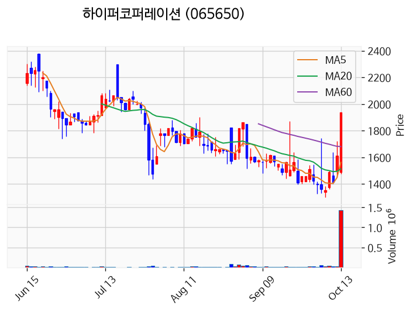

---

### 신라섬유 (상한가)
— 등락률 +29.98% / 거래량 111만 주

**◎ 관련기사**
_(관련기사 없음 / 미조회)_

**◎ 공시**
- _(공시 없음 / 미조회)_

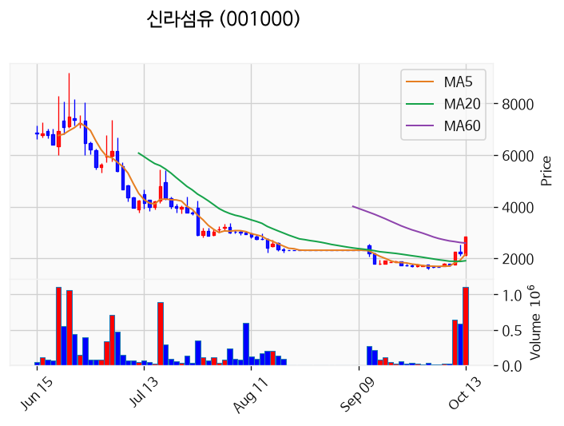

---

### 예선테크 (상한가)
— 등락률 +29.97% / 거래량 35만 주

**◎ 관련기사**
_(관련기사 없음 / 미조회)_

**◎ 공시**
- _(공시 없음 / 미조회)_

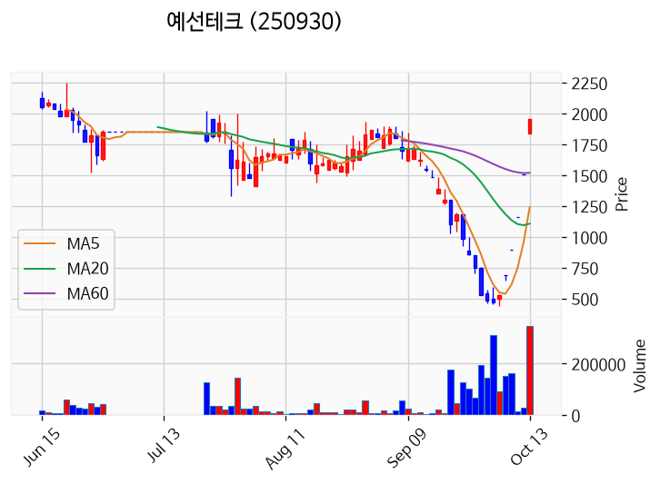

---

### 바이오인프라 (상한가)
— 등락률 +29.92% / 거래량 3만 주

**◎ 관련기사**
- [식약처장 "청소년 고카페인 음료 규제할 때 됐다"](https://news.google.com/rss/articles/CBMingFBVV95cUxNWVF1Z3RFT2c2Z0FtREtrS2pfRldBdnVfS01wZVA1WVpNUTl5QmRqYUhWX3dCOWxSYnBEa3pXYVF4a09oRnJETWZ2dkRPRVNRYjVHVlBMakh1cjVVOXEwVHVSbmVTNTBOS0xTY3gwMWtKMXpDU19YYTNHd1o2X2M4Uk5OVE5PSWxBV0xGdjRBWWk2dW0tcTM4THFPUUd3dw?oc=5) — Chosunbiz, 2026-10-13

**◎ 공시**
- _(공시 없음 / 미조회)_

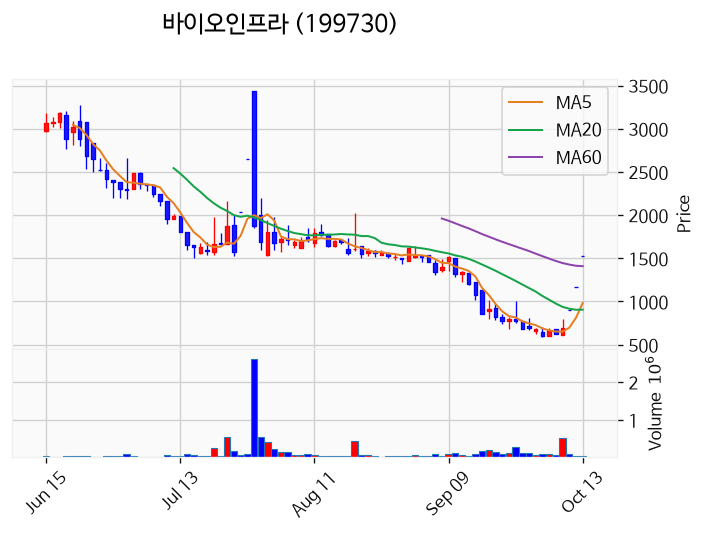

---

### 형지I&C (상한가)
— 등락률 +29.89% / 거래량 382만 주

**◎ 관련기사**
- [증권사·투자자 울린 코스닥 종목…주가 급락에 거래도 말랐다](https://news.google.com/rss/articles/CBMigAFBVV95cUxORGdfeDJqTXVENzZKa3VBa29PcHFoaDNYejZ4MkNqSG1GSzl6NDZ3ZEV6bVV3dVVDTlZlLWxWQ081d1I0TXZFTDZGZnRqbWd2Q2dSejd0QnJVMUxoU1JTX25SM3UyUWNIMFZydkdyVW5KS3h2LWJHbVkzNU9TaTlkYQ?oc=5) — 이데일리, 2026-10-13

**◎ 공시**
- _(공시 없음 / 미조회)_

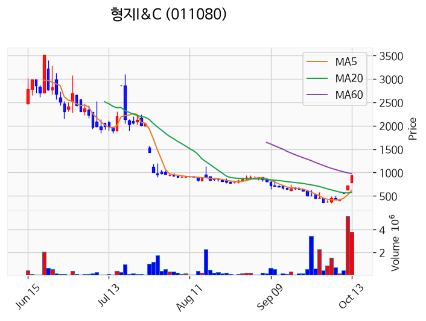

---

### 서산 (상한가)
— 등락률 +29.88% / 거래량 1,052만 주

**◎ 관련기사**
- [서산시, 여권 묶음 배송 서비스…5권까지](https://news.google.com/rss/articles/CBMicEFVX3lxTE16Wm9RVld4LVVTSS13MVotU2dxXzZRRHBQOE5TNDJhYXJyb3dvRjhuT21DN0ttaW5LTHpBdGJmMjBHUm95djRiSF85X3o1YWwxQzg1djlLaDlkMFd2T3ZKRHk1dXFBOHY2b01nVkhod2g?oc=5) — 로컬투데이, 2026-10-13

**◎ 공시**
- _(공시 없음 / 미조회)_

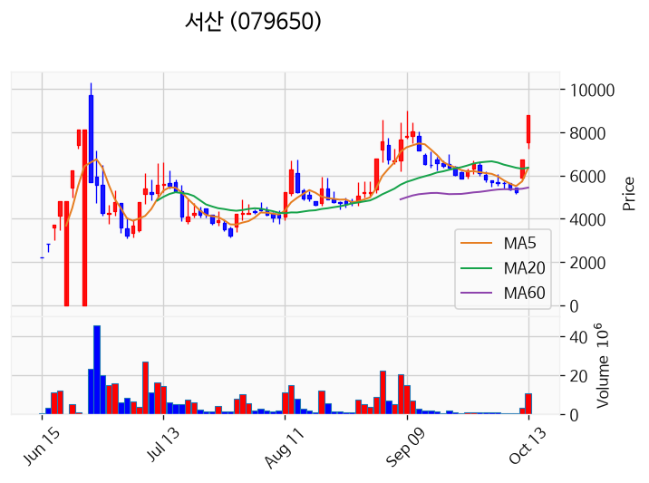

---

### 뉴인텍 (상한가)
— 등락률 +29.78% / 거래량 845만 주

**◎ 관련기사**
_(관련기사 없음 / 미조회)_

**◎ 공시**
- _(공시 없음 / 미조회)_

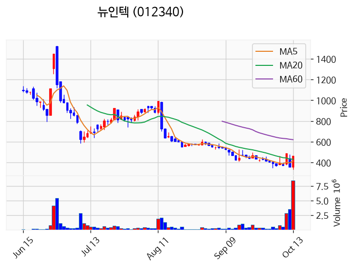

---

### 형지글로벌 (상한가)
— 등락률 +29.78% / 거래량 638만 주

**◎ 관련기사**
_(관련기사 없음 / 미조회)_

**◎ 공시**
- _(공시 없음 / 미조회)_

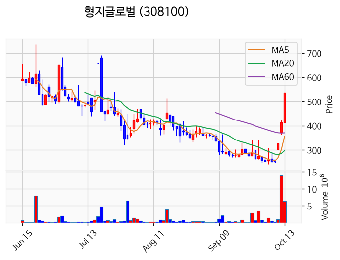

---

### 대양금속 (거래량 급증)
— 등락률 +20.90% / 거래량 1,484만 주

**◎ 관련기사**
_(관련기사 없음 / 미조회)_

**◎ 공시**
- [[기재정정]주주총회소집결의              ](https://dart.fss.or.kr/dsaf001/main.do?rcpNo=20261013800552) — 대양금속, 20261013
- [[기재정정]주주명부폐쇄기간또는기준일설정              ](https://dart.fss.or.kr/dsaf001/main.do?rcpNo=20261013800554) — 대양금속, 20261013

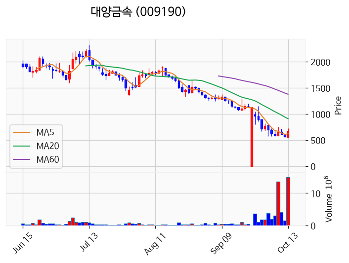

---

### 모아데이타 (거래량 급증)
— 등락률 +20.81% / 거래량 1,823만 주

**◎ 관련기사**
_(관련기사 없음 / 미조회)_

**◎ 공시**
- _(공시 없음 / 미조회)_

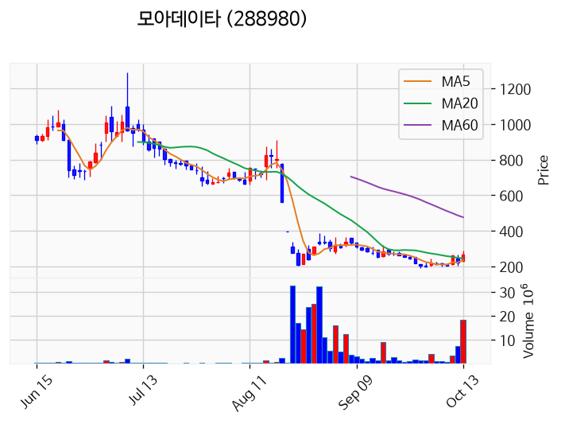

---

### 국제약품 (거래량 급증)
— 등락률 +17.84% / 거래량 3,259만 주

**◎ 관련기사**
- [유가증권 제약지수, 6거래일 연속 하락](https://news.google.com/rss/articles/CBMiZ0FVX3lxTFB3SlJ0NDdSd1B2ODFOYUZzVHVmMUJCRjl4M2xYd1pkU2pHY0JleGRvUGVIdHh6aW1wMmswZ2RaQmJtNENLUm5GYkt4LVVobDg4NFJtckE5YzdhcmFkTzBVanpvMWhDWEE?oc=5) — 의약뉴스, 2026-10-13

**◎ 공시**
- _(공시 없음 / 미조회)_

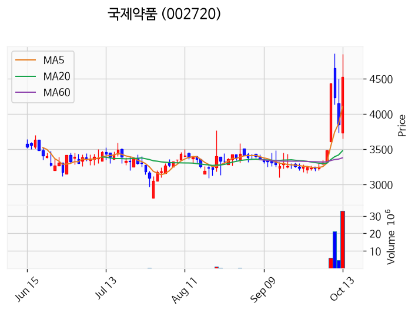

---

### 에이엔피 (거래량 급증)
— 등락률 +14.21% / 거래량 1,168만 주

**◎ 관련기사**
_(관련기사 없음 / 미조회)_

**◎ 공시**
- _(공시 없음 / 미조회)_

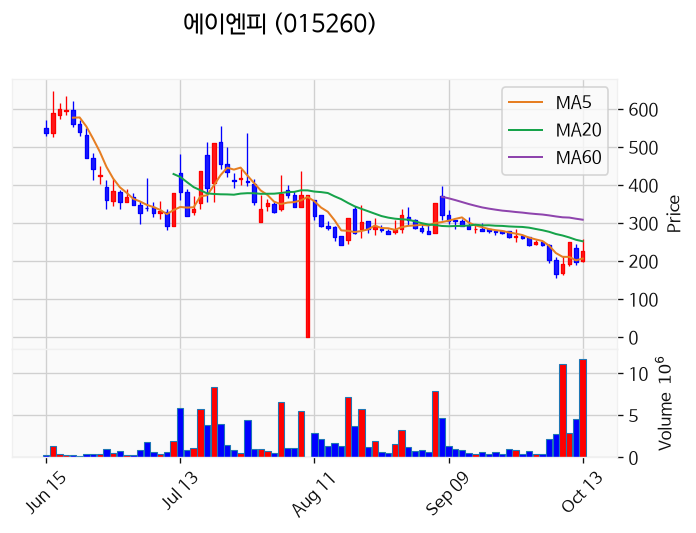

---

### 롯데손해보험 (거래량 급증)
— 등락률 +10.09% / 거래량 1,544만 주

**◎ 관련기사**
- [신한금융, 롯데손해보험 인수계약 체결](https://news.google.com/rss/articles/CBMia0FVX3lxTE1jY0JWOVZETGxaOXp0RkVROXkwVVdVYWV6b05uUTd2WjlrT21tUmtzNjdndk9hVW1NQV90MjRKSWFFUmF4UHpPdjB1Xy0tMjdWWHRNLUxZMjlRZVdWclRRUld0Nm1oXzZBc1F3?oc=5) — BBS불교방송, 2026-10-13

**◎ 공시**
- [투자판단관련주요경영사항              ](https://dart.fss.or.kr/dsaf001/main.do?rcpNo=20261013800179) — 롯데손해보험, 20261013

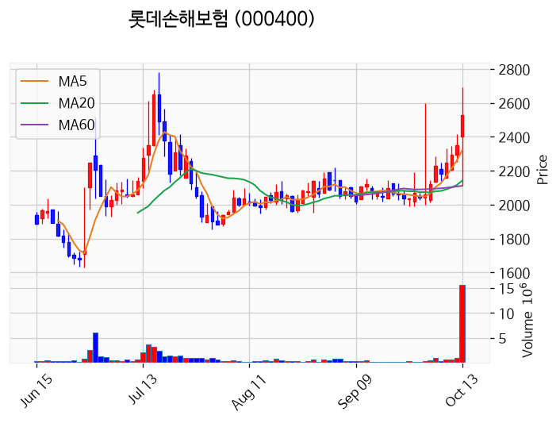

---

### 라온시큐어 (거래량 급증)
— 등락률 +5.38% / 거래량 1,423만 주

**◎ 관련기사**
- [장윤주, 남편 따라 런던 이주에 "솔직히 불안해" [소셜in]](https://news.google.com/rss/articles/CBMidEFVX3lxTFB4OW8wX3B4VWdUdmhES1RRLWYwTDRDSjkwZ0ZhVDJUbDh2TUl5TGFVdHFLS1c1c0tFVlBQYy0wU0xFTkhONXpNTHh1cVJzZDdfZ2RmQlB5ajliUkpaVEFDVW5WMU9iVEl3amFiZVJxMmxFbkhn?oc=5) — 파이낸셜포스트, 2026-10-13

**◎ 공시**
- _(공시 없음 / 미조회)_

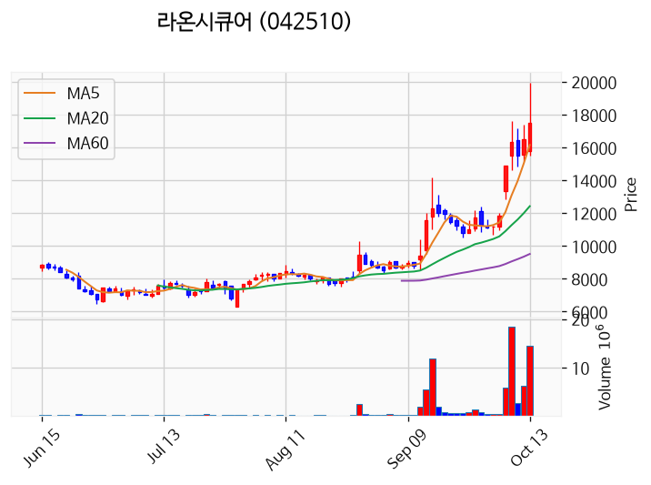

---

### 녹십자엠에스 (거래량 급증)
— 등락률 +4.72% / 거래량 2,613만 주

**◎ 관련기사**
- [녹십자엠에스 주가, 10월 13일 애프터마켓 3,865원 4.18% 상승](https://news.google.com/rss/articles/CBMickFVX3lxTE50R1ZBVnhwQmpmRkxNWEQ0bjB5SzdZazZ6VXdUbmVGTUloUGdPdGsxRlNhYmtzSlpyMVN1c2wxWEhaTlgtUERlSFRkTzJIcFBjYmVqYWVCYlRuc3VVeXI5NkRhdnNfb3RYODNLbjR3UURlZw?oc=5) — 톱스타뉴스, 2026-10-13

**◎ 공시**
- _(공시 없음 / 미조회)_

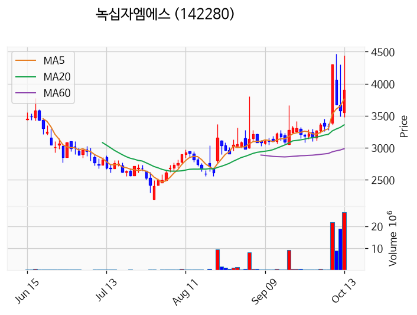

---

### 금호전기 (거래량 급증)
— 등락률 +3.61% / 거래량 3,312만 주

**◎ 관련기사**
- ["호남 반도체 속도전…최태원 한마디에 테마주 이틀 연속 '불기둥'](https://news.google.com/rss/articles/CBMiWkFVX3lxTE8tTkpQeXFOVER2c1lTa3lBYlpaa25uUm1QbjZGa2RhMkFWb1ZyTXF2WklZcFFTal9hajhvd3AwcDFRWUpud1N0SGdLTUhPMmxFakFjY3dpUmdUUQ?oc=5) — 한국경제, 2026-10-13

**◎ 공시**
- _(공시 없음 / 미조회)_

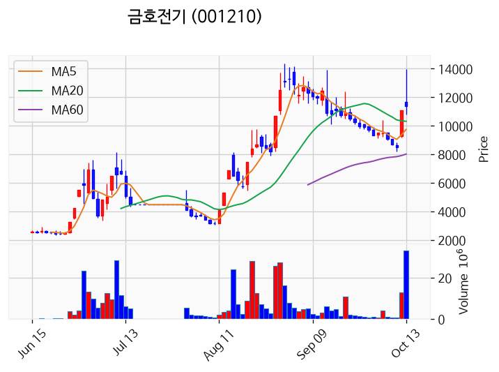

---

### 삼성전자 (거래량 급증)
— 등락률 -6.99% / 거래량 2,568만 주

**◎ 관련기사**
- [삼성전자, 'OCP 글로벌 서밋 2026'서 HBM5·CXL 중심 차세대 메모리 전략 공개](https://news.google.com/rss/articles/CBMiWkFVX3lxTE9uRmlJbFZsLTJTR2k4M0VpWTIwSnN2eUU3cVBTM2R1UGdVTjR3ZDV3cW0tOVRHZXh3WHBhT0pXNEQ5VFhBck9TMUptak1jWmNSSGpzRXgyc1VkQQ?oc=5) — 한국경제, 2026-10-13

**◎ 공시**
- _(공시 없음 / 미조회)_

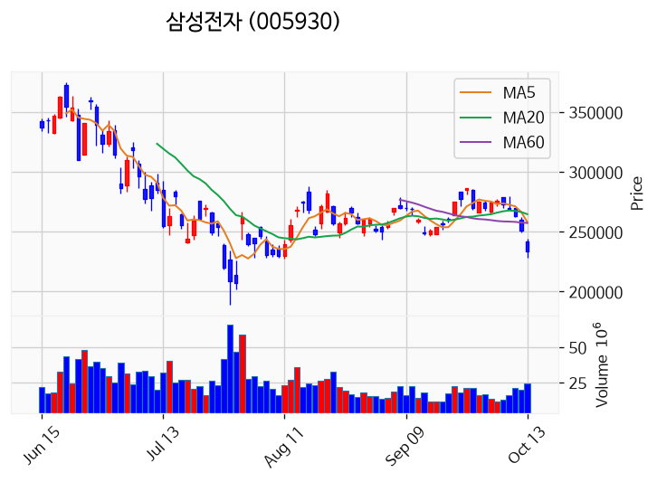

---

### 금호건설 (거래량 급증)
— 등락률 -9.93% / 거래량 1,463만 주

**◎ 관련기사**
- [“함께 성장할 파트너 찾는다”…금호건설, 외주·자재 협력회사 모집](https://news.google.com/rss/articles/CBMiWEFVX3lxTE5wWC1qRENFQWozUmtIT0ZjdUpCMUJEWllyLTJDWFRMa0FHZXhURWpPZUF3NlNYNFJ2ZVlCMVpkYWNHNWtUZjJVX2dRN1ZUZXAwRDc1aDIwQUw?oc=5) — 매일경제, 2026-10-13

**◎ 공시**
- _(공시 없음 / 미조회)_

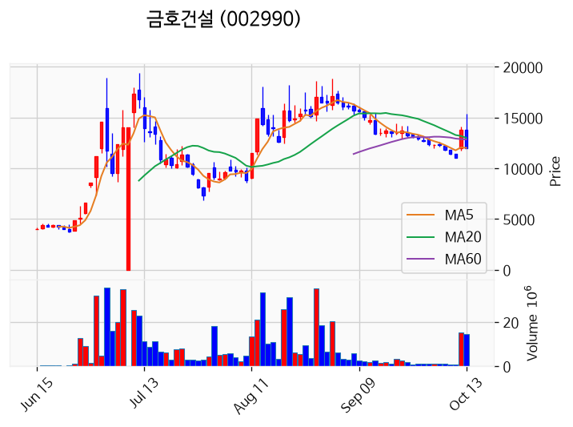

---

### 한창 (거래량 급증)
— 등락률 -69.44% / 거래량 1,039만 주

**◎ 관련기사**
- [[사진] 中 헤이룽장 수수밭에서 가을걷이 한창~](https://news.google.com/rss/articles/CBMia0FVX3lxTFBFUFZkY1hJSXlrU1Fqa0YwMlpfVTJWaUJiMDBTSHctMTY0cmJYcFZWMC05RF9BRWJtMTM5MWlQYVFXMWRjMXR2U1BLbVdJY3pHQjJmdnNzVVBFQnI0UHZPZGtYNUhvY0t2OEtZ?oc=5) — 서울뉴스통신, 2026-10-13

**◎ 공시**
- _(공시 없음 / 미조회)_

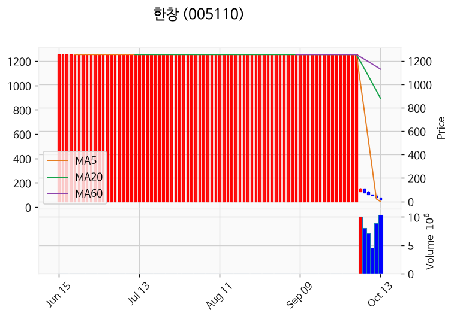

---

## 2. 거래량 폭증 후 급감 패턴 종목
_(폭증 전일 대비 500~1000%, 급감 전일 대비 25% 이하, 급감일 종가가 5일선 대비 -3% 이내)_

_해당 종목 없음_
