# 2026년 10월 14일 시황 노트

## 1. 상한가 / 거래량 1,000만주 이상 종목

### 유니켐 (상한가)
— 등락률 +30.00% / 거래량 142만 주

**◎ 관련기사**
- [[급등락주 짚어보기] 유니켐, 美 기업 인수에 상한가⋯‘시총 상폐’ 유예에 변동성↑](https://news.google.com/rss/articles/CBMibkFVX3lxTFBaS0I3dW5SdHZXVDE1cVdRV29RWFhBMjZQSXZJRXpRcDYzUG5sdVoxNjA0M3BTMHpWNEtSVzZTWms5QkFRX0FPZGhIcDJ2SzllLXF3dHh6YzVobFhWSUZMSEVzX1hIbUF1ZVBXb1ln?oc=5) — 이투데이, 2026-10-14

**◎ 공시**
- _(공시 없음 / 미조회)_

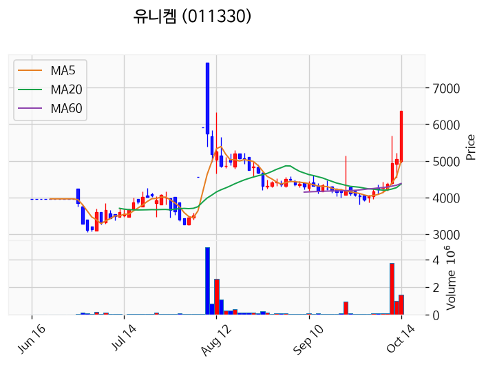

---

### 바이오인프라 (상한가)
— 등락률 +29.99% / 거래량 52만 주

**◎ 관련기사**
- [바이오인프라, 장중 상한가 1981원 기록](https://news.google.com/rss/articles/CBMiZkFVX3lxTE5FUDUzNXBFWENDUzVZWUdteW5RWThhaWMyTEpGNGFsNjJXcjd2OW5tV1Q2aF9OMUZRTk5xaFlxZVNlQjZuZk9yN252QmxqdkJZX3dSQVYzRHF4QzVWb1pwYUVfcHhOUQ?oc=5) — 비건뉴스, 2026-10-14

**◎ 공시**
- [기타경영사항(자율공시)              (소규모합병 승인 이사회 결의(주주총회 갈음) 결과 보고)](https://dart.fss.or.kr/dsaf001/main.do?rcpNo=20261014900515) — 바이오인프라, 20261014

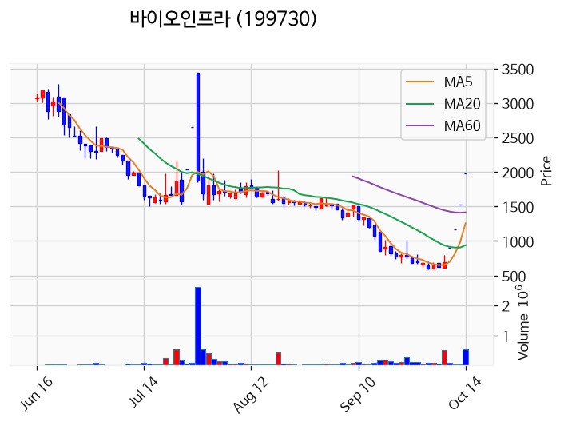

---

### 씨엑스아이 (상한가)
— 등락률 +29.99% / 거래량 13만 주

**◎ 관련기사**
- [씨엑스아이, 장중 가격제한폭까지 상승](https://news.google.com/rss/articles/CBMiZkFVX3lxTFBaa0djUmk0c3M4dGlrQzN0alNRdDJqMW9zZVltOHN4V21WbnBpQXZ0bjJKWmg2TVJvUWxjMGQzU0FILWk3Yk9QX3Joakk5Qi1RTGpJRk43YlpORGc3STF5Slh0SHNHdw?oc=5) — 비건뉴스, 2026-10-14

**◎ 공시**
- [임원ㆍ주요주주특정증권등거래계획철회보고서](https://dart.fss.or.kr/dsaf001/main.do?rcpNo=20261014000313) — LIN JINSHENG, 20261014

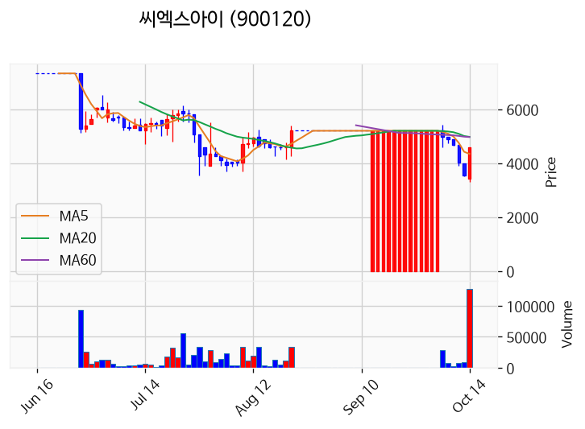

---

### 프롬바이오 (상한가)
— 등락률 +29.96% / 거래량 222만 주

**◎ 관련기사**
- [트와이스·블랙핑크 안무 만들었는데도..리정 "열등감 뗄래야 뗄 수 없어" ('누가찌품') - 조선비즈](https://news.google.com/rss/articles/CBMikwFBVV95cUxNWkkzX0hGTTl6QU51bFRVVzBTSUpqOWRQOHFpREd6RWhfdEl6eTlYaWV1eVlfNGdJYkgxdXlLLWFTdGpLTE9jWTNBakh6M0xReHlzUTZLekJfaVBLZEs5NVpMTHVZZ3RRQmtZVkhFeGpUdU5nN25lZWpTZ2J3RnBEbjZvRjVNUnVlUmRicUtPeWtOSlXSAacBQVVfeXFMTThIZjh1STVPbkVKdWs2OXJBQWVRc01JTkgtc25DWi1CNnd5RlUzYXJrLTJoT3dIZFB1dTROTVkyMGxNSzdua2ZlTGU3eGkteHVtanZqWUh3RkEtLTlsN1VrekFHaFlqMWo2RVNEUHhpODFFY0k4T3owLVM1anpLZkJBNTJfMEQ4RTFhSzJqTzNnQWg0SHpaNzFEUkJ0Smx0YWtzNjVhWkU?oc=5) — Chosunbiz, 2026-10-14

**◎ 공시**
- _(공시 없음 / 미조회)_

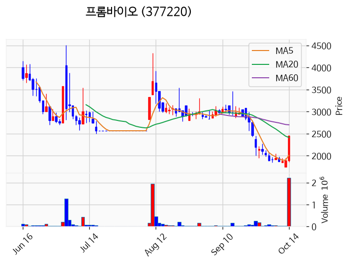

---

### 에스엠벡셀 (상한가)
— 등락률 +29.93% / 거래량 1,499만 주

**◎ 관련기사**
- [[급등락주 짚어보기] 유니켐, 美 기업 인수에 상한가⋯‘시총 상폐’ 유예에 변동성↑](https://news.google.com/rss/articles/CBMibkFVX3lxTFBaS0I3dW5SdHZXVDE1cVdRV29RWFhBMjZQSXZJRXpRcDYzUG5sdVoxNjA0M3BTMHpWNEtSVzZTWms5QkFRX0FPZGhIcDJ2SzllLXF3dHh6YzVobFhWSUZMSEVzX1hIbUF1ZVBXb1ln?oc=5) — 이투데이, 2026-10-14

**◎ 공시**
- _(공시 없음 / 미조회)_

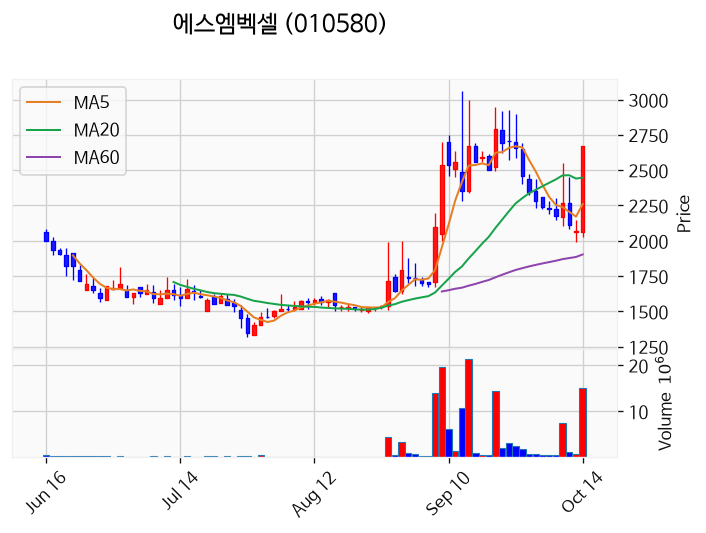

---

### 뉴인텍 (상한가)
— 등락률 +29.87% / 거래량 861만 주

**◎ 관련기사**
_(관련기사 없음 / 미조회)_

**◎ 공시**
- _(공시 없음 / 미조회)_

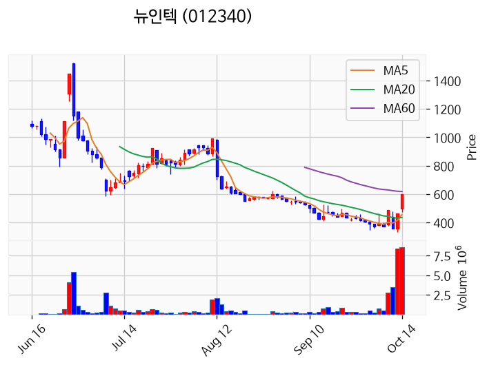

---

### 하이퍼코퍼레이션 (상한가)
— 등락률 +29.84% / 거래량 5만 주

**◎ 관련기사**
- [유성구 내년도 구정 밑그림 마련](https://news.google.com/rss/articles/CBMiaEFVX3lxTE9ReVRveVlnVVpvdl9vOTBubzlPWGNKWm1Hc01PRTZ0SmtaT29JUXpYZnJZZWEyYjYwUzNMNnZMWFFEcWVSRFl1eDcwSUREdmZDX0hWVmVnOTkxVkwzZDlzRkR3dFVsby1N?oc=5) — 금강일보, 2026-10-14

**◎ 공시**
- [주요사항보고서(유상증자결정)](https://dart.fss.or.kr/dsaf001/main.do?rcpNo=20261014000001) — 하이퍼코퍼레이션, 20261014

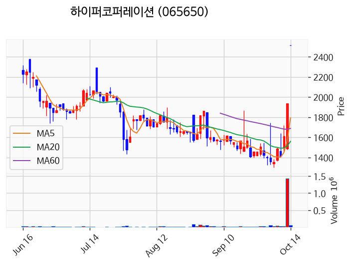

---

### 에이엔피 (상한가)
— 등락률 +29.78% / 거래량 1,421만 주

**◎ 관련기사**
- [[급등락주 짚어보기] 유니켐, 美 기업 인수에 상한가⋯‘시총 상폐’ 유예에 변동성↑](https://news.google.com/rss/articles/CBMibkFVX3lxTFBaS0I3dW5SdHZXVDE1cVdRV29RWFhBMjZQSXZJRXpRcDYzUG5sdVoxNjA0M3BTMHpWNEtSVzZTWms5QkFRX0FPZGhIcDJ2SzllLXF3dHh6YzVobFhWSUZMSEVzX1hIbUF1ZVBXb1ln?oc=5) — 이투데이, 2026-10-14

**◎ 공시**
- _(공시 없음 / 미조회)_

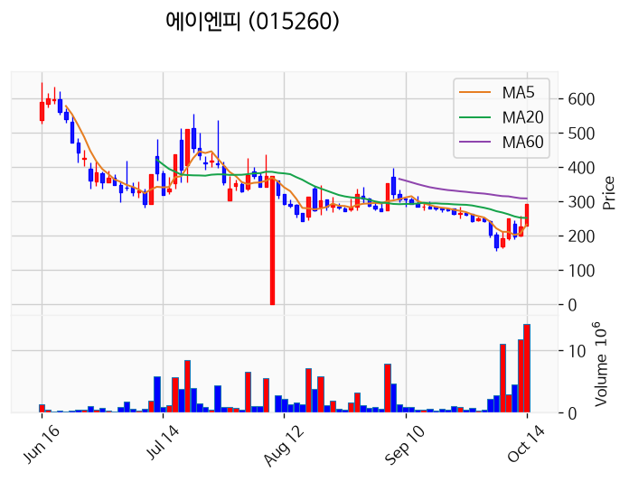

---

### 천일고속 (상한가)
— 등락률 +29.78% / 거래량 10만 주

**◎ 관련기사**
- [[급등락주 짚어보기] 유니켐, 美 기업 인수에 상한가⋯‘시총 상폐’ 유예에 변동성↑](https://news.google.com/rss/articles/CBMibkFVX3lxTFBaS0I3dW5SdHZXVDE1cVdRV29RWFhBMjZQSXZJRXpRcDYzUG5sdVoxNjA0M3BTMHpWNEtSVzZTWms5QkFRX0FPZGhIcDJ2SzllLXF3dHh6YzVobFhWSUZMSEVzX1hIbUF1ZVBXb1ln?oc=5) — 이투데이, 2026-10-14

**◎ 공시**
- _(공시 없음 / 미조회)_

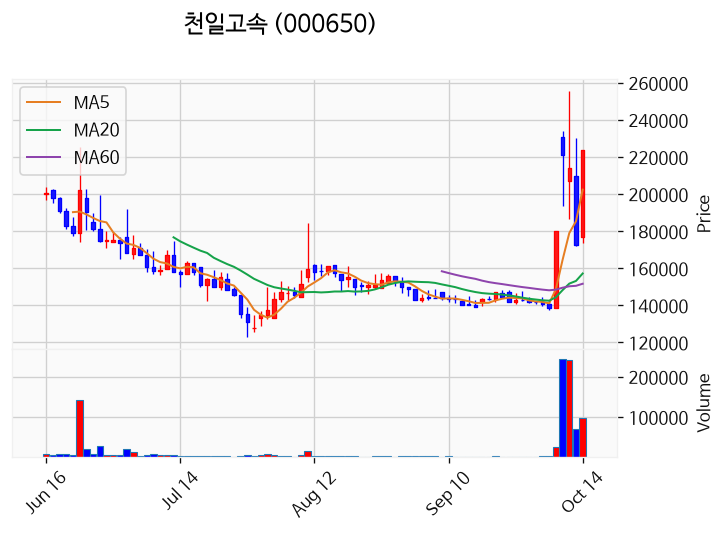

---

### 대성산업 (거래량 급증)
— 등락률 +19.05% / 거래량 1,078만 주

**◎ 관련기사**
- [대성산업 주가, 10월 14일 애프터마켓 4,970원 18.33% 상승](https://news.google.com/rss/articles/CBMickFVX3lxTE1sVExfVkxuVW01bGQzaUZpWlc4T1ZOZHNxZEE0U3J3alo5MnZSbFNnZkIzYzZjZnVnN0M1UkFfTktsZkpabERIOUhBelZmSVdUUE9CTE9yRGotQm9LMDNjNGJSaUlsS3NRQmI3SHFDREVLUQ?oc=5) — 톱스타뉴스, 2026-10-14

**◎ 공시**
- _(공시 없음 / 미조회)_

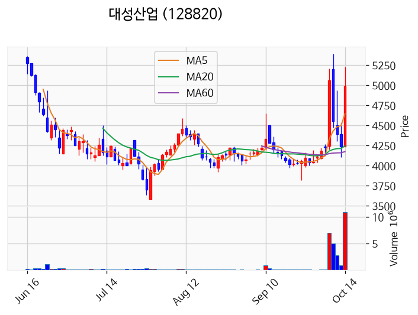

---

### 대양금속 (거래량 급증)
— 등락률 +17.14% / 거래량 1,673만 주

**◎ 관련기사**
_(관련기사 없음 / 미조회)_

**◎ 공시**
- _(공시 없음 / 미조회)_

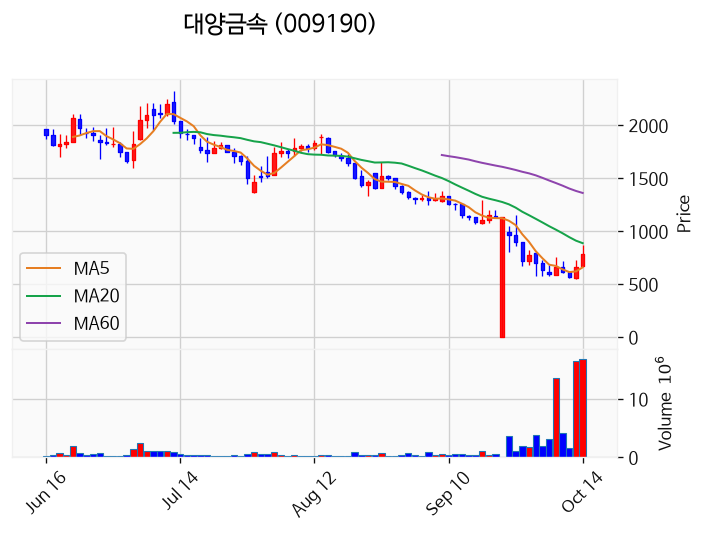

---

### HT로보틱스 (거래량 급증)
— 등락률 +14.33% / 거래량 1,172만 주

**◎ 관련기사**
- [HT로보틱스 주가, 10월 14일 애프터마켓 7,230원 15.13% 상승](https://news.google.com/rss/articles/CBMickFVX3lxTE5ZamlwZ2xfU3hjdDA2Z1EtZXp4VVBRbGR6cGstaWU5MGpTM1dnY0RUSVlxNkticGQwU0c5R3FVS01yc3RPSUljWnI0V2pxT0kxekQwVnZyNlhtSkdjV3hYN2hHQ3NrWHR4cldhY0xQVG1Ldw?oc=5) — 톱스타뉴스, 2026-10-14

**◎ 공시**
- _(공시 없음 / 미조회)_

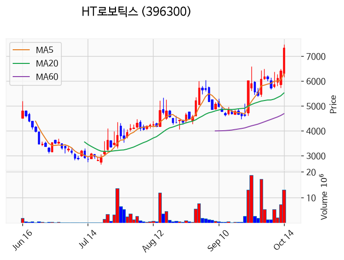

---

### 글로벌테크놀로지 (거래량 급증)
— 등락률 +11.30% / 거래량 1,089만 주

**◎ 관련기사**
- [글로벌테크놀로지 주가, 10월 14일 애프터마켓 10,640원 13.43% 상승](https://news.google.com/rss/articles/CBMickFVX3lxTE9Nay03b1JDMFJyRWtsSmVPV2p4N3VHYjRWV041LWtxaURxUHA4UXRhU2dSbUt4VHViZ28yYXpCcTV3V0tzQ3JZdWd2ZURvZmFDcWFXYkVHRjQ4NkRtaGxISDRyUEEzMnY2d2xvZXNPRVBYQQ?oc=5) — 톱스타뉴스, 2026-10-14

**◎ 공시**
- _(공시 없음 / 미조회)_

---

### 모아데이타 (거래량 급증)
— 등락률 +10.86% / 거래량 2,360만 주

**◎ 관련기사**
_(관련기사 없음 / 미조회)_

**◎ 공시**
- _(공시 없음 / 미조회)_

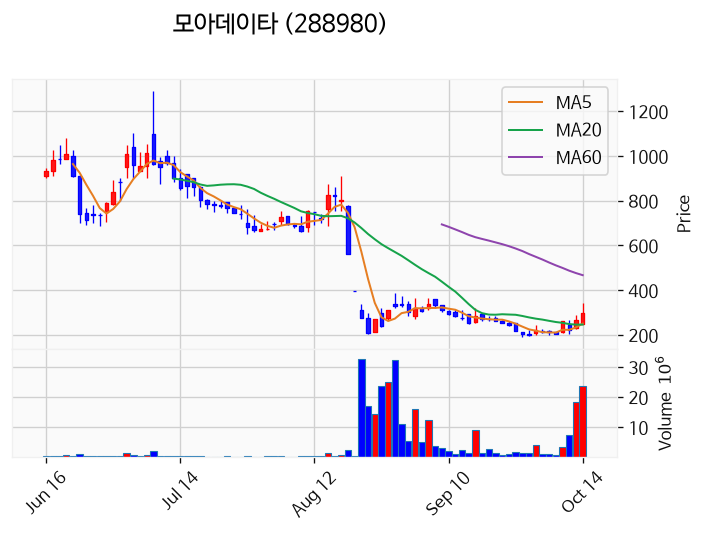

---

### 팬오션 (거래량 급증)
— 등락률 +9.62% / 거래량 1,701만 주

**◎ 관련기사**
- [팬오션 주가, 10월 14일 애프터마켓 7,240원 10.53% 상승](https://news.google.com/rss/articles/CBMickFVX3lxTFBfZzB3VmxYZ1BGbnJ0YmNjdEItTDhNWFpveFNVN2NJcnNIRWpwN0tkT2JFQ21SSk9ScG82c2IxcXpjdnI3SVphSUV0WDc4elNTSm13Y2FIYjNTb1drTjJvQlF2WHoxZUZlbTk3ZEdwYlAtZw?oc=5) — 톱스타뉴스, 2026-10-14

**◎ 공시**
- _(공시 없음 / 미조회)_

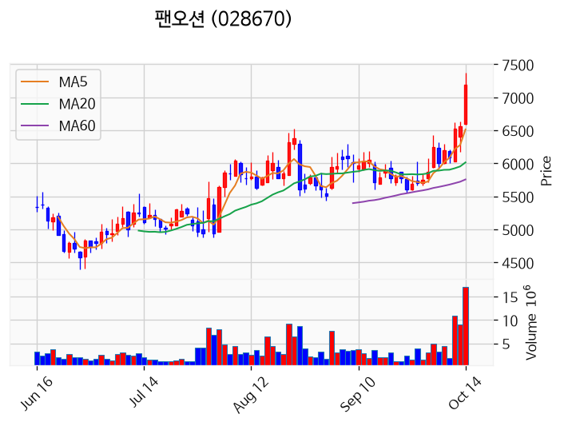

---

### 한온시스템 (거래량 급증)
— 등락률 +3.68% / 거래량 1,000만 주

**◎ 관련기사**
- [조현범 한국앤컴퍼니 회장, 바텀업 혁신 주문 "스스로 찾아야 실행력 생겨"](https://news.google.com/rss/articles/CBMiYEFVX3lxTFBsVG1IS0Z6V0YzYS14dFU2S0hHakZITmpRc0xmN2NhWjE3WnJ6YUNXTGhPdnJhLTJHNDJxZllVSER3aXhQM0hxTTNKQXJKOUpVdHc5N2ZKejlHbVZ6NmlkStIBeEFVX3lxTE1pRGtQcF9xV1JfaUM0RHBBRG5LYUFCT1I2bHpEN25OTFhuOUUybEtyM2x0VkF6OWtIcF9aT3Q4N3NlTTNoczBHQi1NVHQ1VXVXQ25vMG1DQ3lmZHp2VEpBdFdneEtSVk5aek11X0E5dkNNOFpXWkc2Ug?oc=5) — 뉴시스, 2026-10-14

**◎ 공시**
- _(공시 없음 / 미조회)_

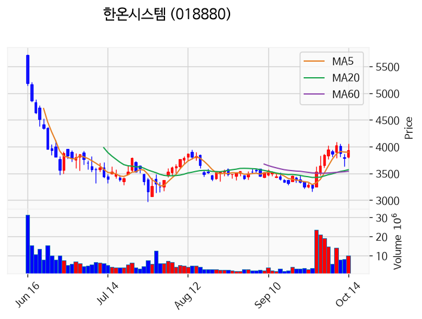

---

### KBI동양철관 (거래량 급증)
— 등락률 +2.20% / 거래량 1,377만 주

**◎ 관련기사**
- [알래스카 LNG 투자 기대에 철강주 급등...“실적·신사업 성과 따져 선별해야”](https://news.google.com/rss/articles/CBMiWkFVX3lxTE9NVzJfRUM2Z1ZVc01YejNhM1RjeGJBUmxuR1pqcktlNnZiRU80LXoyX0ZwdzNJaGc4VlhxUDh5OW1qTjROd3FXYmt1V3E2TjNrN0tRNEYtSjdXQQ?oc=5) — 한국경제, 2026-10-14

**◎ 공시**
- _(공시 없음 / 미조회)_

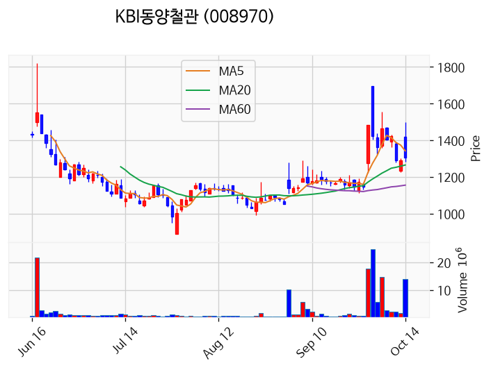

---

### HC보광산업 (거래량 급증)
— 등락률 +1.81% / 거래량 1,344만 주

**◎ 관련기사**
_(관련기사 없음 / 미조회)_

**◎ 공시**
- _(공시 없음 / 미조회)_

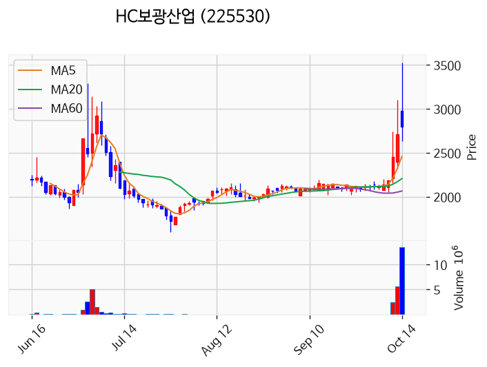

---

### 형지I&C (거래량 급증)
— 등락률 +1.27% / 거래량 1,118만 주

**◎ 관련기사**
_(관련기사 없음 / 미조회)_

**◎ 공시**
- _(공시 없음 / 미조회)_

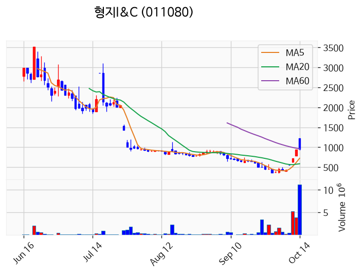

---

### 삼성전자 (거래량 급증)
— 등락률 +0.65% / 거래량 1,857만 주

**◎ 관련기사**
- [12단계 러닝 코치·수면 균형 그래프까지…삼성전자, ‘헬스 플랫폼’ 고도화](https://news.google.com/rss/articles/CBMidkFVX3lxTE9wX0w5aDRBS3UwTUJMdHptNjFlT2RxVl9HUG1sYlU3MlFZWWNPamV4T09xcWVCLU5rb2RTd1loZE83TldkQUsweHFJdnIyYzR3WDBvWHZtYnQyUGI0TjJsV2RvbGhpMmxoMEhpYU0tLW9BN2hsMFHSAWZBVV95cUxNY2lud29rUGNGY3dvaGdZQnVPWDVzMkFtOU9BMWs2cUNEb3ZVWlRjZHZxZjA1eXNRQmpCYXU0WWJVc3B4MnpSalhfMHVaUW9lc0ZrSFV1Q2FFT21NYXNNZnd3SVVVUXc?oc=5) — 동아일보, 2026-10-14

**◎ 공시**
- _(공시 없음 / 미조회)_

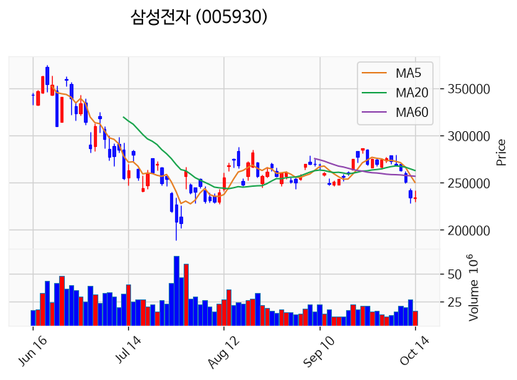

---

### 한창 (거래량 급증)
— 등락률 +0.00% / 거래량 1,226만 주

**◎ 관련기사**
- [♥한창이 질투하겠네…장영란, 웨딩드레스 입고 남자에 안겼다 “바람나다”](https://news.google.com/rss/articles/CBMie0FVX3lxTE9WcDFjX0paNEh1c3dpa1JaU21wa0lzQzB0Yi1oYWlLcVUtRUpiakJnVWZFVnlvbHBVdlJXQlZtU3ZRcFZiZmJmSy1aQUx2NUVuWUZLZEZsenF0ckVWRzhvRjJJS19CVUl1X1BfOU9VaWdOT0JfNUlxalFQZw?oc=5) — 뉴스엔, 2026-10-14

**◎ 공시**
- _(공시 없음 / 미조회)_

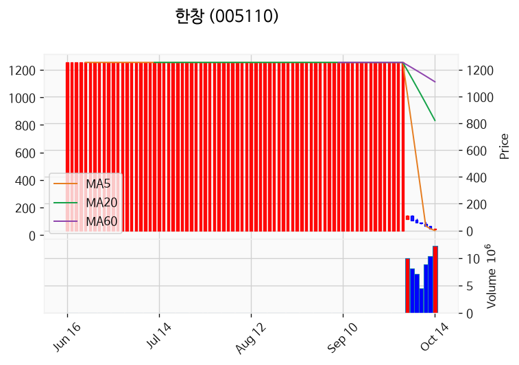

---

### 빛과전자 (거래량 급증)
— 등락률 -1.20% / 거래량 1,155만 주

**◎ 관련기사**
_(관련기사 없음 / 미조회)_

**◎ 공시**
- _(공시 없음 / 미조회)_

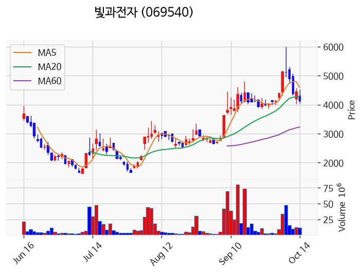

---

### 국제약품 (거래량 급증)
— 등락률 -1.67% / 거래량 2,422만 주

**◎ 관련기사**
_(관련기사 없음 / 미조회)_

**◎ 공시**
- _(공시 없음 / 미조회)_

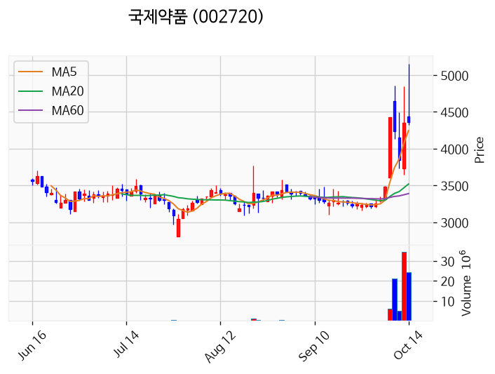

---

### 서산 (거래량 급증)
— 등락률 -16.86% / 거래량 1,165만 주

**◎ 관련기사**
- [서산경찰서 성연파출소, 현장 예방활동 펼쳐 땀 흘려 지은 농산물 지킨다](https://news.google.com/rss/articles/CBMic0FVX3lxTFBtcHVWZGxCQkthSFo1M3UyOWQzWDRGckJsbUJEUmJ6R0VyTWRBMXFsS1pmcWVvTy1tMXFMSGYxTWZnM3gzNU9RckhoSGc0bzV4UUdZZnN2NDZsRFExSDRvdTdGNk9lSHdBTC1XY0R4cTN0Unc?oc=5) — 충남일보, 2026-10-14

**◎ 공시**
- _(공시 없음 / 미조회)_

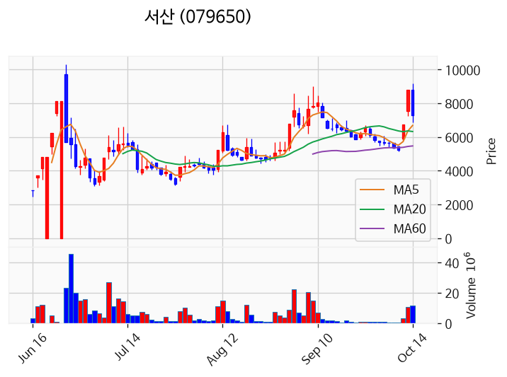

---

## 2. 거래량 폭증 후 급감 패턴 종목
_(폭증 전일 대비 500~1000%, 급감 전일 대비 25% 이하, 급감일 종가가 5일선 대비 -3% 이내)_

### 유유제약2우B
- 폭증일: 2026-10-13, 거래량 0만 주 (전일 대비 549%)
- 급감일: 2026-10-14, 거래량 0만 주 (전일 대비 4%)
- 급감일 종가 7,930원 / 5일선 4,774원 (이격률 +66.11%)

### 남광토건
- 폭증일: 2026-10-13, 거래량 123만 주 (전일 대비 591%)
- 급감일: 2026-10-14, 거래량 9만 주 (전일 대비 7%)
- 급감일 종가 7,970원 / 5일선 4,840원 (이격률 +64.67%)

### 코오롱글로벌우
- 폭증일: 2026-10-13, 거래량 0만 주 (전일 대비 900%)
- 급감일: 2026-10-14, 거래량 0만 주 (전일 대비 0%)
- 급감일 종가 12,200원 / 5일선 7,266원 (이격률 +67.91%)

### 대륙제관
- 폭증일: 2026-10-13, 거래량 9만 주 (전일 대비 978%)
- 급감일: 2026-10-14, 거래량 2만 주 (전일 대비 25%)
- 급감일 종가 4,290원 / 5일선 2,536원 (이격률 +69.16%)

### 일양약품우
- 폭증일: 2026-10-13, 거래량 0만 주 (전일 대비 976%)
- 급감일: 2026-10-14, 거래량 0만 주 (전일 대비 2%)
- 급감일 종가 7,700원 / 5일선 4,670원 (이격률 +64.88%)

### 고려제약
- 폭증일: 2026-10-13, 거래량 1만 주 (전일 대비 514%)
- 급감일: 2026-10-14, 거래량 0만 주 (전일 대비 24%)
- 급감일 종가 3,145원 / 5일선 1,880원 (이격률 +67.29%)

### 신풍제약우
- 폭증일: 2026-10-13, 거래량 2만 주 (전일 대비 662%)
- 급감일: 2026-10-14, 거래량 0만 주 (전일 대비 18%)
- 급감일 종가 14,300원 / 5일선 8,460원 (이격률 +69.03%)

### 한국파마
- 폭증일: 2026-10-13, 거래량 33만 주 (전일 대비 533%)
- 급감일: 2026-10-14, 거래량 5만 주 (전일 대비 17%)
- 급감일 종가 8,470원 / 5일선 4,994원 (이격률 +69.60%)

### 제일테크노스
- 폭증일: 2026-10-13, 거래량 3만 주 (전일 대비 742%)
- 급감일: 2026-10-14, 거래량 1만 주 (전일 대비 17%)
- 급감일 종가 5,260원 / 5일선 3,194원 (이격률 +64.68%)

### 수산아이앤티
- 폭증일: 2026-10-13, 거래량 1만 주 (전일 대비 566%)
- 급감일: 2026-10-14, 거래량 0만 주 (전일 대비 22%)
- 급감일 종가 8,420원 / 5일선 5,090원 (이격률 +65.42%)

### 세동
- 폭증일: 2026-10-13, 거래량 3만 주 (전일 대비 501%)
- 급감일: 2026-10-14, 거래량 1만 주 (전일 대비 18%)
- 급감일 종가 1,228원 / 5일선 738원 (이격률 +66.31%)

### YBM넷
- 폭증일: 2026-10-13, 거래량 2만 주 (전일 대비 547%)
- 급감일: 2026-10-14, 거래량 0만 주 (전일 대비 20%)
- 급감일 종가 2,080원 / 5일선 1,255원 (이격률 +65.74%)

### 국보디자인
- 폭증일: 2026-10-13, 거래량 2만 주 (전일 대비 798%)
- 급감일: 2026-10-14, 거래량 0만 주 (전일 대비 13%)
- 급감일 종가 25,000원 / 5일선 14,970원 (이격률 +67.00%)

### 세이브존I&C
- 폭증일: 2026-10-13, 거래량 6만 주 (전일 대비 606%)
- 급감일: 2026-10-14, 거래량 1만 주 (전일 대비 24%)
- 급감일 종가 2,265원 / 5일선 1,379원 (이격률 +64.25%)

### 디에스케이
- 폭증일: 2026-10-13, 거래량 10만 주 (전일 대비 915%)
- 급감일: 2026-10-14, 거래량 1만 주 (전일 대비 14%)
- 급감일 종가 3,995원 / 5일선 2,341원 (이격률 +70.65%)

### 아시아종묘
- 폭증일: 2026-10-13, 거래량 9만 주 (전일 대비 801%)
- 급감일: 2026-10-14, 거래량 1만 주 (전일 대비 10%)
- 급감일 종가 1,555원 / 5일선 936원 (이격률 +66.06%)

### 파마리서치바이오
- 폭증일: 2026-10-13, 거래량 0만 주 (전일 대비 940%)
- 급감일: 2026-10-14, 거래량 0만 주 (전일 대비 2%)
- 급감일 종가 29,400원 / 5일선 17,630원 (이격률 +66.76%)

### 로지스몬
- 폭증일: 2026-10-13, 거래량 1만 주 (전일 대비 502%)
- 급감일: 2026-10-14, 거래량 0만 주 (전일 대비 13%)
- 급감일 종가 136원 / 5일선 74원 (이격률 +84.28%)

### 보라티알
- 폭증일: 2026-10-13, 거래량 1만 주 (전일 대비 577%)
- 급감일: 2026-10-14, 거래량 0만 주 (전일 대비 9%)
- 급감일 종가 5,310원 / 5일선 3,224원 (이격률 +64.70%)

### 프리시젼바이오
- 폭증일: 2026-10-13, 거래량 3만 주 (전일 대비 815%)
- 급감일: 2026-10-14, 거래량 0만 주 (전일 대비 5%)
- 급감일 종가 1,545원 / 5일선 904원 (이격률 +70.98%)

### 드림인사이트
- 폭증일: 2026-10-13, 거래량 3만 주 (전일 대비 546%)
- 급감일: 2026-10-14, 거래량 1만 주 (전일 대비 25%)
- 급감일 종가 1,173원 / 5일선 717원 (이격률 +63.55%)

### LX홀딩스1우
- 폭증일: 2026-10-13, 거래량 1만 주 (전일 대비 846%)
- 급감일: 2026-10-14, 거래량 0만 주 (전일 대비 11%)
- 급감일 종가 7,350원 / 5일선 4,454원 (이격률 +65.02%)

### 비스토스
- 폭증일: 2026-10-13, 거래량 13만 주 (전일 대비 724%)
- 급감일: 2026-10-14, 거래량 2만 주 (전일 대비 17%)
- 급감일 종가 3,235원 / 5일선 1,934원 (이격률 +67.27%)

### 삼성FN리츠
- 폭증일: 2026-10-13, 거래량 14만 주 (전일 대비 762%)
- 급감일: 2026-10-14, 거래량 3만 주 (전일 대비 23%)
- 급감일 종가 5,190원 / 5일선 3,100원 (이격률 +67.42%)

### 디비금융제13호스팩
- 폭증일: 2026-10-13, 거래량 1만 주 (전일 대비 722%)
- 급감일: 2026-10-14, 거래량 0만 주 (전일 대비 16%)
- 급감일 종가 2,050원 / 5일선 1,228원 (이격률 +66.94%)
