# 2026년 10월 15일 시황 노트

## 1. 상한가 / 거래량 1,000만주 이상 종목

### 멜콘 (상한가)
— 등락률 +39.35% / 거래량 2,745만 주

**◎ 관련기사**
- [코스피 7.57% 폭락에 5500선 추락…양 시장 서킷브레이커 발동](https://news.google.com/rss/articles/CBMidEFVX3lxTE41S09aNjVjS0ZvdzJkN2JWSFRvdHpoN2xzTEJrMXNEY2lSRUZqblp4QXpYMHU2SmVTVVJXdzVpbzhuSkx6WE51bElNM3VEcl9NbGZUSVhNbXZZVHAwamt0OWZsZkxsdE1hLUgtT01wcGF1X0Jm?oc=5) — 파이낸셜포스트, 2026-10-15

**◎ 공시**
- _(공시 없음 / 미조회)_

---

### 뉴인텍 (상한가)
— 등락률 +30.00% / 거래량 358만 주

**◎ 관련기사**
- [[급등락주 짚어보기] ‘시총 미달’ 상폐 유예에 희비⋯에이엔피 上ㆍ예선테크 下](https://news.google.com/rss/articles/CBMidEFVX3lxTE5wNF9jWGc0WFdhdnI3aEx4cDNvMnNtZkxudDJRblFTZ3pvWEZIam5GMF9PYjNuQW9ucmtnWU9fSHZHM0RCT092UFN6U2U1YVc5VkdCY0R3UHJza2tfRERGRklYd3VvM3dhZTdRTFNxYXhWcm0w?oc=5) — 이투데이, 2026-10-15

**◎ 공시**
- [기타시장안내              (주가 미달에 따른 상장폐지 우려 관련 안내)](https://dart.fss.or.kr/dsaf001/main.do?rcpNo=20261015900582) — 코스닥시장본부, 20261015

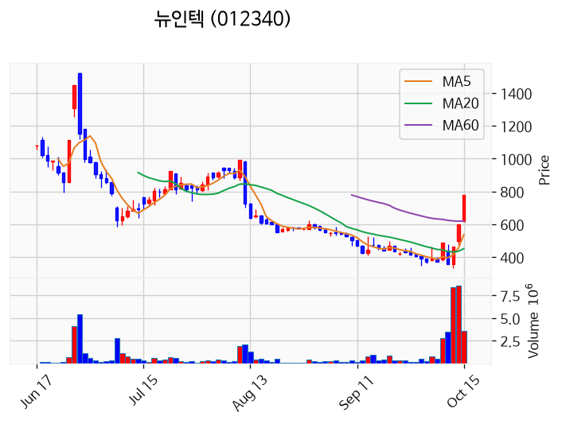

---

### 듀켐바이오 (상한가)
— 등락률 +30.00% / 거래량 306만 주

**◎ 관련기사**
- ["뚱뚱하다" '악플 눈물' 셀레나 고메즈, 잘록한 허리에 샤프한 턱선..결혼 1주년 [Oh!llywood] - 조선비즈](https://news.google.com/rss/articles/CBMikwFBVV95cUxNTkd4eXhRYlBQUFdaTFo0OHRPaXZiRkxaQ3pJMm41UEl1VWJhYUFlVlI3Yk5lc0ZBOUotUDNfMVV1a1NnczhmcVloanBscjY1S2dveEZPakJDNk5sQnc5M2d6VDlMcTlNNjNCak9wVEt1cm5rRWdZbkdHV2xYdkgwRE5CY0U2SFJaV1Nndms1QU1xdEXSAacBQVVfeXFMTTZ5YTl3NUZYRWNiSktIdFAzcjlfcnVnNVVpbFcyaXNfckNEOXlMTVRkNVktc1dRcnNVWWdveklZSXYwNlVpdmRsSnVvYXhkSnhRaVduRGttb09WVmwyN21kdFpJOGFBX01xS29SOG9OWUt0Z1JXMnJHR2U5TkFFUkdJb2xTTGU2QmZIZVlzTlVJMllGU0xwRXotSndjdndxOGUyNmx2bmM?oc=5) — Chosunbiz, 2026-10-15

**◎ 공시**
- _(공시 없음 / 미조회)_

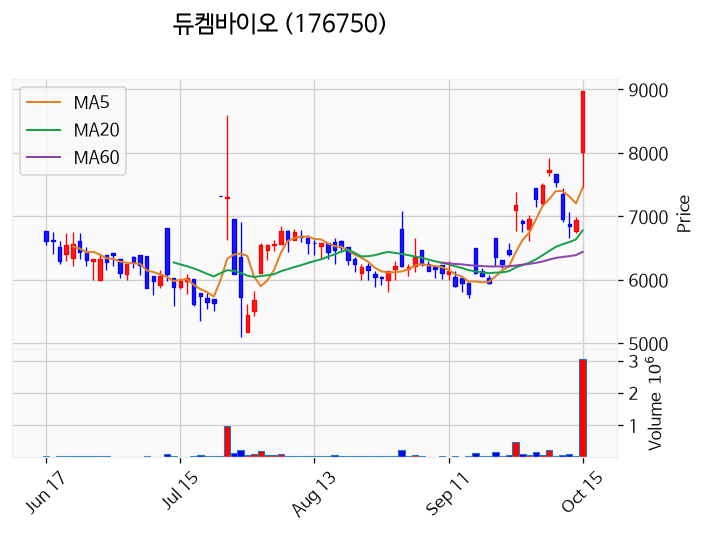

---

### 바이오인프라 (상한가)
— 등락률 +29.98% / 거래량 30만 주

**◎ 관련기사**
- [[급등락주 짚어보기] ‘시총 미달’ 상폐 유예에 희비⋯에이엔피 上ㆍ예선테크 下](https://news.google.com/rss/articles/CBMidEFVX3lxTE5wNF9jWGc0WFdhdnI3aEx4cDNvMnNtZkxudDJRblFTZ3pvWEZIam5GMF9PYjNuQW9ucmtnWU9fSHZHM0RCT092UFN6U2U1YVc5VkdCY0R3UHJza2tfRERGRklYd3VvM3dhZTdRTFNxYXhWcm0w?oc=5) — 이투데이, 2026-10-15

**◎ 공시**
- _(공시 없음 / 미조회)_

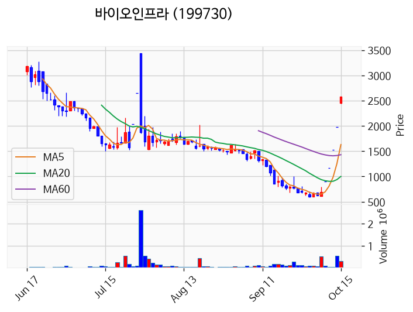

---

### CJ씨푸드1우 (상한가)
— 등락률 +29.88% / 거래량 1만 주

**◎ 관련기사**
- [[급등락주 짚어보기] ‘시총 미달’ 상폐 유예에 희비⋯에이엔피 上ㆍ예선테크 下](https://news.google.com/rss/articles/CBMidEFVX3lxTE5wNF9jWGc0WFdhdnI3aEx4cDNvMnNtZkxudDJRblFTZ3pvWEZIam5GMF9PYjNuQW9ucmtnWU9fSHZHM0RCT092UFN6U2U1YVc5VkdCY0R3UHJza2tfRERGRklYd3VvM3dhZTdRTFNxYXhWcm0w?oc=5) — 이투데이, 2026-10-15

**◎ 공시**
- _(공시 없음 / 미조회)_

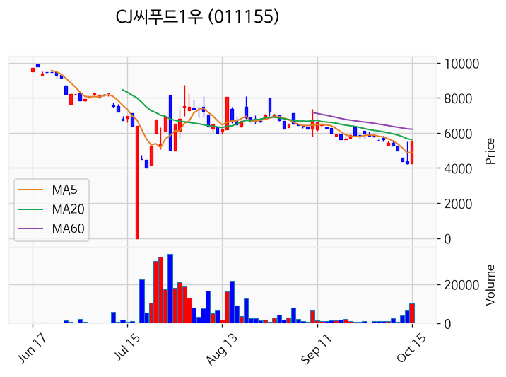

---

### 하이퍼코퍼레이션 (상한가)
— 등락률 +29.82% / 거래량 48만 주

**◎ 관련기사**
- [[급등락주 짚어보기] ‘시총 미달’ 상폐 유예에 희비⋯에이엔피 上ㆍ예선테크 下](https://news.google.com/rss/articles/CBMidEFVX3lxTE5wNF9jWGc0WFdhdnI3aEx4cDNvMnNtZkxudDJRblFTZ3pvWEZIam5GMF9PYjNuQW9ucmtnWU9fSHZHM0RCT092UFN6U2U1YVc5VkdCY0R3UHJza2tfRERGRklYd3VvM3dhZTdRTFNxYXhWcm0w?oc=5) — 이투데이, 2026-10-15

**◎ 공시**
- _(공시 없음 / 미조회)_

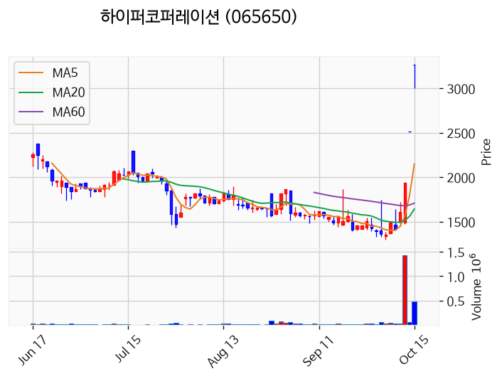

---

### 에이엔피 (상한가)
— 등락률 +29.79% / 거래량 712만 주

**◎ 관련기사**
- [[급등락주 짚어보기] ‘시총 미달’ 상폐 유예에 희비⋯에이엔피 上ㆍ예선테크 下](https://news.google.com/rss/articles/CBMidEFVX3lxTE5wNF9jWGc0WFdhdnI3aEx4cDNvMnNtZkxudDJRblFTZ3pvWEZIam5GMF9PYjNuQW9ucmtnWU9fSHZHM0RCT092UFN6U2U1YVc5VkdCY0R3UHJza2tfRERGRklYd3VvM3dhZTdRTFNxYXhWcm0w?oc=5) — 이투데이, 2026-10-15

**◎ 공시**
- _(공시 없음 / 미조회)_

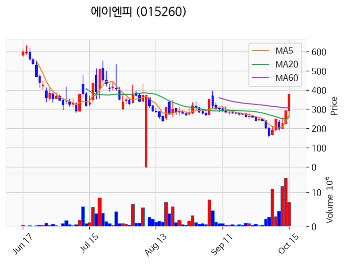

---

### 에스엠벡셀 (거래량 급증)
— 등락률 +21.54% / 거래량 4,184만 주

**◎ 관련기사**
- [김사랑, 가운 사이 드러난 레오퍼드 수영복…매혹적 근황 - 조선비즈](https://news.google.com/rss/articles/CBMikwFBVV95cUxPaXMxN196MndVLVF5WXg1X2kwQjZib3BESk9TOUNjVXhDUXJTOXdTVWZSZHhnTm5veGVqSkFJem9lVjBRQm5TWXRXYWVLaWlxbTN0X2tLcXRGU2lUQzIyTndsY2pvUXBuTkh5ZDFZaVNMVTNGN0VOcXctSVB4R1hMbzNiWDd2aFRpZlBDOGRkVGZYeDDSAacBQVVfeXFMTWw2QUxhZW14NTl2YnZDWERxZkNzamdObnVvWmFMZUIxSnRNZmlZU0ZVbkhxWWFabFFGOXQwMGZhQloyQk1UaGFtdG9zRlAwYVllUlJTMFpuR0Q0NW4zbXJPTEVzcHQ1MUhid0VFcEJEMFBERUNqdUV6ZzlfS2pWOGc1dzMyWGZhZHhNVjRTX0VuRjN2WVhObVNqMnNIeGJYQVVmUlJQUDg?oc=5) — Chosunbiz, 2026-10-15

**◎ 공시**
- _(공시 없음 / 미조회)_

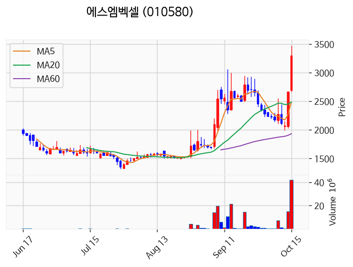

---

### 라온시큐어 (거래량 급증)
— 등락률 +16.76% / 거래량 1,301만 주

**◎ 관련기사**
- [증시 폭락에도 라온시큐어 17% 급등...보안주 약세 속 '나홀로 질주'](https://news.google.com/rss/articles/CBMiX0FVX3lxTE9JcV9kd21XOW45RFYyUGlwamRiTDc5VDNqZWw1eElJLU1ILXhzMGYxX0FKWHNRMk5IZ193c1R4bEJTSGNpRVBuOU9BQVFDdlFIS3p2MDVRVUNjeTRRU0xB?oc=5) — MTN 머니투데이방송, 2026-10-15

**◎ 공시**
- _(공시 없음 / 미조회)_

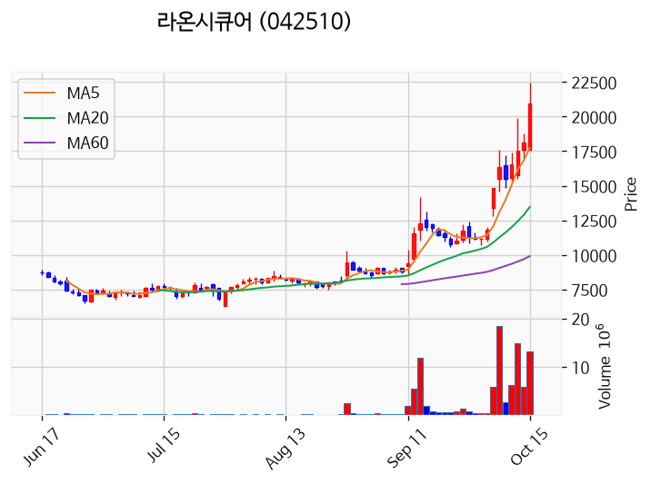

---

### HT로보틱스 (거래량 급증)
— 등락률 +5.39% / 거래량 1,228만 주

**◎ 관련기사**
- [[코스닥 외국인] 파마리서치·알테오젠 샀다…에코프로는 순매도 1위](https://news.google.com/rss/articles/CBMid0FVX3lxTE9ubUs2M19TMXM1TG4zSmtEYVdVeHU3TGVzNS1qS2VIUFJYYTZCbUc1V2Nvc1pzVTZ4MVNqR0pvSHdiUWxadjI4SEQtZFl6OWZuemtPT1N2bjVpcGZkbDVuaDY5MV9vNUVUSVdyNG9hS0lvSUQ5M0F30gF3QVVfeXFMT25tSzYzX1MxczVMbjNKa0RhV1V4dTdMZXM1LWpLZUhQUlhhNkJtRzVXY29zWnNVNngxU2pHSm9Id2JRbFp2MjhIRC1kWXo5Zm56a09PU3ZuNWlwZmRsNW5oNjkxX281RVRJV3I0b2FLSW9JRDkzQXc?oc=5) — 핀포인트뉴스, 2026-10-15

**◎ 공시**
- _(공시 없음 / 미조회)_

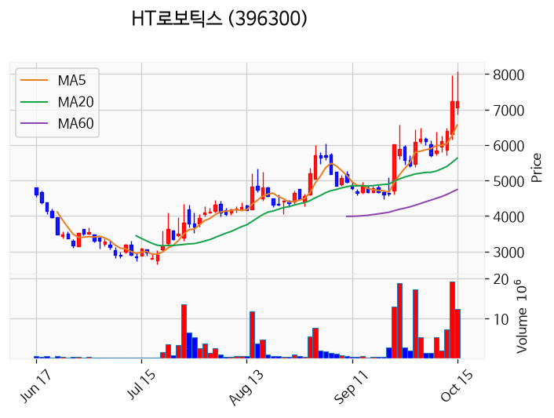

---

### 대양금속 (거래량 급증)
— 등락률 +3.75% / 거래량 1,348만 주

**◎ 관련기사**
_(관련기사 없음 / 미조회)_

**◎ 공시**
- _(공시 없음 / 미조회)_

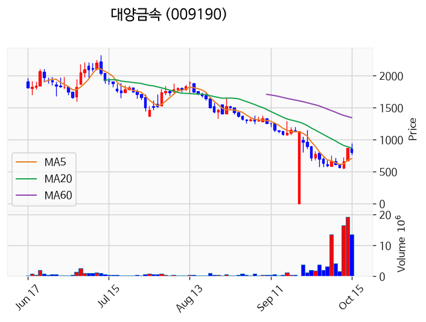

---

### 모아데이타 (거래량 급증)
— 등락률 -5.07% / 거래량 2,018만 주

**◎ 관련기사**
- [모아데이타, 주권매매거래정지](https://news.google.com/rss/articles/CBMie0FVX3lxTE1sdXpsZVBzcHh1NFEyZXdRdlowc0lhQnRRTWhsalE5amhWVVBmV3lWNE1QUXlJczBrMFBZRmw4VnV6YWlSSzVhcWpxZ29lemVCRXIyRklsQVd3ODh2Sm5EXzROS2Y0X3ktamZhNERjemgtWl9sZjc1NU1wZw?oc=5) — 디지털투데이, 2026-10-15

**◎ 공시**
- [기타시장안내              (주가 미달에 따른 상장폐지 우려 안내)](https://dart.fss.or.kr/dsaf001/main.do?rcpNo=20261015900516) — 코스닥시장본부, 20261015
- [주권매매거래정지              (주식의 병합, 분할 등 전자등록 변경, 말소)](https://dart.fss.or.kr/dsaf001/main.do?rcpNo=20261015900469) — 코스닥시장본부, 20261015
- [[기재정정]기타경영사항(자율공시)              (제8회 신주인수권부사채(BW) 취득 후 재매각)](https://dart.fss.or.kr/dsaf001/main.do?rcpNo=20261015900232) — 모아데이타, 20261015
- [[기재정정]주요사항보고서(자기전환사채매도결정)](https://dart.fss.or.kr/dsaf001/main.do?rcpNo=20261015000098) — 모아데이타, 20261015

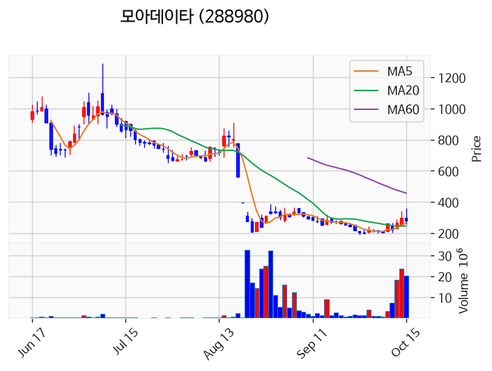

---

### 팬오션 (거래량 급증)
— 등락률 -7.18% / 거래량 1,627만 주

**◎ 관련기사**
_(관련기사 없음 / 미조회)_

**◎ 공시**
- _(공시 없음 / 미조회)_

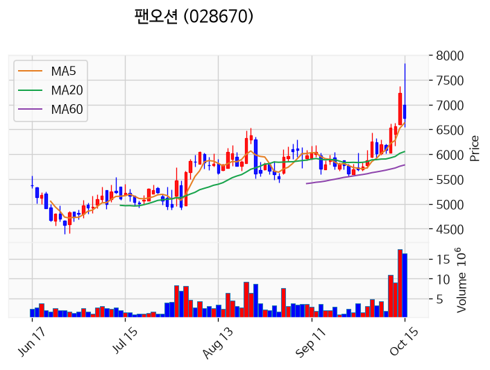

---

### 삼성전자 (거래량 급증)
— 등락률 -9.70% / 거래량 3,319만 주

**◎ 관련기사**
- [하이닉스 11% 폭락, 삼성전자 9%↓…7월 말 이후 낙폭 최대(종합)](https://news.google.com/rss/articles/CBMiW0FVX3lxTE1GOUZCUjgyb0FFYWpkdnhYRzhQa1FndExZVWlRNmhLRzZOWktKczFnX3pnYWk4dm1YNllmTkdWOWZpUmxTeHFzTURJa1V5N19feTZlTDRKTG54Q1XSAWBBVV95cUxOa01vWjRoWmZXQklXTHJxeFFWZ0txYVFMN2h3OGhudlQ0MV9NajgxYXFOU2c1eHlWeXNkX0dSd2FJUmNEeGdLOHZNOGVUTVVIcDdkOE1iWG9ILUF6Qy1aZkc?oc=5) — 연합뉴스, 2026-10-15

**◎ 공시**
- _(공시 없음 / 미조회)_

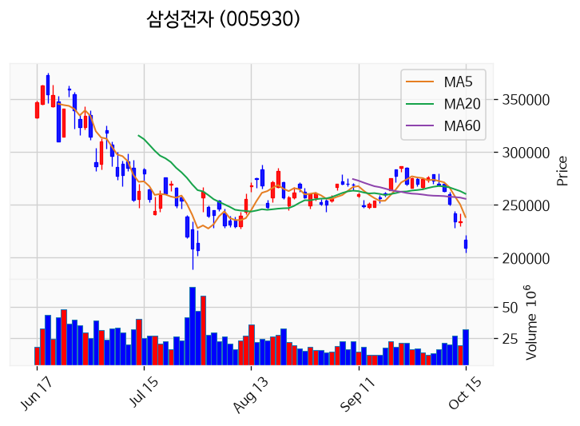

---

### 진코스텍 (거래량 급증)
— 등락률 -39.58% / 거래량 1,153만 주

**◎ 관련기사**
- [티그리스-파인밸류 컨소, 진코스텍 공모가 36% 급락에도 평가익 '방어’](https://news.google.com/rss/articles/CBMib0FVX3lxTE04UlItUWtuYzVIbjRHT0FiQzhvX0pDaFQ1d1RWVmZhZXBCemp2RnFwdzVicEJxVmlvWDNtN2NoYUxUbWhBTEZsa2U1bEYxZEZOblRRMWNWQTRTXzl5d3hVdno4YmpKQktSMHJoN1N5aw?oc=5) — 뉴스톱, 2026-10-15

**◎ 공시**
- _(공시 없음 / 미조회)_

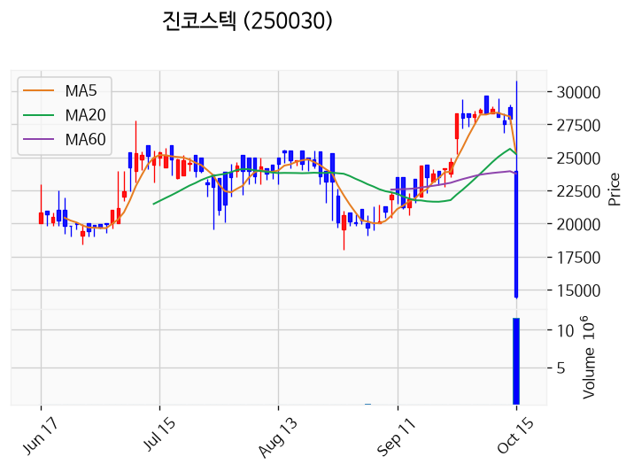

---

## 2. 거래량 폭증 후 급감 패턴 종목
_(폭증 전일 대비 500~1000%, 급감 전일 대비 25% 이하, 급감일 종가가 5일선 대비 -3% 이내)_

### 미래에셋비전스팩8호
- 폭증일: 2026-10-14, 거래량 1만 주 (전일 대비 536%)
- 급감일: 2026-10-15, 거래량 0만 주 (전일 대비 1%)
- 급감일 종가 1,989원 / 5일선 1,592원 (이격률 +24.97%)

### 삼미금속
- 폭증일: 2026-10-14, 거래량 454만 주 (전일 대비 502%)
- 급감일: 2026-10-15, 거래량 59만 주 (전일 대비 13%)
- 급감일 종가 9,500원 / 5일선 8,096원 (이격률 +17.34%)

### 영화금속
- 폭증일: 2026-10-14, 거래량 6만 주 (전일 대비 916%)
- 급감일: 2026-10-15, 거래량 0만 주 (전일 대비 6%)
- 급감일 종가 4,130원 / 5일선 3,160원 (이격률 +30.70%)

### 쎄니트
- 폭증일: 2026-10-13, 거래량 3만 주 (전일 대비 628%)
- 급감일: 2026-10-15, 거래량 1만 주 (전일 대비 18%)
- 급감일 종가 2,360원 / 5일선 1,984원 (이격률 +18.95%)

### 광동헬스바이오
- 폭증일: 2026-10-13, 거래량 0만 주 (전일 대비 606%)
- 급감일: 2026-10-15, 거래량 0만 주 (전일 대비 1%)
- 급감일 종가 1,099원 / 5일선 860원 (이격률 +27.79%)

### 볼빅
- 폭증일: 2026-10-14, 거래량 0만 주 (전일 대비 617%)
- 급감일: 2026-10-15, 거래량 0만 주 (전일 대비 3%)
- 급감일 종가 1,750원 / 5일선 1,394원 (이격률 +25.56%)

### 포인트엔지니어링
- 폭증일: 2026-10-14, 거래량 0만 주 (전일 대비 704%)
- 급감일: 2026-10-15, 거래량 0만 주 (전일 대비 24%)
- 급감일 종가 4,305원 / 5일선 3,452원 (이격률 +24.71%)

### 미디어젠
- 폭증일: 2026-10-13, 거래량 1만 주 (전일 대비 593%)
- 급감일: 2026-10-15, 거래량 1만 주 (전일 대비 16%)
- 급감일 종가 3,965원 / 5일선 3,261원 (이격률 +21.59%)

### 유엑스엔
- 폭증일: 2026-10-13, 거래량 0만 주 (전일 대비 780%)
- 급감일: 2026-10-15, 거래량 0만 주 (전일 대비 10%)
- 급감일 종가 6,260원 / 5일선 4,988원 (이격률 +25.50%)

### 브이씨
- 폭증일: 2026-10-14, 거래량 6만 주 (전일 대비 616%)
- 급감일: 2026-10-15, 거래량 1만 주 (전일 대비 17%)
- 급감일 종가 2,485원 / 5일선 2,019원 (이격률 +23.08%)

### 아이지넷
- 폭증일: 2026-10-14, 거래량 23만 주 (전일 대비 875%)
- 급감일: 2026-10-15, 거래량 3만 주 (전일 대비 12%)
- 급감일 종가 1,640원 / 5일선 1,334원 (이격률 +22.96%)
