# 2026년 10월 16일 시황 노트

## 1. 상한가 / 거래량 1,000만주 이상 종목

### TS트릴리온 (상한가)
— 등락률 +30.00% / 거래량 194만 주

**◎ 관련기사**
- [[급등락주 짚어보기] TS트릴리온, AI데이터센터 추진에 상한가⋯대양금속 이틀째 上](https://news.google.com/rss/articles/CBMidEFVX3lxTE9UN0VaYy03cjlRMmxDU2p1UDNGVXFOOGwyUWkwdmo3Nm5ka2ljbjh3NHpwTEh4bW1hR3FZSDhmQVhyd0VIUXZhWXh3d0lFTWFkNjdZNnNKdlprMFJFQUFzUjY0alVCXzlKVVhISzNDRzUzeTU3?oc=5) — 이투데이, 2026-10-16

**◎ 공시**
- _(공시 없음 / 미조회)_

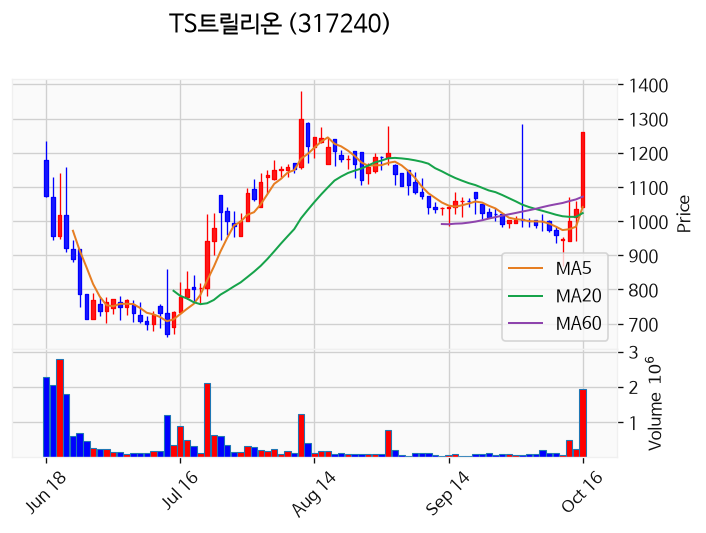

---

### 에코앤드림 (상한가)
— 등락률 +30.00% / 거래량 151만 주

**◎ 관련기사**
- [오후 이슈 [통신장비] : 쏘닉스, 우리로, 서진시스템, 오이솔루션, 다보링크](https://news.google.com/rss/articles/CBMiWkFVX3lxTE5fLUE4S0xNbzBITEJhTG84SmUtMzlxV3lSY05PdjhkaHJfSVNMS1I2YjFiczlyUVUtWC10ZmxheHJ3X1Q0T0N1cHFrTk1nNFdYbmxKNTBPVENhdw?oc=5) — 파이낸셜뉴스, 2026-10-16

**◎ 공시**
- _(공시 없음 / 미조회)_

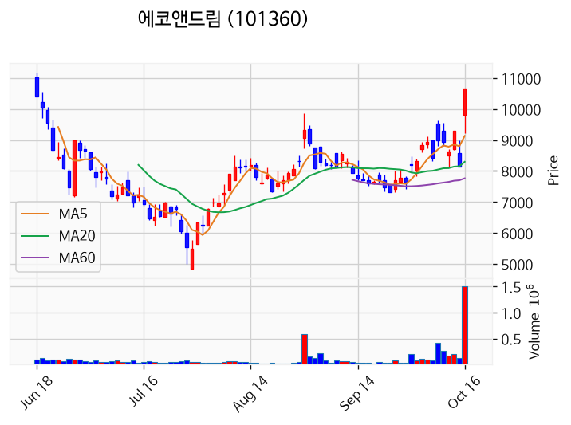

---

### 한화갤러리아우 (상한가)
— 등락률 +30.00% / 거래량 14만 주

**◎ 관련기사**
- [[급등락주 짚어보기] TS트릴리온, AI데이터센터 추진에 상한가⋯대양금속 이틀째 上](https://news.google.com/rss/articles/CBMidEFVX3lxTE9UN0VaYy03cjlRMmxDU2p1UDNGVXFOOGwyUWkwdmo3Nm5ka2ljbjh3NHpwTEh4bW1hR3FZSDhmQVhyd0VIUXZhWXh3d0lFTWFkNjdZNnNKdlprMFJFQUFzUjY0alVCXzlKVVhISzNDRzUzeTU3?oc=5) — 이투데이, 2026-10-16

**◎ 공시**
- _(공시 없음 / 미조회)_

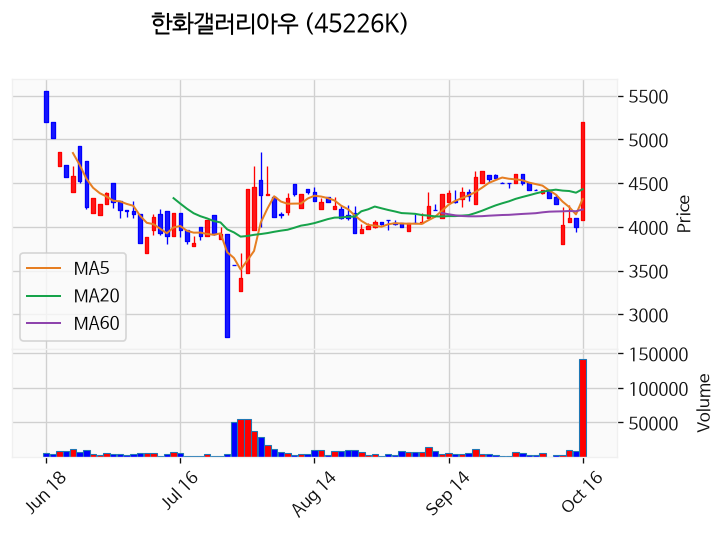

---

### 대양금속 (상한가)
— 등락률 +29.99% / 거래량 2,821만 주

**◎ 관련기사**
- [대양금속 주가, 10월 16일 애프터마켓 1,049원 29.99% 상승](https://news.google.com/rss/articles/CBMickFVX3lxTFAzTVl4TjNLSWVMVEVhbDRwOEF3eVA2cDNZNEdlN1MzYnBPZFJVckhOa1l3Wks5SjJOeWRZNFdGWHpwa1dTRXVoTnBPaV9FcllBeTM3MHJLdzVfeXJYWlc3YVhaOTlSZ0FPT0FRWDZZYkk1QQ?oc=5) — 톱스타뉴스, 2026-10-16

**◎ 공시**
- _(공시 없음 / 미조회)_

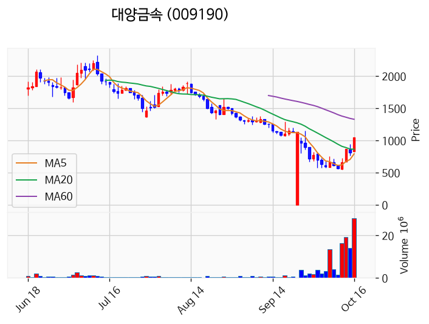

---

### 프롬바이오 (상한가)
— 등락률 +29.98% / 거래량 139만 주

**◎ 관련기사**
- [7거래일 연속 하락 후 반등, 이번엔 ‘큰장’ 열린다? [뉴스톡 웰스톡]](https://news.google.com/rss/articles/CBMibEFVX3lxTE5xMm10UXB2LU1OYmFEN2tRaUtJa3FEeGlROFRBcFZTM2YxQ2tsQXM1UVZxWFFPU3gyb3h6a1ZwZHpQcUE5MnZLd3BfczNXcjVQYXJBNzR4TEpJZDYtMnZHMTl3UXBpYy1wM0JrYQ?oc=5) — 뉴스웰, 2026-10-16

**◎ 공시**
- _(공시 없음 / 미조회)_

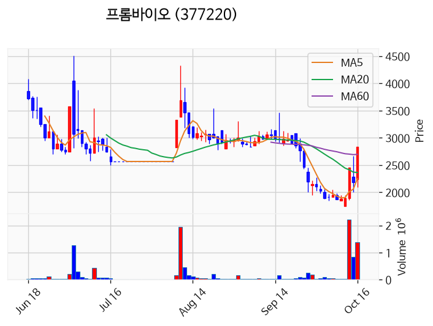

---

### 예선테크 (상한가)
— 등락률 +29.93% / 거래량 65만 주

**◎ 관련기사**
- [7거래일 연속 하락 후 반등, 이번엔 ‘큰장’ 열린다? [뉴스톡 웰스톡]](https://news.google.com/rss/articles/CBMibEFVX3lxTE5xMm10UXB2LU1OYmFEN2tRaUtJa3FEeGlROFRBcFZTM2YxQ2tsQXM1UVZxWFFPU3gyb3h6a1ZwZHpQcUE5MnZLd3BfczNXcjVQYXJBNzR4TEpJZDYtMnZHMTl3UXBpYy1wM0JrYQ?oc=5) — 뉴스웰, 2026-10-16

**◎ 공시**
- _(공시 없음 / 미조회)_

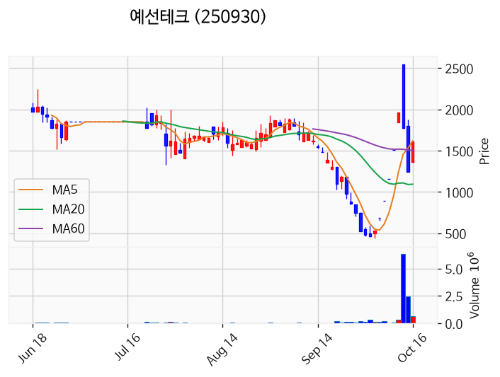

---

### 한국비티비 (상한가)
— 등락률 +29.93% / 거래량 12만 주

**◎ 관련기사**
- [[급등락주 짚어보기] TS트릴리온, AI데이터센터 추진에 상한가⋯대양금속 이틀째 上](https://news.google.com/rss/articles/CBMidEFVX3lxTE9UN0VaYy03cjlRMmxDU2p1UDNGVXFOOGwyUWkwdmo3Nm5ka2ljbjh3NHpwTEh4bW1hR3FZSDhmQVhyd0VIUXZhWXh3d0lFTWFkNjdZNnNKdlprMFJFQUFzUjY0alVCXzlKVVhISzNDRzUzeTU3?oc=5) — 이투데이, 2026-10-16

**◎ 공시**
- _(공시 없음 / 미조회)_

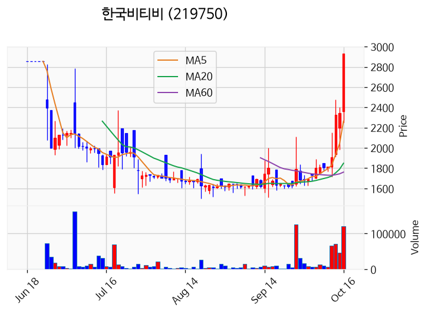

---

### 자이언트스텝 (상한가)
— 등락률 +29.90% / 거래량 47만 주

**◎ 관련기사**
- ['74세' 이수만이 추는 “미혼 앤 비혼”..써니, 에투라 ‘네온’ 댄스 공개에 SM 총출동 [핫피플] - 조선비즈](https://news.google.com/rss/articles/CBMikwFBVV95cUxQSDd6blQyN1d4RHFpaEQzWl9mcm0wSThyTTNzVy1hZElvcndqQWhONUZTREVoa3dTZjJOYkpEZGlXZ002YzZpZ1BpRlJ3TGtfVHh5OG0tLVFlV0hWNHE5TzFmSFBJUEs5X1pkdFFEVUxyOXo5UjY0V3l0bFVaV1NXdHRlb01fX1p5OE5vek1IbXVEU1nSAacBQVVfeXFMTUxnNXNMeTVpc3VIRWtscldEamRJV3hFNExjbkVuNjcxNURsUXJEVWRaZExISzdUbnFkMWJaUERDZ01ick93Zmd5MkwyN295dnE1UW5TYlBuRFNKbmthdGF5RHZzNS1fWHlDMVVaQUNuVTlnamRtUzh2NVV3Mk9jZjNGQU1WNUo5THhwcFhSeFFMSzllOGI3dWg3X2M3Yk0tdXFaejM2Ujg?oc=5) — Chosunbiz, 2026-10-16

**◎ 공시**
- _(공시 없음 / 미조회)_

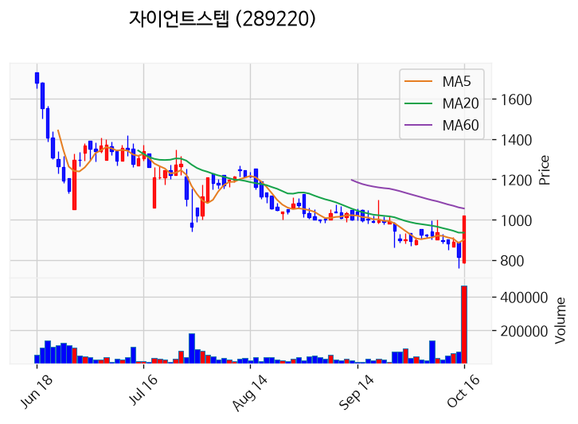

---

### HT로보틱스 (거래량 급증)
— 등락률 +25.59% / 거래량 3,073만 주

**◎ 관련기사**
- [오후 이슈 [통신장비] : 쏘닉스, 우리로, 서진시스템, 오이솔루션, 다보링크](https://news.google.com/rss/articles/CBMiWkFVX3lxTE5fLUE4S0xNbzBITEJhTG84SmUtMzlxV3lSY05PdjhkaHJfSVNMS1I2YjFiczlyUVUtWC10ZmxheHJ3X1Q0T0N1cHFrTk1nNFdYbmxKNTBPVENhdw?oc=5) — 파이낸셜뉴스, 2026-10-16

**◎ 공시**
- _(공시 없음 / 미조회)_

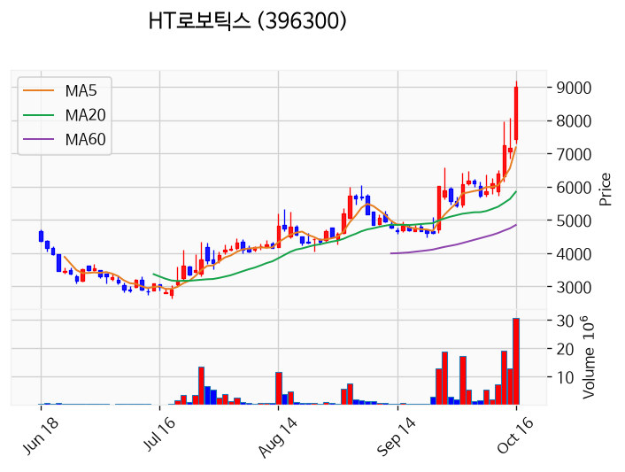

---

### 우리로 (거래량 급증)
— 등락률 +24.20% / 거래량 1,063만 주

**◎ 관련기사**
- [오후 이슈 [통신장비] : 쏘닉스, 우리로, 서진시스템, 오이솔루션, 다보링크](https://news.google.com/rss/articles/CBMiWkFVX3lxTE5fLUE4S0xNbzBITEJhTG84SmUtMzlxV3lSY05PdjhkaHJfSVNMS1I2YjFiczlyUVUtWC10ZmxheHJ3X1Q0T0N1cHFrTk1nNFdYbmxKNTBPVENhdw?oc=5) — 파이낸셜뉴스, 2026-10-16

**◎ 공시**
- _(공시 없음 / 미조회)_

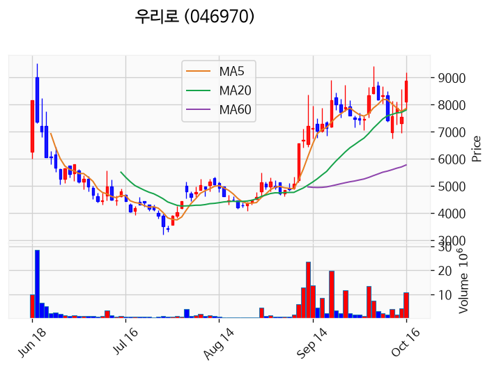

---

### 서산 (거래량 급증)
— 등락률 +22.22% / 거래량 1,076만 주

**◎ 관련기사**
- [미래엔서해에너지·가스안전공사, 서산 184세대 CO 중독 예방점검](https://news.google.com/rss/articles/CBMickFVX3lxTE1EcDh5QjI5NVFIU3B1R0Y2TmNLeWN4cWtnQ0JFcW40WU5QcFVjVmRseVlsOGJPVFNfbl9hdUdNRXBXc3BMX3ZGSXFEYXhiVUZvbWViNlAwMDYzN2FvOFF3MDJWZVVPVlVfVV93WHMzT2NQZw?oc=5) — 에너지데일리, 2026-10-16

**◎ 공시**
- _(공시 없음 / 미조회)_

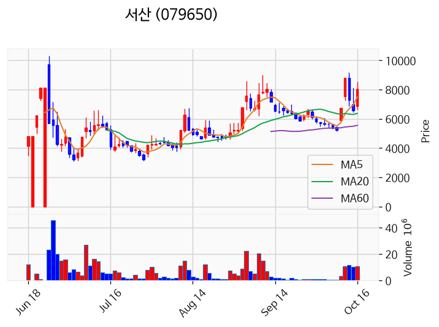

---

### 에이엔피 (거래량 급증)
— 등락률 +12.93% / 거래량 2,046만 주

**◎ 관련기사**
_(관련기사 없음 / 미조회)_

**◎ 공시**
- _(공시 없음 / 미조회)_

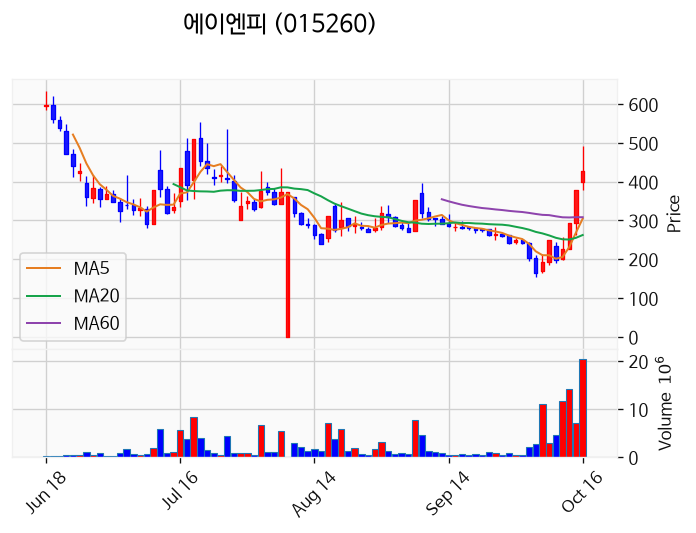

---

### 삼기에너지솔루션즈 (거래량 급증)
— 등락률 +5.69% / 거래량 1,333만 주

**◎ 관련기사**
_(관련기사 없음 / 미조회)_

**◎ 공시**
- _(공시 없음 / 미조회)_

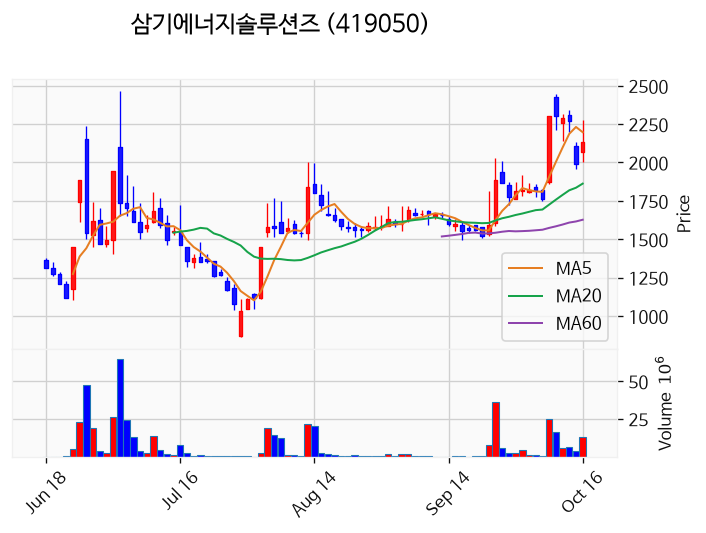

---

### 엔젠바이오 (거래량 급증)
— 등락률 +5.28% / 거래량 1,024만 주

**◎ 관련기사**
- [코스피, 7%대 폭락 딛고 2% 반등해 5660선 회복...코스닥 4.46% 급등](https://news.google.com/rss/articles/CBMic0FVX3lxTFA2R2RGYzg5S1JLVGpvZTktQnlvdXFJb1pqWlZsTEctenpzUGVpX0ZUOWRCZUxCWlMtcEZxTmZYNExDZjdjYXdtUXNkNVBSeGhkMExweThNY0JISXJZRk9faG1VU0g2Mm1zS1V2bkhrOU9TUFHSAXdBVV95cUxNUnFGODJsTTZRRVIydndsRjl4SW1haXZLTmg3MU9YcjdBSkFvV3VjOEZWMmZQODdZVS1lM0NSVGVpVGFQczBTM0FMU3pfamFaRXhOeUNUclF6TmtwY1lXb1F4ajJ5QUhMWVVBaTFKZjRwck5mOUR0cw?oc=5) — 핀포인트뉴스, 2026-10-16

**◎ 공시**
- _(공시 없음 / 미조회)_

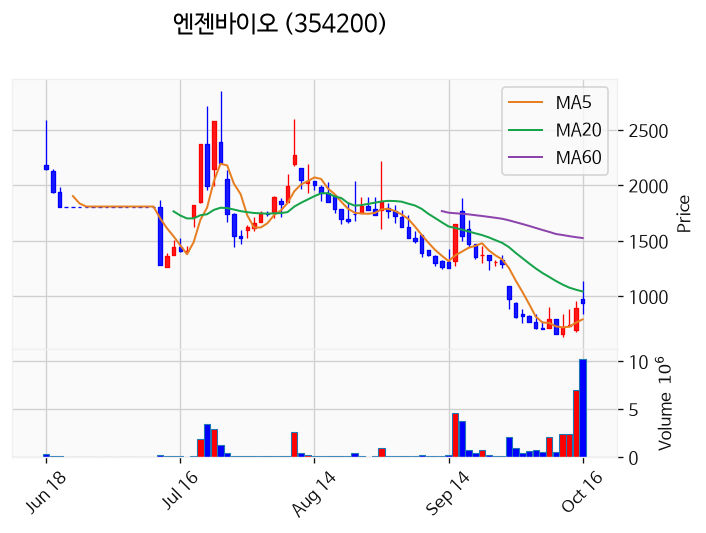

---

### 삼성전자 (거래량 급증)
— 등락률 +3.10% / 거래량 1,846만 주

**◎ 관련기사**
- [삼성전자 급락에 증여세도 뚝?…‘절묘한 증여 타이밍’ [재계톡톡]](https://news.google.com/rss/articles/CBMiVEFVX3lxTFBnNGZVbHBib053RlpYNUM0WG5jaVI1Mi1udElIT3A1TGVZN1NETEk3VFg3Wkp1VUJhc0RsdHdscEo4N1RWTW16Z091QWZKMm1mNkRXUw?oc=5) — 매일경제, 2026-10-16

**◎ 공시**
- _(공시 없음 / 미조회)_

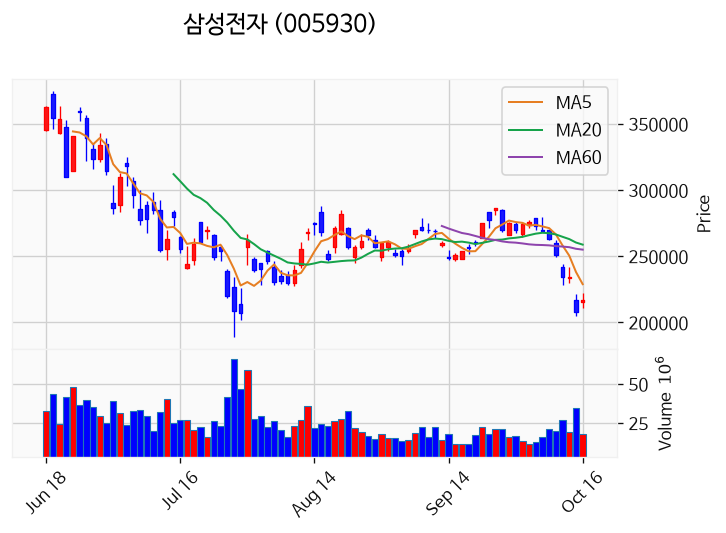

---

### 뉴인텍 (거래량 급증)
— 등락률 -13.33% / 거래량 1,971만 주

**◎ 관련기사**
_(관련기사 없음 / 미조회)_

**◎ 공시**
- _(공시 없음 / 미조회)_

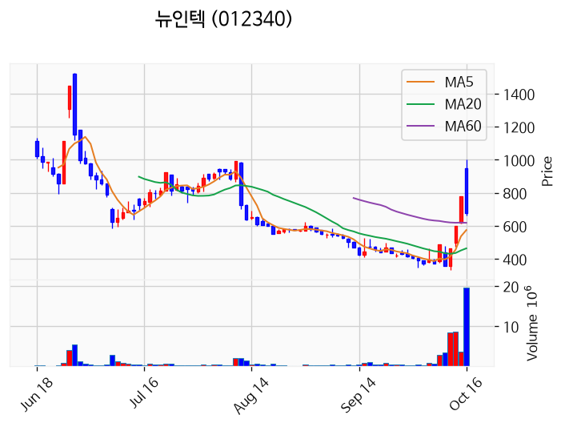

---

### 멜콘 (거래량 급증)
— 등락률 -13.80% / 거래량 1,109만 주

**◎ 관련기사**
- [[신규 상장] 빅웨이브로보틱스, 전일비 5.82%↑... 현재가 14,920원](https://news.google.com/rss/articles/CBMiYkFVX3lxTE5XUVRUYlFadzJYa3FTTnZpeUdRQkFIVFlrNFNnamRueXZwaXE1VEYzQ3A2d0RId3VOekdRTldqRHlzeV9sdU9hZjFJWUJPNW1DendEZzFPUFdkenB5SXNSQWdR?oc=5) — 버핏연구소, 2026-10-16

**◎ 공시**
- _(공시 없음 / 미조회)_

---

### 모아데이타 (거래량 급증)
— 등락률 -14.95% / 거래량 1,136만 주

**◎ 관련기사**
_(관련기사 없음 / 미조회)_

**◎ 공시**
- [[기재정정]주요사항보고서(자기전환사채만기전취득결정)](https://dart.fss.or.kr/dsaf001/main.do?rcpNo=20261015000442) — 모아데이타, 20261016

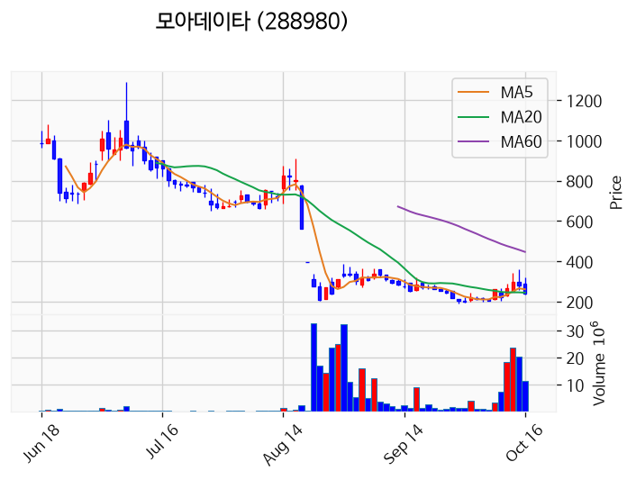

---

## 2. 거래량 폭증 후 급감 패턴 종목
_(폭증 전일 대비 500~1000%, 급감 전일 대비 25% 이하, 급감일 종가가 5일선 대비 -3% 이내)_

### 하이트진로홀딩스우
- 폭증일: 2026-10-15, 거래량 0만 주 (전일 대비 765%)
- 급감일: 2026-10-16, 거래량 0만 주 (전일 대비 8%)
- 급감일 종가 9,060원 / 5일선 9,034원 (이격률 +0.29%)

### 유니온
- 폭증일: 2026-10-15, 거래량 14만 주 (전일 대비 776%)
- 급감일: 2026-10-16, 거래량 2만 주 (전일 대비 12%)
- 급감일 종가 2,920원 / 5일선 2,852원 (이격률 +2.38%)

### 넥센타이어1우B
- 폭증일: 2026-10-15, 거래량 3만 주 (전일 대비 811%)
- 급감일: 2026-10-16, 거래량 0만 주 (전일 대비 7%)
- 급감일 종가 3,935원 / 5일선 3,938원 (이격률 -0.08%)

### 우양피앤엘
- 폭증일: 2026-10-15, 거래량 2만 주 (전일 대비 717%)
- 급감일: 2026-10-16, 거래량 0만 주 (전일 대비 24%)
- 급감일 종가 5,690원 / 5일선 5,580원 (이격률 +1.97%)

### 에이스침대
- 폭증일: 2026-10-15, 거래량 1만 주 (전일 대비 544%)
- 급감일: 2026-10-16, 거래량 0만 주 (전일 대비 24%)
- 급감일 종가 31,750원 / 5일선 31,530원 (이격률 +0.70%)

### 삼성스팩11호
- 폭증일: 2026-10-15, 거래량 1만 주 (전일 대비 582%)
- 급감일: 2026-10-16, 거래량 0만 주 (전일 대비 21%)
- 급감일 종가 2,005원 / 5일선 2,004원 (이격률 +0.05%)

### 남선알미늄
- 폭증일: 2026-10-15, 거래량 295만 주 (전일 대비 572%)
- 급감일: 2026-10-16, 거래량 61만 주 (전일 대비 21%)
- 급감일 종가 1,099원 / 5일선 1,075원 (이격률 +2.21%)

### 하나36호스팩
- 폭증일: 2026-10-13, 거래량 1만 주 (전일 대비 856%)
- 급감일: 2026-10-16, 거래량 0만 주 (전일 대비 7%)
- 급감일 종가 1,954원 / 5일선 1,972원 (이격률 -0.92%)

### 영흥
- 폭증일: 2026-10-15, 거래량 8만 주 (전일 대비 736%)
- 급감일: 2026-10-16, 거래량 1만 주 (전일 대비 8%)
- 급감일 종가 2,225원 / 5일선 2,208원 (이격률 +0.77%)

### 지엠비코리아
- 폭증일: 2026-10-15, 거래량 7만 주 (전일 대비 927%)
- 급감일: 2026-10-16, 거래량 2만 주 (전일 대비 22%)
- 급감일 종가 3,810원 / 5일선 3,740원 (이격률 +1.87%)

### KB제34호스팩
- 폭증일: 2026-10-15, 거래량 22만 주 (전일 대비 504%)
- 급감일: 2026-10-16, 거래량 3만 주 (전일 대비 13%)
- 급감일 종가 1,898원 / 5일선 1,894원 (이격률 +0.21%)

### 오스템
- 폭증일: 2026-10-15, 거래량 14만 주 (전일 대비 613%)
- 급감일: 2026-10-16, 거래량 3만 주 (전일 대비 24%)
- 급감일 종가 1,138원 / 5일선 1,128원 (이격률 +0.89%)

### 아이티센씨티에스
- 폭증일: 2026-10-15, 거래량 9만 주 (전일 대비 511%)
- 급감일: 2026-10-16, 거래량 1만 주 (전일 대비 13%)
- 급감일 종가 5,370원 / 5일선 5,486원 (이격률 -2.11%)

### 소프트센우
- 폭증일: 2026-10-15, 거래량 2만 주 (전일 대비 992%)
- 급감일: 2026-10-16, 거래량 0만 주 (전일 대비 0%)
- 급감일 종가 6,850원 / 5일선 6,216원 (이격률 +10.20%)

### HDC랩스
- 폭증일: 2026-10-15, 거래량 1만 주 (전일 대비 772%)
- 급감일: 2026-10-16, 거래량 0만 주 (전일 대비 23%)
- 급감일 종가 7,370원 / 5일선 7,298원 (이격률 +0.99%)

### 로지시스
- 폭증일: 2026-10-15, 거래량 4만 주 (전일 대비 553%)
- 급감일: 2026-10-16, 거래량 0만 주 (전일 대비 4%)
- 급감일 종가 2,075원 / 5일선 2,088원 (이격률 -0.62%)

### 현대백화점
- 폭증일: 2026-10-15, 거래량 55만 주 (전일 대비 717%)
- 급감일: 2026-10-16, 거래량 11만 주 (전일 대비 20%)
- 급감일 종가 78,800원 / 5일선 80,760원 (이격률 -2.43%)

### 우리산업홀딩스
- 폭증일: 2026-10-15, 거래량 2만 주 (전일 대비 526%)
- 급감일: 2026-10-16, 거래량 0만 주 (전일 대비 16%)
- 급감일 종가 2,415원 / 5일선 2,293원 (이격률 +5.32%)

### 엘엠에스
- 폭증일: 2026-10-15, 거래량 0만 주 (전일 대비 843%)
- 급감일: 2026-10-16, 거래량 0만 주 (전일 대비 3%)
- 급감일 종가 5,050원 / 5일선 5,140원 (이격률 -1.75%)

### 텔코웨어
- 폭증일: 2026-10-15, 거래량 1만 주 (전일 대비 604%)
- 급감일: 2026-10-16, 거래량 0만 주 (전일 대비 10%)
- 급감일 종가 13,220원 / 5일선 13,260원 (이격률 -0.30%)

### 유비벨록스
- 폭증일: 2026-10-15, 거래량 3만 주 (전일 대비 592%)
- 급감일: 2026-10-16, 거래량 1만 주 (전일 대비 17%)
- 급감일 종가 4,160원 / 5일선 4,189원 (이격률 -0.69%)

### 효성ITX
- 폭증일: 2026-10-15, 거래량 2만 주 (전일 대비 701%)
- 급감일: 2026-10-16, 거래량 0만 주 (전일 대비 18%)
- 급감일 종가 11,670원 / 5일선 11,740원 (이격률 -0.60%)

### 한국철강
- 폭증일: 2026-10-15, 거래량 10만 주 (전일 대비 526%)
- 급감일: 2026-10-16, 거래량 3만 주 (전일 대비 24%)
- 급감일 종가 9,610원 / 5일선 9,436원 (이격률 +1.84%)

### KC산업
- 폭증일: 2026-10-15, 거래량 0만 주 (전일 대비 649%)
- 급감일: 2026-10-16, 거래량 0만 주 (전일 대비 0%)
- 급감일 종가 1,184원 / 5일선 1,181원 (이격률 +0.24%)

### 딜리
- 폭증일: 2026-10-14, 거래량 1만 주 (전일 대비 872%)
- 급감일: 2026-10-16, 거래량 0만 주 (전일 대비 23%)
- 급감일 종가 4,000원 / 5일선 4,051원 (이격률 -1.26%)

### 루켄테크놀러지스
- 폭증일: 2026-10-14, 거래량 1만 주 (전일 대비 603%)
- 급감일: 2026-10-16, 거래량 0만 주 (전일 대비 20%)
- 급감일 종가 3,890원 / 5일선 3,915원 (이격률 -0.64%)

### 포톤
- 폭증일: 2026-10-15, 거래량 27만 주 (전일 대비 754%)
- 급감일: 2026-10-16, 거래량 3만 주 (전일 대비 10%)
- 급감일 종가 2,455원 / 5일선 2,462원 (이격률 -0.28%)

### 한솔제지
- 폭증일: 2026-10-15, 거래량 8만 주 (전일 대비 645%)
- 급감일: 2026-10-16, 거래량 2만 주 (전일 대비 23%)
- 급감일 종가 7,000원 / 5일선 7,016원 (이격률 -0.23%)

### 인크로스
- 폭증일: 2026-10-15, 거래량 3만 주 (전일 대비 917%)
- 급감일: 2026-10-16, 거래량 1만 주 (전일 대비 22%)
- 급감일 종가 4,990원 / 5일선 4,954원 (이격률 +0.73%)

### 크라운제과우
- 폭증일: 2026-10-15, 거래량 0만 주 (전일 대비 691%)
- 급감일: 2026-10-16, 거래량 0만 주 (전일 대비 6%)
- 급감일 종가 7,490원 / 5일선 7,394원 (이격률 +1.30%)

### KBG
- 폭증일: 2026-10-15, 거래량 2만 주 (전일 대비 576%)
- 급감일: 2026-10-16, 거래량 0만 주 (전일 대비 6%)
- 급감일 종가 2,575원 / 5일선 2,629원 (이격률 -2.05%)

### 무진메디
- 폭증일: 2026-10-15, 거래량 0만 주 (전일 대비 542%)
- 급감일: 2026-10-16, 거래량 0만 주 (전일 대비 17%)
- 급감일 종가 1,849원 / 5일선 1,853원 (이격률 -0.21%)

### 두산퓨얼셀2우B
- 폭증일: 2026-10-15, 거래량 1만 주 (전일 대비 546%)
- 급감일: 2026-10-16, 거래량 0만 주 (전일 대비 3%)
- 급감일 종가 7,030원 / 5일선 7,056원 (이격률 -0.37%)

### 시선AI
- 폭증일: 2026-10-15, 거래량 77만 주 (전일 대비 699%)
- 급감일: 2026-10-16, 거래량 19만 주 (전일 대비 24%)
- 급감일 종가 3,840원 / 5일선 3,751원 (이격률 +2.37%)

### 에코아이
- 폭증일: 2026-10-15, 거래량 2만 주 (전일 대비 643%)
- 급감일: 2026-10-16, 거래량 1만 주 (전일 대비 25%)
- 급감일 종가 9,070원 / 5일선 8,968원 (이격률 +1.14%)

### 키움히어로제1호스팩
- 폭증일: 2026-10-14, 거래량 0만 주 (전일 대비 595%)
- 급감일: 2026-10-16, 거래량 0만 주 (전일 대비 3%)
- 급감일 종가 2,015원 / 5일선 2,011원 (이격률 +0.20%)

### 하나33호스팩
- 폭증일: 2026-10-15, 거래량 8만 주 (전일 대비 676%)
- 급감일: 2026-10-16, 거래량 1만 주 (전일 대비 7%)
- 급감일 종가 2,090원 / 5일선 2,087원 (이격률 +0.14%)

### 엔에이치스팩31호
- 폭증일: 2026-10-15, 거래량 3만 주 (전일 대비 743%)
- 급감일: 2026-10-16, 거래량 0만 주 (전일 대비 10%)
- 급감일 종가 2,070원 / 5일선 2,067원 (이격률 +0.15%)

### KB제30호스팩
- 폭증일: 2026-10-15, 거래량 1만 주 (전일 대비 635%)
- 급감일: 2026-10-16, 거래량 0만 주 (전일 대비 4%)
- 급감일 종가 2,055원 / 5일선 2,051원 (이격률 +0.20%)

### 교보17호스팩
- 폭증일: 2026-10-15, 거래량 0만 주 (전일 대비 900%)
- 급감일: 2026-10-16, 거래량 0만 주 (전일 대비 25%)
- 급감일 종가 2,060원 / 5일선 2,056원 (이격률 +0.19%)

### KB제31호스팩
- 폭증일: 2026-10-13, 거래량 1만 주 (전일 대비 517%)
- 급감일: 2026-10-16, 거래량 0만 주 (전일 대비 10%)
- 급감일 종가 2,035원 / 5일선 2,033원 (이격률 +0.08%)
