# 2026년 10월 19일 시황 노트

## 1. 상한가 / 거래량 1,000만주 이상 종목

### CSA 코스믹 (상한가)
— 등락률 +29.97% / 거래량 69만 주

**◎ 관련기사**
- [[오늘의 특징주] CSA 코스믹·KBI동양철관 상한가…스페이스X 납품·우주항공 배터리 부각](https://news.google.com/rss/articles/CBMiZEFVX3lxTE55TUpxUEZac0FydHZnMi1uMkg4cURkRWRvNjgtdWJ1MWdSRUhuWnlDa0FLN0ZDT1loQVRQcXRFcFhwUnRjUEszZVNhOGtnN2dvYkd4aEZuYkl4c2lSRk8teUl6UTM?oc=5) — www.ppss.kr, 2026-10-19

**◎ 공시**
- _(공시 없음 / 미조회)_

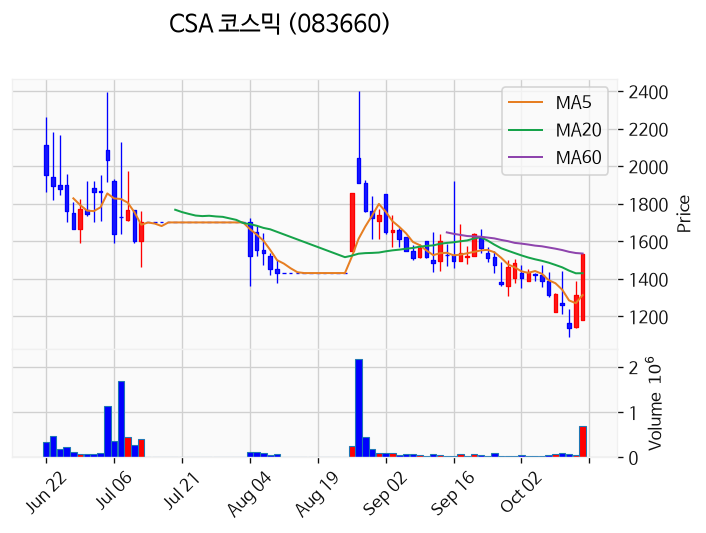

---

### KBI동양철관 (상한가)
— 등락률 +29.96% / 거래량 1,311만 주

**◎ 관련기사**
- [[오늘의 특징주] CSA 코스믹·KBI동양철관 상한가…스페이스X 납품·우주항공 배터리 부각](https://news.google.com/rss/articles/CBMiZEFVX3lxTE55TUpxUEZac0FydHZnMi1uMkg4cURkRWRvNjgtdWJ1MWdSRUhuWnlDa0FLN0ZDT1loQVRQcXRFcFhwUnRjUEszZVNhOGtnN2dvYkd4aEZuYkl4c2lSRk8teUl6UTM?oc=5) — www.ppss.kr, 2026-10-19

**◎ 공시**
- _(공시 없음 / 미조회)_

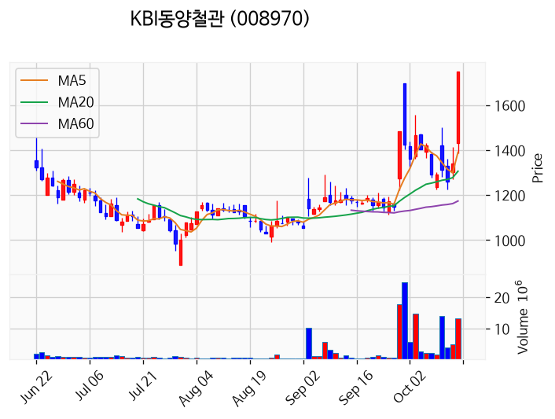

---

### 에스엠벡셀 (상한가)
— 등락률 +29.90% / 거래량 2,677만 주

**◎ 관련기사**
- [[오늘의 특징주] CSA 코스믹·KBI동양철관 상한가…스페이스X 납품·우주항공 배터리 부각](https://news.google.com/rss/articles/CBMiZEFVX3lxTE55TUpxUEZac0FydHZnMi1uMkg4cURkRWRvNjgtdWJ1MWdSRUhuWnlDa0FLN0ZDT1loQVRQcXRFcFhwUnRjUEszZVNhOGtnN2dvYkd4aEZuYkl4c2lSRk8teUl6UTM?oc=5) — www.ppss.kr, 2026-10-19

**◎ 공시**
- _(공시 없음 / 미조회)_

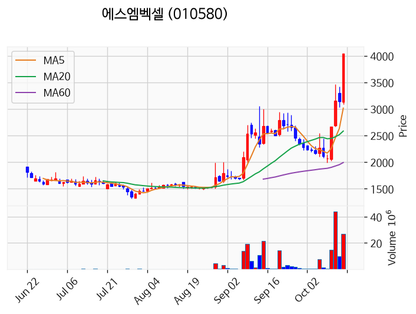

---

### 뉴인텍 (상한가)
— 등락률 +29.88% / 거래량 885만 주

**◎ 관련기사**
- [[오늘의 특징주] CSA 코스믹·KBI동양철관 상한가…스페이스X 납품·우주항공 배터리 부각](https://news.google.com/rss/articles/CBMiZEFVX3lxTE55TUpxUEZac0FydHZnMi1uMkg4cURkRWRvNjgtdWJ1MWdSRUhuWnlDa0FLN0ZDT1loQVRQcXRFcFhwUnRjUEszZVNhOGtnN2dvYkd4aEZuYkl4c2lSRk8teUl6UTM?oc=5) — www.ppss.kr, 2026-10-19

**◎ 공시**
- _(공시 없음 / 미조회)_

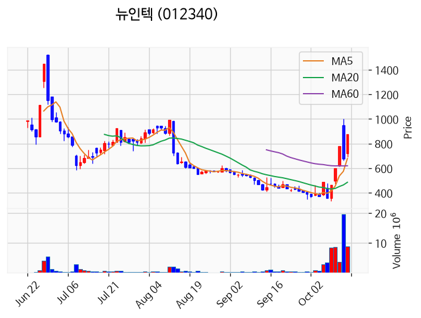

---

### 삼기에너지솔루션즈 (거래량 급증)
— 등락률 +24.71% / 거래량 5,270만 주

**◎ 관련기사**
_(관련기사 없음 / 미조회)_

**◎ 공시**
- _(공시 없음 / 미조회)_

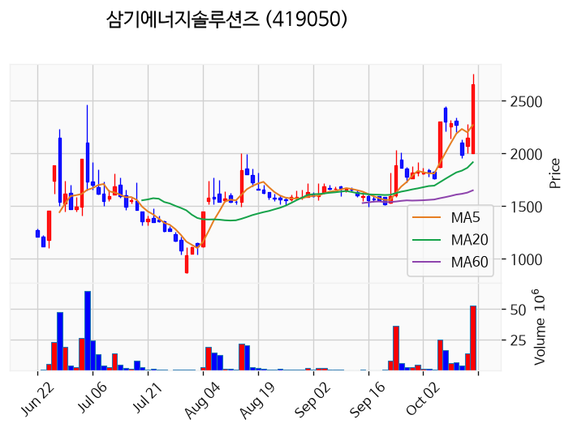

---

### 삼성전자 (거래량 급증)
— 등락률 +1.86% / 거래량 1,651만 주

**◎ 관련기사**
- [삼성전자, 상승전환해 1%대 강세 마감…SK하이닉스도 0.4%↑(종합)](https://news.google.com/rss/articles/CBMiW0FVX3lxTE5oUUx1MUZ3NHFaUFBwWDlLd0wtMlYwdTNpUGxVQUl4YzFvOHo4a2pzSDc4R3JzVVZybUtCZXA3NXlmWk9IXzNOaFF0dTQ4ek8tTmEwZkllQnd6aHfSAWBBVV95cUxOWWs5aWU2MmQ2enBpYUxYWWZCV2JiaF8zQkc0N0xXSjA0RlZSZWF5M1Z3SDhuM2RFejNmYmpvTWFfN1JrQzJpME14anN5RkNLTDN4Q3JyTHFnUzYwajhYaFQ?oc=5) — 연합뉴스, 2026-10-19

**◎ 공시**
- [임원ㆍ주요주주특정증권등소유상황보고서](https://dart.fss.or.kr/dsaf001/main.do?rcpNo=20261019000318) — 최고은, 20261019

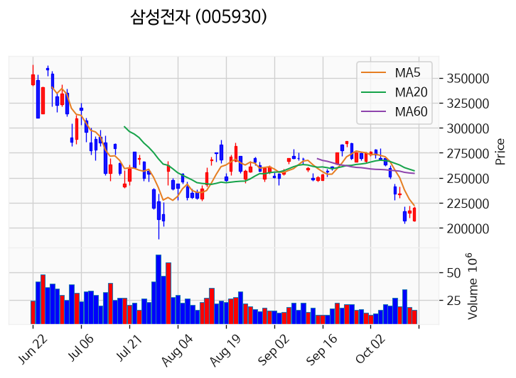

---

### HT로보틱스 (거래량 급증)
— 등락률 +0.33% / 거래량 1,699만 주

**◎ 관련기사**
_(관련기사 없음 / 미조회)_

**◎ 공시**
- [임원ㆍ주요주주특정증권등소유상황보고서](https://dart.fss.or.kr/dsaf001/main.do?rcpNo=20261019000084) — 박태원, 20261019

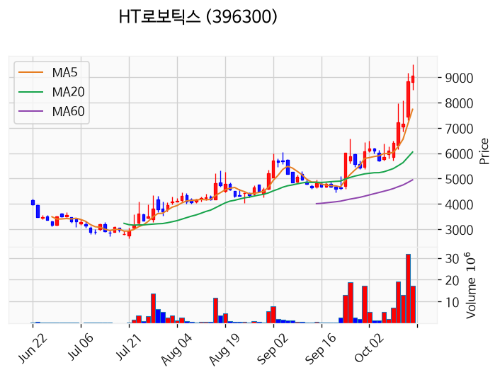

---

### 한화오션 (거래량 급증)
— 등락률 -1.23% / 거래량 2,305만 주

**◎ 관련기사**
- ['크레인'까지 올라간 HD현대重·한화오션 노조..파업에 고공농성까지 - 머니투데이](https://news.google.com/rss/articles/CBMiekFVX3lxTFA4RmEwbmt2MXZjQ05XWjhtdzk2OHV6YkVJYW50emdhaENtdkluVnVPckdzenJfVVE5NV9PbWVOWDZNR0FUaXBZUmV0bUdrcS1JT1FQNmZRX3VoU2djUDFyWWJxclJDR0RiNUtmVTFXNE9LLUQ1OGZvV3FR0gF_QVVfeXFMUEQ1NndaZ21WTGg2SURoZlB2UTRNbHBsTEd0V1NoakVUUmwtNUJxYUwxc3RnYzdjaW9TZHV6b0RGX3NvTVlTZ1E1WVplTnlEMzBtUTR6WnpGRlNBd2ZORjdNMVZHM25uSHp3emg5NHRaazByWHp5a0VLTUdwUkw5dw?oc=5) — 머니투데이, 2026-10-19

**◎ 공시**
- _(공시 없음 / 미조회)_

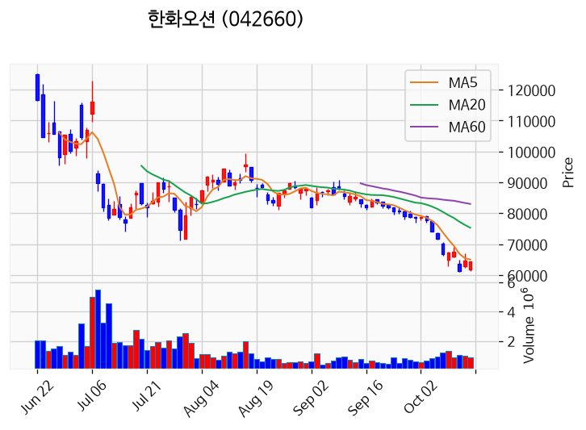

---

### 대양금속 (거래량 급증)
— 등락률 -7.44% / 거래량 1,617만 주

**◎ 관련기사**
_(관련기사 없음 / 미조회)_

**◎ 공시**
- _(공시 없음 / 미조회)_

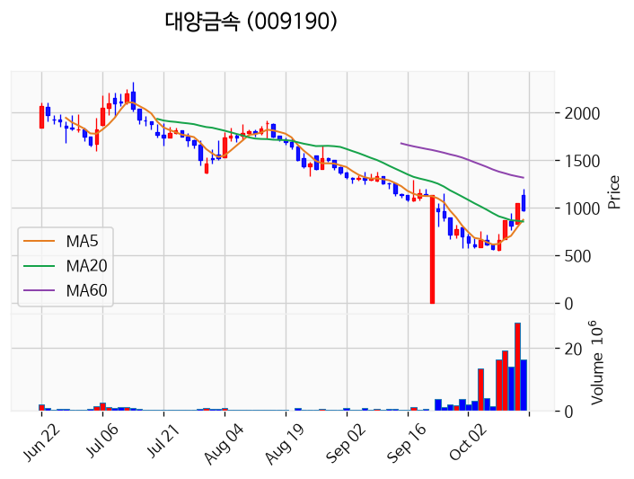

---

### TS트릴리온 (거래량 급증)
— 등락률 -8.09% / 거래량 1,054만 주

**◎ 관련기사**
_(관련기사 없음 / 미조회)_

**◎ 공시**
- _(공시 없음 / 미조회)_

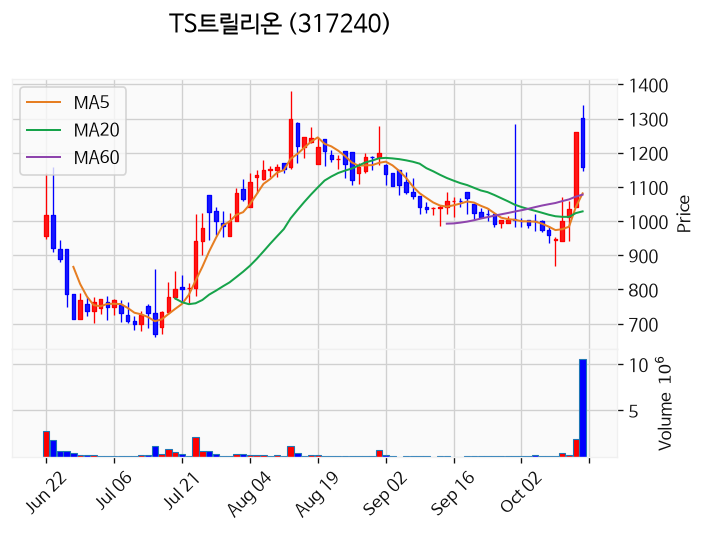

---

### 모아데이타 (거래량 급증)
— 등락률 -14.64% / 거래량 1,067만 주

**◎ 관련기사**
_(관련기사 없음 / 미조회)_

**◎ 공시**
- _(공시 없음 / 미조회)_

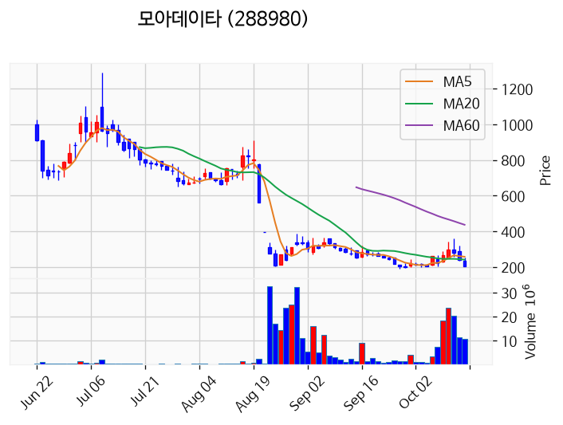

---

### 에이엔피 (거래량 급증)
— 등락률 -29.91% / 거래량 1,131만 주

**◎ 관련기사**
_(관련기사 없음 / 미조회)_

**◎ 공시**
- _(공시 없음 / 미조회)_

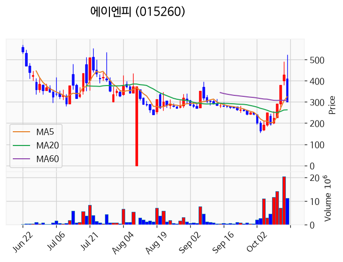

---

## 2. 거래량 폭증 후 급감 패턴 종목
_(폭증 전일 대비 500~1000%, 급감 전일 대비 25% 이하, 급감일 종가가 5일선 대비 -3% 이내)_

_해당 종목 없음_
