# 2026년 10월 20일 시황 노트

## 1. 상한가 / 거래량 1,000만주 이상 종목

### 형지엘리트 (상한가)
— 등락률 +30.00% / 거래량 108만 주

**◎ 관련기사**
- [상폐 위기 벗어나자 '동전주 上上上'…단타주의보](https://news.google.com/rss/articles/CBMiWkFVX3lxTE9sci1QSlpJS0J2VHgtZWV2N25PNFRaNUlBZEJCelZWZzNScV82a2htcGhMWmEyc0sxQmthNVlzNGlLaUd4S3ZxQ1BUSEZBcEJMUGJXVWswUmtidw?oc=5) — 한국경제, 2026-10-20

**◎ 공시**
- _(공시 없음 / 미조회)_

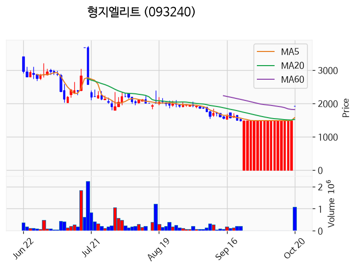

---

### 플리토 (상한가)
— 등락률 +29.99% / 거래량 129만 주

**◎ 관련기사**
- ["美서도 언어 장벽 허물어"…플리토 보글, 'KOOM Week 2026' 다국어 소통 지원](https://news.google.com/rss/articles/CBMihwFBVV95cUxNbVpwNzhhWGdPQl8tUHlEbGNNZTQ5eDlaUThkSkhraVdIOGFBT01XempUME5hMWo3SzZRdXhwN3g3MTZkem9Rb21hUE94cm1GVlhsNmNXOUFqU2ZPOG80YTU2cmQwMlR0NlFucWl2ZmFzMzk3ZEVydnRJbXZyRkRKTkRFTEYwQknSAXtBVV95cUxPMUtPYml0OXY4aHRTZkJjR2pyVGtnUG90aXdVcGRCaDFnRVBpSk1jM09LaHNZUVEtS3QyVHl1Q283WGdQMG1sSFBUYWVXSlA3ekpSV3lyZmZYeTBtSFlEeHNLZjFtVWNGNWpzbndqMTlQbHZWUVU5Mnd2OUU?oc=5) — 디지틀조선일보, 2026-10-20

**◎ 공시**
- [연결재무제표기준영업(잠정)실적(공정공시)              ](https://dart.fss.or.kr/dsaf001/main.do?rcpNo=20261020900285) — 플리토, 20261020

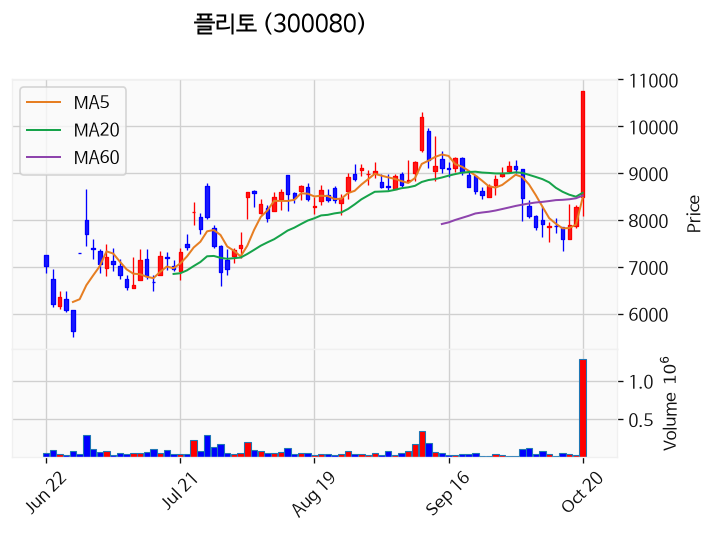

---

### 형지I&C (상한가)
— 등락률 +29.99% / 거래량 576만 주

**◎ 관련기사**
- [형지I&C, 투자경고종목 상태서 매매거래정지 가능성 예고](https://news.google.com/rss/articles/CBMickFVX3lxTE5QcFVJbjBiamtlYjFKelNPeW9mU2EyZlVnRkowZy1ubUhFZGp1T09nTTdON09scEFhMTFqaXBfTGE5OXhSclV1ZjY2c0U2bG5QZ0h3UUFtMmw0RC1SMDEtWXlFMjFvb3I4Q0lqRzRydkNNQQ?oc=5) — 톱스타뉴스, 2026-10-20

**◎ 공시**
- _(공시 없음 / 미조회)_

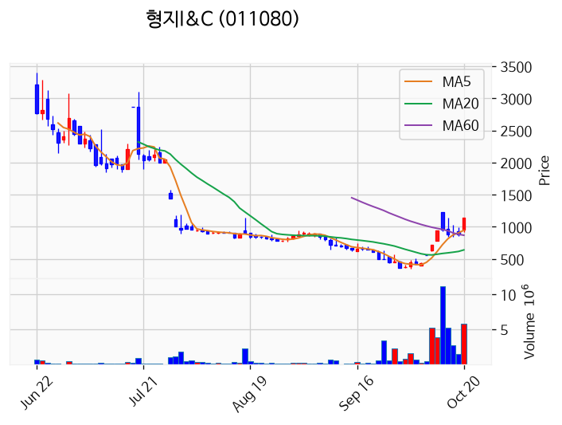

---

### 에스팀 (상한가)
— 등락률 +29.97% / 거래량 100만 주

**◎ 관련기사**
- [[상한가 종목] KR모터스-플리토 이어 에스팀 등 마감](https://news.google.com/rss/articles/CBMibkFVX3lxTE93c3J3TlJvRFJUS2puV2NWZ29aWkVyczVlVkhUaG9yTnhuUTJkaVAtb2lQZmZVT2dudmY4dk95VGVxUE8zUGd6dC1DblVGQjFVRndHOTRwTUU4RGg2RGhYYXlyQWJVTVZyT3E5QW1R?oc=5) — 이코노뉴스, 2026-10-20

**◎ 공시**
- _(공시 없음 / 미조회)_

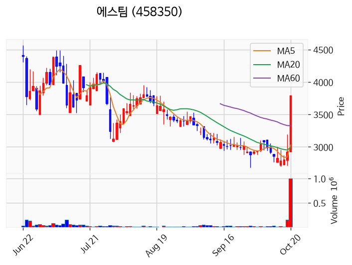

---

### 자이언트스텝 (상한가)
— 등락률 +29.95% / 거래량 98만 주

**◎ 관련기사**
- [한국거래소, 자이언트스텝에 시황변동 관련 조회공시 요구](https://news.google.com/rss/articles/CBMic0FVX3lxTFBCOVJOZEEwWmRGNmh4U1RLckx5YldfVDhBR2Q3YkJDNl9vVExQZVQ0d2lvY2FhU2pueTRHS2pMdGxpa0hJTUtSRTBsNGxkbUlPdVk3c2x2dGF5WGM5eUZ1ejVqUS1Jbzl5cUpXUUEyYWlZYzQ?oc=5) — 데이터투자, 2026-10-20

**◎ 공시**
- [조회공시요구(현저한시황변동)              ](https://dart.fss.or.kr/dsaf001/main.do?rcpNo=20261020900670) — 코스닥시장본부, 20261020
- [독립이사의선임ㆍ해임또는중도퇴임에관한신고](https://dart.fss.or.kr/dsaf001/main.do?rcpNo=20261020000193) — 자이언트스텝, 20261020
- [임시주주총회결과              ](https://dart.fss.or.kr/dsaf001/main.do?rcpNo=20261020900343) — 자이언트스텝, 20261020

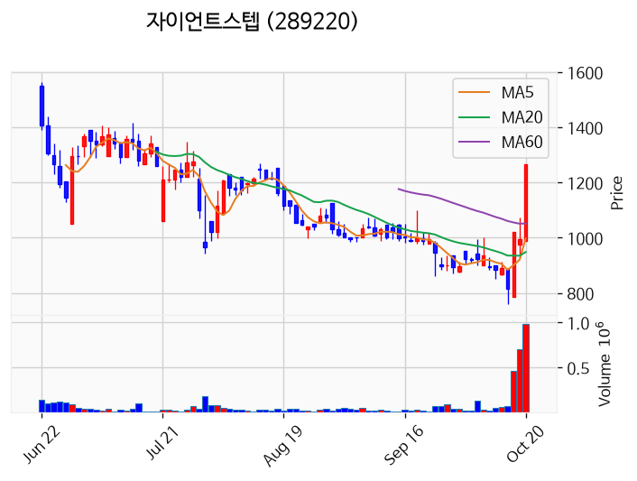

---

### KR모터스 (상한가)
— 등락률 +29.94% / 거래량 100만 주

**◎ 관련기사**
- [[상한가 종목] KR모터스-플리토 이어 에스팀 등 마감](https://news.google.com/rss/articles/CBMibkFVX3lxTE93c3J3TlJvRFJUS2puV2NWZ29aWkVyczVlVkhUaG9yTnhuUTJkaVAtb2lQZmZVT2dudmY4dk95VGVxUE8zUGd6dC1DblVGQjFVRndHOTRwTUU4RGg2RGhYYXlyQWJVTVZyT3E5QW1R?oc=5) — 이코노뉴스, 2026-10-20

**◎ 공시**
- [[기재정정]주주총회소집공고](https://dart.fss.or.kr/dsaf001/main.do?rcpNo=20261020000327) — KR모터스, 20261020

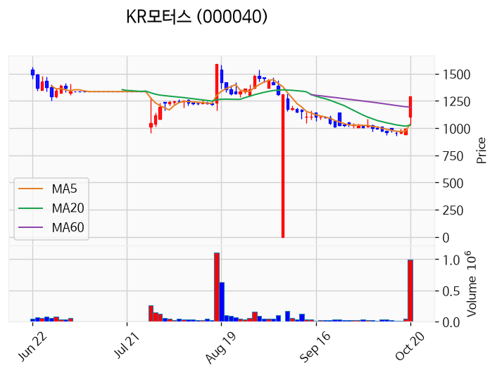

---

### 형지글로벌 (상한가)
— 등락률 +29.83% / 거래량 498만 주

**◎ 관련기사**
- [[상한가 종목] KR모터스-플리토 이어 에스팀 등 마감](https://news.google.com/rss/articles/CBMibkFVX3lxTE93c3J3TlJvRFJUS2puV2NWZ29aWkVyczVlVkhUaG9yTnhuUTJkaVAtb2lQZmZVT2dudmY4dk95VGVxUE8zUGd6dC1DblVGQjFVRndHOTRwTUU4RGg2RGhYYXlyQWJVTVZyT3E5QW1R?oc=5) — 이코노뉴스, 2026-10-20

**◎ 공시**
- _(공시 없음 / 미조회)_

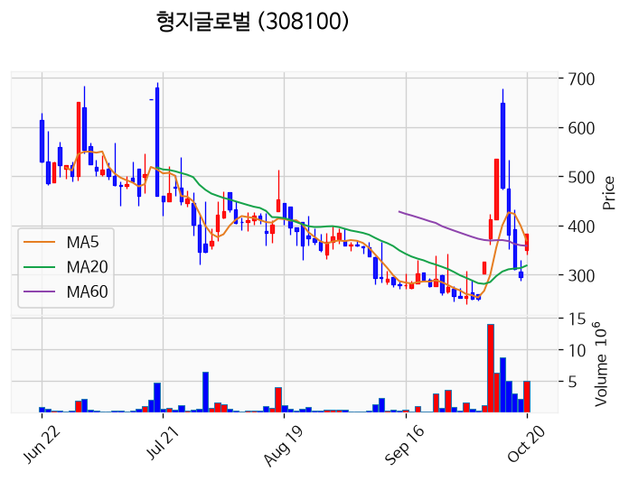

---

### 빅텍 (거래량 급증)
— 등락률 +10.98% / 거래량 2,360만 주

**◎ 관련기사**
- [빅텍 주가, 10월 20일 애프터마켓 3,235원 10.98% 상승](https://news.google.com/rss/articles/CBMickFVX3lxTE8xa2hNeTZfYzU0aXlNa1RneDczQUhSYlRVaE11MTBwLURJdTMtQjVUZVVpSGJPVVVhYzZjMnB6YmwzRVNoM3ktUFFKdlY4d2Y4STFUN3h5b0dSU21jdG1IbGRMZk5OYnVhclJyTEhNaFdDUQ?oc=5) — 톱스타뉴스, 2026-10-20

**◎ 공시**
- _(공시 없음 / 미조회)_

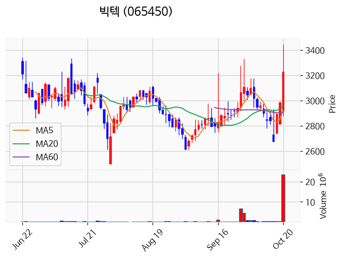

---

### TS트릴리온 (거래량 급증)
— 등락률 +9.19% / 거래량 2,812만 주

**◎ 관련기사**
- [TS트릴리온, 12월 1일 임시주주총회 소집 결의](https://news.google.com/rss/articles/CBMie0FVX3lxTE9KSTVUZmlIdDMyRF9ESUZEQVltTEYwZXVIQVdRR0hZMHBhMFRBLWNPNmJXaFB6MnNEV0VkQ1N3SDlZMWotczJhUUFvUEtOa3pfamRENmttUmJwWXdPZ29UUnVGNmlNdWxoOGxaMEM2bGszQzZwM0tTYUhpbw?oc=5) — 디지털투데이, 2026-10-20

**◎ 공시**
- [주주명부폐쇄기간또는기준일설정              ](https://dart.fss.or.kr/dsaf001/main.do?rcpNo=20261020900595) — TS트릴리온, 20261020
- [주주총회소집결의              (임시주주총회)](https://dart.fss.or.kr/dsaf001/main.do?rcpNo=20261020900597) — TS트릴리온, 20261020

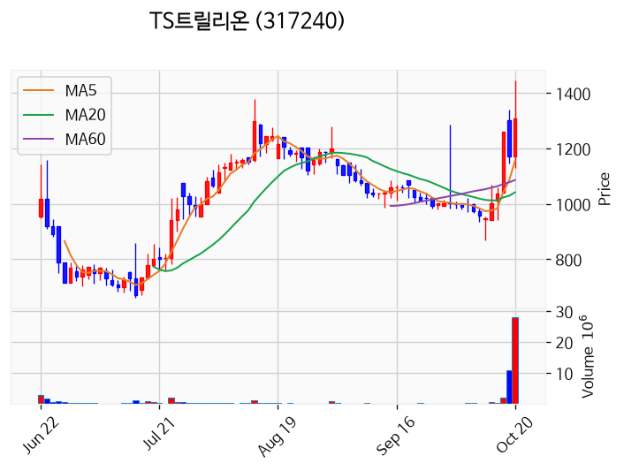

---

### HT로보틱스 (거래량 급증)
— 등락률 +7.13% / 거래량 2,872만 주

**◎ 관련기사**
- [[종목상담 주식민원처리반] 배터리·자동차 부품사업 영위, SM그룹 계열사 '에스엠벡셀' - 머니투데이](https://news.google.com/rss/articles/CBMiaEFVX3lxTE1mbzRucllqTU5QYm9icDUtVldMOV9KMlZxRlhvdTc0emJPSmgwUndvSE85VGVMNTEyc1RLR09qal9JcnNWcDlWNzY1cGhPLXpoMk9iQ0N5amZuYnliTkROYlp2ZDJmRmt40gFuQVVfeXFMTnp6M3JxeEthd1kzazdIVkg5WFpyWHZPQ0FfdGhuMXBjTElFTmZUaU93elRtOUU4UnJmMkFLYWRPY3o0VzdOQjlHa1JQVGdUdUVrN0hJSGd6ekJzaEs4ZjZDWllvVVRtcURFVk1JSWc?oc=5) — 머니투데이, 2026-10-20

**◎ 공시**
- _(공시 없음 / 미조회)_

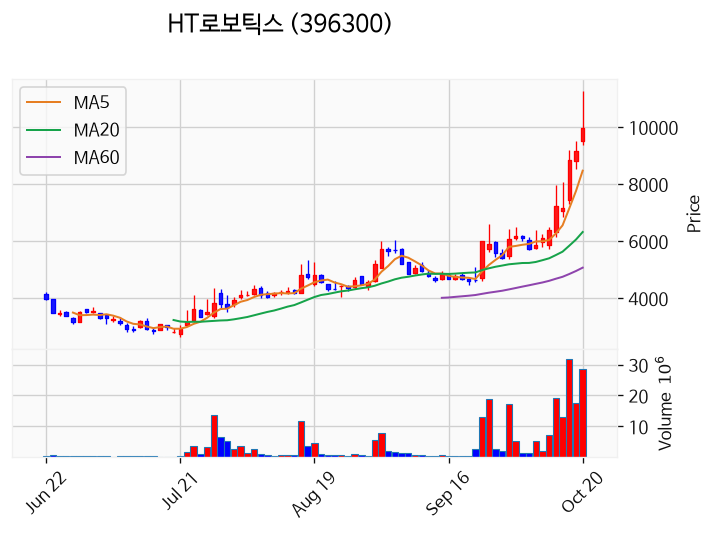

---

### 녹십자엠에스 (거래량 급증)
— 등락률 +6.67% / 거래량 1,375만 주

**◎ 관련기사**
- [[종목상담 주식민원처리반] 배터리·자동차 부품사업 영위, SM그룹 계열사 '에스엠벡셀' - 머니투데이](https://news.google.com/rss/articles/CBMibkFVX3lxTE56ejNycXhLYXdZM2s3SFZIOVhaclh2T0NBX3RobjFwY0xJRU5mVGlPd3pUbTlFOFJyZjJBS2FkT2N6NFc3TkI5R2tSUFRnVHVFazdISUhnenpCc2hLOGY2Q1pZb1VUbXFERVZNSUln0gFuQVVfeXFMTnp6M3JxeEthd1kzazdIVkg5WFpyWHZPQ0FfdGhuMXBjTElFTmZUaU93elRtOUU4UnJmMkFLYWRPY3o0VzdOQjlHa1JQVGdUdUVrN0hJSGd6ekJzaEs4ZjZDWllvVVRtcURFVk1JSWc?oc=5) — 머니투데이, 2026-10-20

**◎ 공시**
- _(공시 없음 / 미조회)_

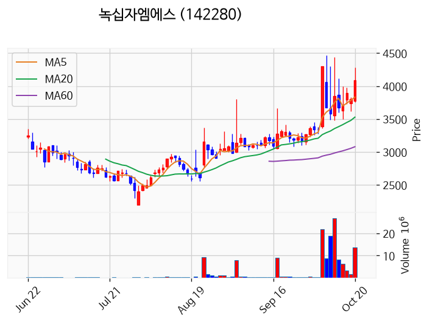

---

### 앤로보틱스 (거래량 급증)
— 등락률 +6.58% / 거래량 2,391만 주

**◎ 관련기사**
- [앤로보틱스 주가, 10월 20일 애프터마켓 1,434원 11.08% 상승](https://news.google.com/rss/articles/CBMickFVX3lxTE1JUXAxYjhOWWVOZ2FqVHZhVFlVWEQxR0s2Yi1TNEdxQkVSZlBqWFczcG1JOXJkTlQycWpZOGd3N0FTSVRFQkg0M0VTWWh5REo3OVZGUXpNbXRDRkpjN19leks5N3VtUUUxbkRzcTNsYmFIZw?oc=5) — 톱스타뉴스, 2026-10-20

**◎ 공시**
- _(공시 없음 / 미조회)_

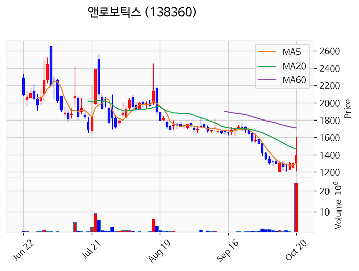

---

### 뉴인텍 (거래량 급증)
— 등락률 +1.14% / 거래량 1,315만 주

**◎ 관련기사**
_(관련기사 없음 / 미조회)_

**◎ 공시**
- _(공시 없음 / 미조회)_

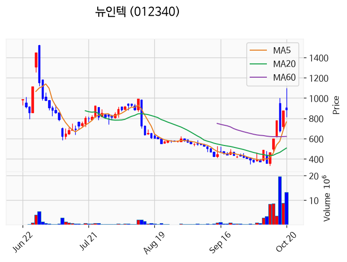

---

### 삼성전자 (거래량 급증)
— 등락률 -2.98% / 거래량 1,656만 주

**◎ 관련기사**
- [삼성전자, 낙폭 키워 3% 하락 마감…SK하이닉스도 4.2%↓(종합)](https://news.google.com/rss/articles/CBMiW0FVX3lxTFBTN3BSRjRaSkU3LXpKWVRKQmN4N0VfS1lvRHZoQU8xN2VtSkI2TXE4QXVxWmZIanltY1o2c2dNaWZ0cEF1c3hFU09kZGFtbXBia21MUzUzS1ZpeVHSAWBBVV95cUxNbnN2ZmpGTndVX0JrWlJhMVduaXA0akdPTFBzakc0TGEteTJOYmxscjFYY1U3YWFkSWtMUWtBWHR0LTBfMG9uWmJ1Nm1YdUdDUWxmWERUWm41eTlZLWxPTjM?oc=5) — 연합뉴스, 2026-10-20

**◎ 공시**
- _(공시 없음 / 미조회)_

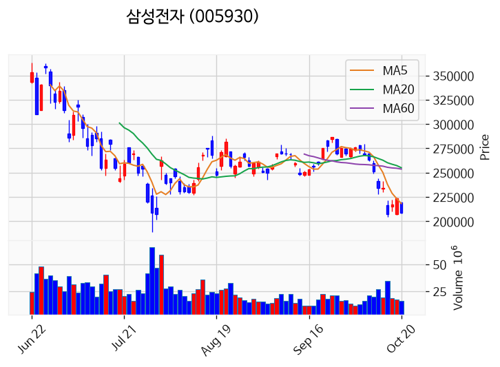

---

### 에스엠벡셀 (거래량 급증)
— 등락률 -4.46% / 거래량 1,073만 주

**◎ 관련기사**
- [[종목상담 주식민원처리반] 배터리·자동차 부품사업 영위, SM그룹 계열사 '에스엠벡셀' - 머니투데이](https://news.google.com/rss/articles/CBMiaEFVX3lxTE1mbzRucllqTU5QYm9icDUtVldMOV9KMlZxRlhvdTc0emJPSmgwUndvSE85VGVMNTEyc1RLR09qal9JcnNWcDlWNzY1cGhPLXpoMk9iQ0N5amZuYnliTkROYlp2ZDJmRmt40gFuQVVfeXFMTnp6M3JxeEthd1kzazdIVkg5WFpyWHZPQ0FfdGhuMXBjTElFTmZUaU93elRtOUU4UnJmMkFLYWRPY3o0VzdOQjlHa1JQVGdUdUVrN0hJSGd6ekJzaEs4ZjZDWllvVVRtcURFVk1JSWc?oc=5) — 머니투데이, 2026-10-20

**◎ 공시**
- _(공시 없음 / 미조회)_

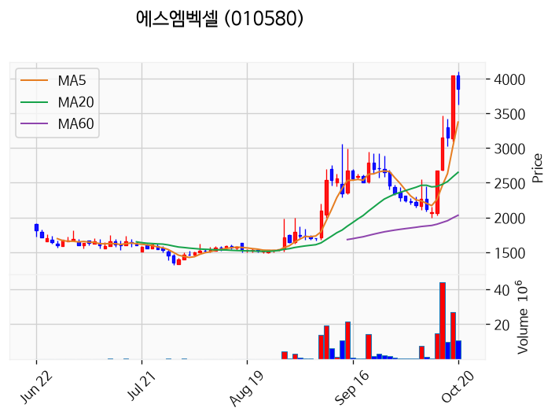

---

### 삼기에너지솔루션즈 (거래량 급증)
— 등락률 -5.75% / 거래량 1,342만 주

**◎ 관련기사**
- [삼기에너지솔루션즈, 87만9886주 전환청구권 행사·발행주식 대비 1.47%](https://news.google.com/rss/articles/CBMic0FVX3lxTE1KLW5vYnltS0IxajhNaFlwakdHOE5fQmRSNjNYWE9qb1BrU1NiQ1VBY1VOcUJCV2V5Qnp4aEtRVjRTUHlXR2txQ3VHeVI0M2tfR0tmMnNwbHhpc0Vyc0pLSXQ3LXhhNi0xQl9ocUxIbHdfMzA?oc=5) — 데이터투자, 2026-10-20

**◎ 공시**
- [전환청구권행사              ](https://dart.fss.or.kr/dsaf001/main.do?rcpNo=20261020900639) — 삼기에너지솔루션즈, 20261020

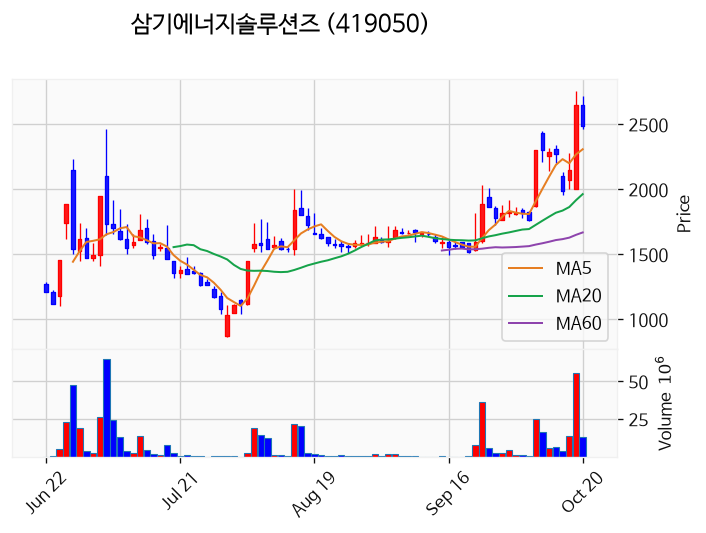

---

### KBI동양철관 (거래량 급증)
— 등락률 -10.01% / 거래량 4,315만 주

**◎ 관련기사**
- ["이대로는 안 된다"…구조관, 가격 인상으로 적자판매 축소 필요](https://news.google.com/rss/articles/CBMiakFVX3lxTFB6RHYxZkpIMDNXMVJLR1BRNTJHeDZWTU4yN3htaGV2U2M5d3FrN0g4cTloMHNHcDk1ZGdKM1hCbE56U2gxOWs0YXZvdDJiczE2YnN6TGwyV0dOXzNZT1VOaWFvQVJnSnRzU3c?oc=5) — 철강금속신문, 2026-10-20

**◎ 공시**
- _(공시 없음 / 미조회)_

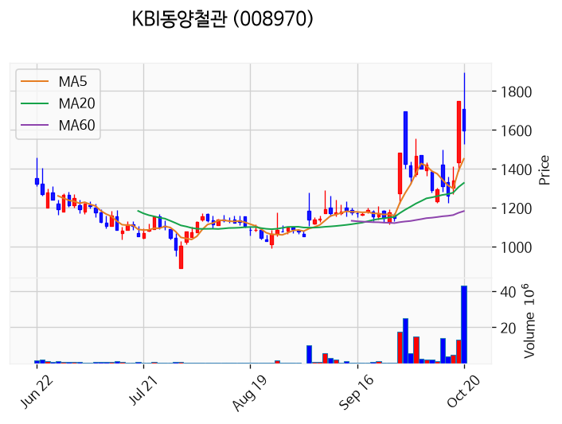

---

### 대양금속 (거래량 급증)
— 등락률 -12.11% / 거래량 1,368만 주

**◎ 관련기사**
_(관련기사 없음 / 미조회)_

**◎ 공시**
- _(공시 없음 / 미조회)_

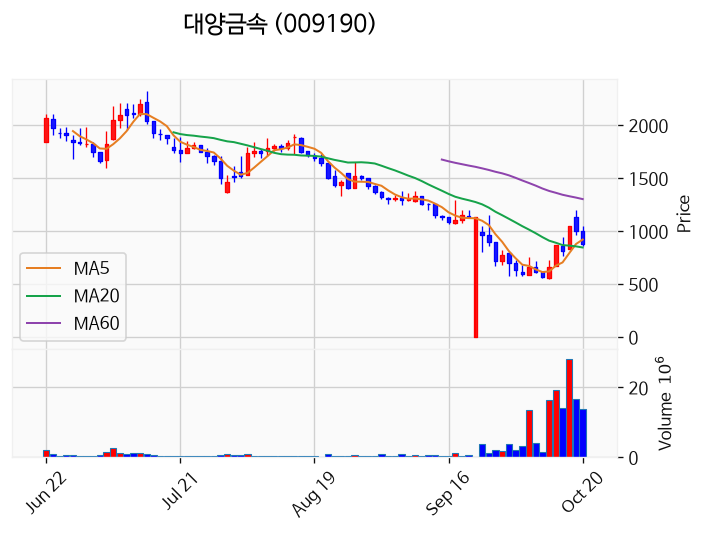

---

### 에이엔피 (거래량 급증)
— 등락률 -15.67% / 거래량 1,180만 주

**◎ 관련기사**
- [에이엔피, 공매도 과열종목 지정기간 1일 연장](https://news.google.com/rss/articles/CBMickFVX3lxTFBGQkEzdDFFYThEV1FnNTZJa2NQMWg2MXdNd2ZhVFNEOHg2Y3R2OHFnQWc0NGtOR2xBWHBTTkw1c19hSkY0bk8zWk5vNXpxbkdfQmhORlQxRjRVenpsczBJb2w1eGRyTnJlWVZkdVlDZTcwdw?oc=5) — 톱스타뉴스, 2026-10-20

**◎ 공시**
- _(공시 없음 / 미조회)_

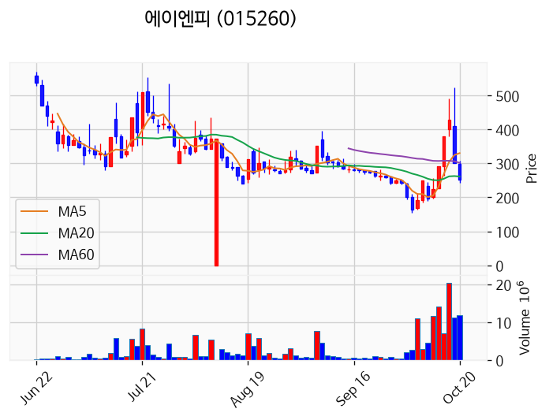

---

## 2. 거래량 폭증 후 급감 패턴 종목
_(폭증 전일 대비 500~1000%, 급감 전일 대비 25% 이하, 급감일 종가가 5일선 대비 -3% 이내)_

_해당 종목 없음_
