# 2026년 10월 21일 시황 노트

## 1. 상한가 / 거래량 1,000만주 이상 종목

### 혜인 (상한가)
— 등락률 +29.98% / 거래량 251만 주

**◎ 관련기사**
- [허지훈 경북도의원, ‘용혜인 의원, 국감 위원 자격 미달’ 규탄 1인 시위 및 긴급 기자회견 개최](https://news.google.com/rss/articles/CBMiXkFVX3lxTE1mX3o4cGxURlhvandjMi05UWctQldOLVBFMEItaTRsNjNQbkkwY0ozLWk4ZXJ1UmFNR09ES05mZEZob1I5Qk5MSHZRVlZNZVBuem9IUlp1NlJ5RmNHWHc?oc=5) — 구미일보, 2026-10-21

**◎ 공시**
- [단일판매ㆍ공급계약체결              ](https://dart.fss.or.kr/dsaf001/main.do?rcpNo=20261021800197) — 혜인, 20261021

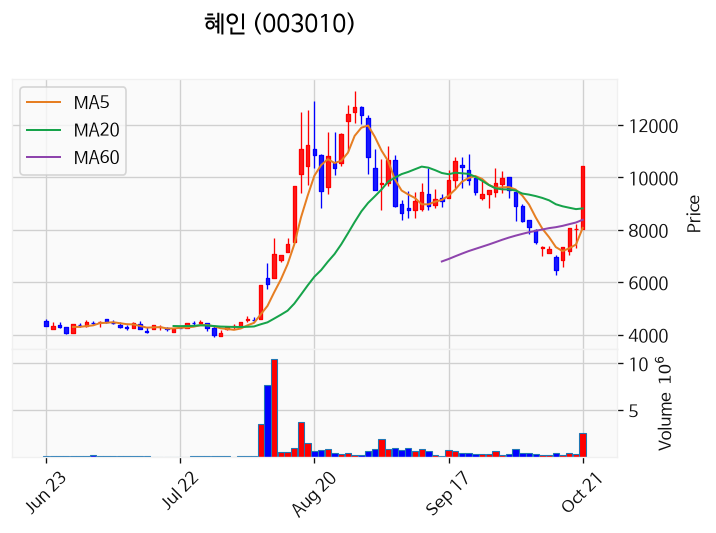

---

### 엘리스 (상한가)
— 등락률 +29.92% / 거래량 160만 주

**◎ 관련기사**
- [코스닥 새내기주 엘리스 월가서도 주목하는 까닭](https://news.google.com/rss/articles/CBMiWkFVX3lxTFAyNjQwTEpfSGJBcGZsWmJxandrMTJrNzdhMVRLM1VPN2liajJZNk04bi0ycmtZVFdRbUhXeE83UkxZMjdWTTVHVTVuVkEwSWttaktxd3p1eWJpQQ?oc=5) — 한국경제, 2026-10-21

**◎ 공시**
- [주식등의대량보유상황보고서(약식)](https://dart.fss.or.kr/dsaf001/main.do?rcpNo=20261021000099) — 한국산업은행, 20261021

---

### 서한 (상한가)
— 등락률 +29.90% / 거래량 248만 주

**◎ 관련기사**
- [비보스 테라퓨틱스, 나스닥 최소 주주지분 요건 충족 확인 서한 수령](https://news.google.com/rss/articles/CBMic0FVX3lxTE1QTDNwZ0dfajh6ZDloZzk1dXlGZnFucWdlRjJ3Q0U2VFlMNWhqY1ltMmdOdC1maC02WDBJTE9jbW1ma2h2ZVJuUUx0cU1yc1Y3MkVlanRhNk8xTUtUaDNFNXBXczQ1R21YMXpPNUU4Qkl1MDQ?oc=5) — 데이터투자, 2026-10-21

**◎ 공시**
- [[기재정정]단일판매ㆍ공급계약체결              ](https://dart.fss.or.kr/dsaf001/main.do?rcpNo=20261021900447) — 서한, 20261021
- [단일판매ㆍ공급계약체결              ](https://dart.fss.or.kr/dsaf001/main.do?rcpNo=20261021900253) — 서한, 20261021

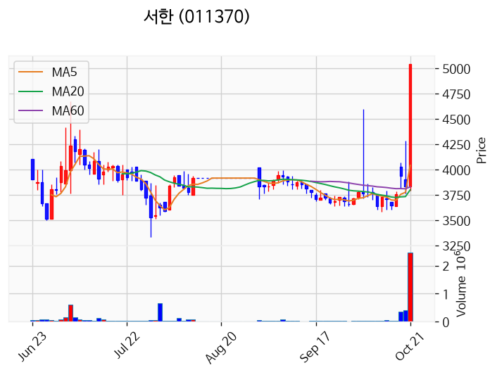

---

### 레몬헬스케어 (상한가)
— 등락률 +29.88% / 거래량 626만 주

**◎ 관련기사**
- ['췌장암 완치' 심영순, 95세 남편 사랑 때문에 "죽기 싫어"('유퀴즈') - 조선비즈](https://news.google.com/rss/articles/CBMikwFBVV95cUxPVmZUOG14a1ppV2lYNzZ2d0ZKeGJFT2lYMWhmWU5vRXJVbDFCZ0ZXazB5UU8yZW1Tc2xEUzBtQUlfaGVpbWFIUVBPYlJNMk05M3lDNGYtV0ZKMzF5RHNnQjc2NE1vTFRUdEJRRHBwV1JKeTdBeUlHMGI1cVBEb2Rudmd3c2NDY1BHS0lnVm80aXVWcjjSAacBQVVfeXFMTk5qNmdzakVBckVwUzVocUtxX1NkSW5WQmhvYmt5NTR5WnJPaEN6TXY2LTNZSW9BR2tiU25TSDZybE95ZkNJSDRsMDRRWnR0UE8tdU9ycnlQMFdIUjJXUTcyeWRJV2xXY3ZDM09nN1poOVJwb0FaQ1MwZEQtUTFBakJRSzRLQWdESldKZEFxUDBjZEJOUUNaTThFeW9TU29xV1VCSm1Eb28?oc=5) — Chosunbiz, 2026-10-21

**◎ 공시**
- _(공시 없음 / 미조회)_

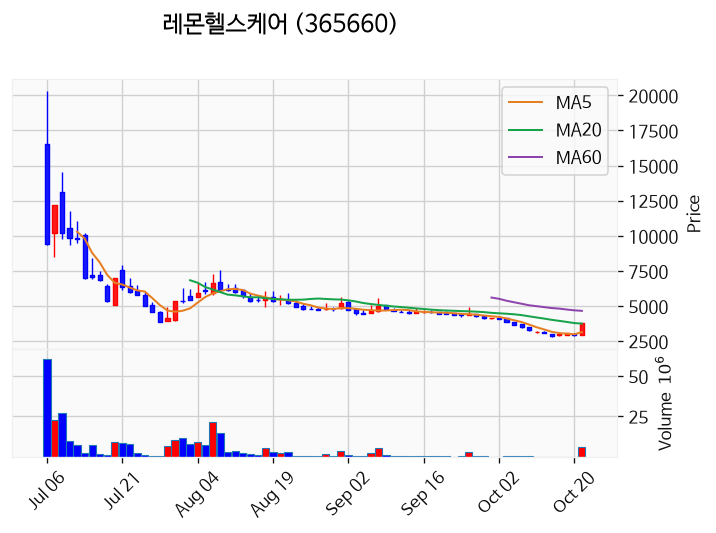

---

### 앤로보틱스 (거래량 급증)
— 등락률 +20.06% / 거래량 3,671만 주

**◎ 관련기사**
_(관련기사 없음 / 미조회)_

**◎ 공시**
- _(공시 없음 / 미조회)_

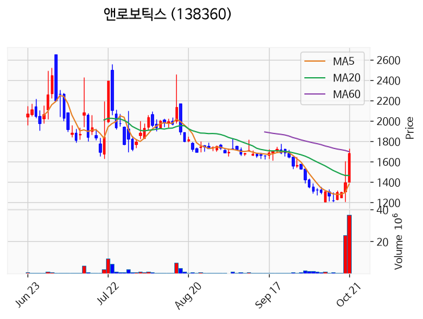

---

### HT로보틱스 (거래량 급증)
— 등락률 +14.02% / 거래량 3,152만 주

**◎ 관련기사**
- [포스코DX·HT로보틱스 손잡은 경북도, 피지컬AI 메가특구 속도](https://news.google.com/rss/articles/CBMiZ0FVX3lxTE43V21GNXFSNkZ2QnRNc2FRTE9SRHNMRTRVblYtRHk5TDVvTE82SHhUVFc5azBhZ0Jna210TzdLcDBBb05GNUd0YUN1YjdIcW9hT1p3U1VPeUJZa2p2NXJLYzRHQ21aT3M?oc=5) — 영남경제, 2026-10-21

**◎ 공시**
- _(공시 없음 / 미조회)_

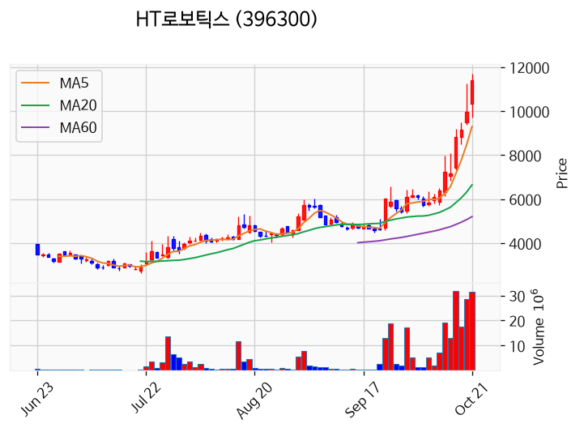

---

### 대한광통신 (거래량 급증)
— 등락률 +12.24% / 거래량 1,255만 주

**◎ 관련기사**
- [코스닥 '활짝'...알테오젠·대한광통신·성호전자·엘리스 '급등'](https://news.google.com/rss/articles/CBMicEFVX3lxTE1aZzd1Vmh0dkc2X01RZlJhRmg5SkF4MUVEYk1nM0NlQXlZbF9NY3cyRGZDak1jeWNFeE5jNnB4ZjBZbnh6cTlWcHEyQkNLMVVrdHFQazI1US10NHhTVWdUalpPQzNZZ1NqTWFkUEExWUjSAXNBVV95cUxOdUpLR3JpRTlUZjNGTnlUTWtLWEZpeVJyMlhQd1BiUWRKdmZTTGhNMFN3cDA0aDJjRDFDQXhyT2ZQalNOWXlfQjI4TDBLYk03ZHJhMElTVHMwdklyOVppLTNkZkV2d0MzaVNlQ2dTZ0lqLVNB?oc=5) — 초이스경제, 2026-10-21

**◎ 공시**
- _(공시 없음 / 미조회)_

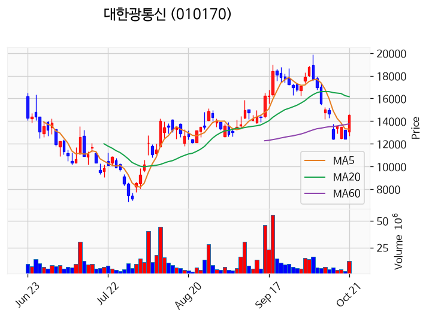

---

### TS트릴리온 (거래량 급증)
— 등락률 +9.52% / 거래량 1,369만 주

**◎ 관련기사**
_(관련기사 없음 / 미조회)_

**◎ 공시**
- _(공시 없음 / 미조회)_

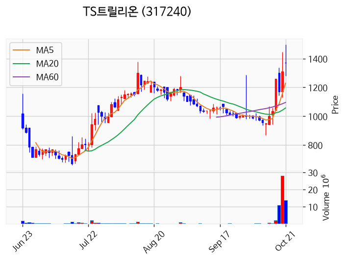

---

### DGI (거래량 급증)
— 등락률 +6.52% / 거래량 1,168만 주

**◎ 관련기사**
_(관련기사 없음 / 미조회)_

**◎ 공시**
- [기타경영사항(자율공시)              (최대주주 보유주식의 자발적 의무보유 시행)](https://dart.fss.or.kr/dsaf001/main.do?rcpNo=20261021900149) — DGI, 20261021

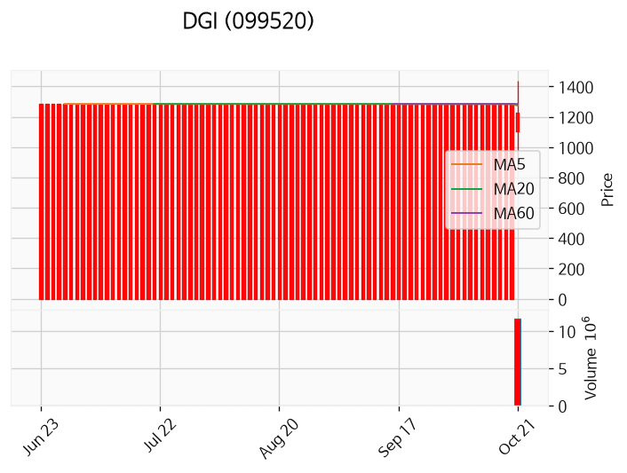

---

### 푸드나무 (거래량 급증)
— 등락률 +5.92% / 거래량 6,698만 주

**◎ 관련기사**
- [푸드나무, 최대주주 변경 수반 지분 매각 제안 검토 중](https://news.google.com/rss/articles/CBMickFVX3lxTE1RTWF4TXFOODY0VXMzdFFEdnp6LS1yRThrZUZRdm5rUWp1OHdEX0lYaXVtY2M1YzBFSUdkb3A0OHNabWJKNkFGc0sxNGV6S19Ob3BEUGNIV1pYSEVxdWt1ZWdGUGNRbmt4SkZEUnFrWEhPdw?oc=5) — 데이터투자, 2026-10-21

**◎ 공시**
- [조회공시요구(현저한시황변동)에대한답변(미확정)              ](https://dart.fss.or.kr/dsaf001/main.do?rcpNo=20261021900648) — 푸드나무, 20261021

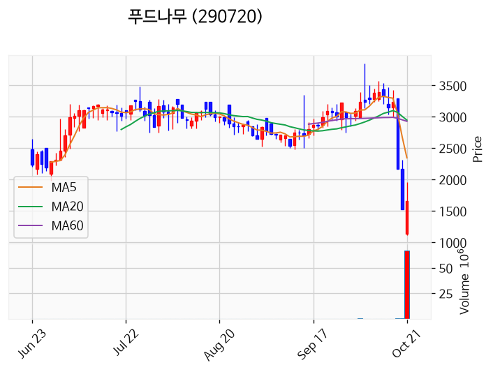

---

### 삼성전자 (거래량 급증)
— 등락률 +5.67% / 거래량 1,727만 주

**◎ 관련기사**
- ["성과급 7.5억 내걸었다"…삼성전자, '코어팀' 본격 가동](https://news.google.com/rss/articles/CBMiWkFVX3lxTE1nRGUwY2tWbjN5em14N2VJUDZYMnZaNnkxd1RoWmtEZXpjS2NCY2EtOXNIaWdkMUhJcC1PVGJfWUNLYkdtdUNIRkNjOUZoZEQ5VFVabDJ6V1Q2dw?oc=5) — 한국경제, 2026-10-21

**◎ 공시**
- _(공시 없음 / 미조회)_

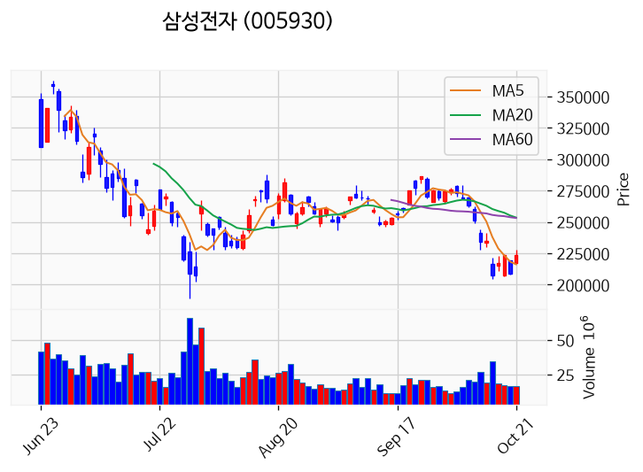

---

### KBI동양철관 (거래량 급증)
— 등락률 -1.46% / 거래량 2,109만 주

**◎ 관련기사**
- [우주사업에 속도 내는 스페이스X···국내 소재·기자재 수주 기회 넓어지나](https://news.google.com/rss/articles/CBMidkFVX3lxTE5GQ2o3RDlZVFotSVZqOXRrLUllR0NRYzcyYjFnMlZtb2pfVl9aMFptdmhPbnFFcG8zTzVVT21VZnJqZ0h3WlRrUG9OZUx6VGdjQ3MxZTlCdG41THpxTnExa1MyaHRKWGwxazFleXN3ajkzalBySnfSAXZBVV95cUxORkNqN0Q5WVRaLUlWajl0ay1JZUdDUWM3MmIxZzJWbW9qX1ZfWjBabXZoT25xRXBvM081VU9tVWZyamdId1pUa1BvTmVMelRnY0NzMWU5QnRuNUx6cU5xMWtTMmh0SlhsMWsxZXlzd2o5M2pQckp3?oc=5) — 시사저널e, 2026-10-21

**◎ 공시**
- _(공시 없음 / 미조회)_

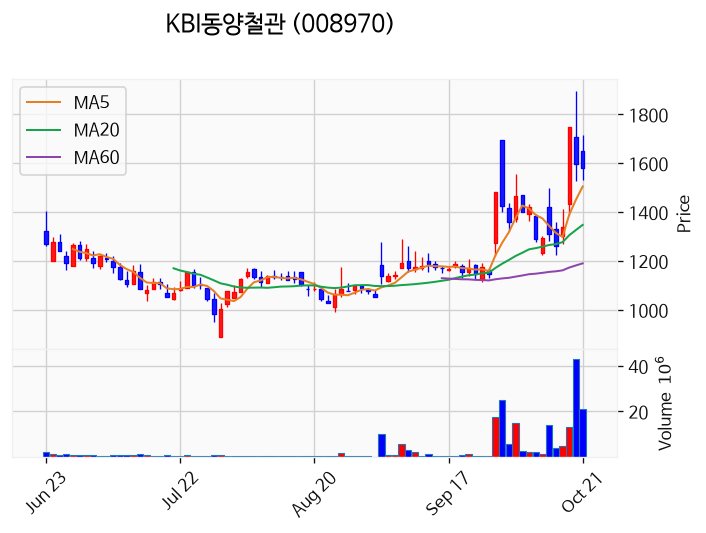

---

### 형지글로벌 (거래량 급증)
— 등락률 -6.53% / 거래량 2,652만 주

**◎ 관련기사**
_(관련기사 없음 / 미조회)_

**◎ 공시**
- _(공시 없음 / 미조회)_

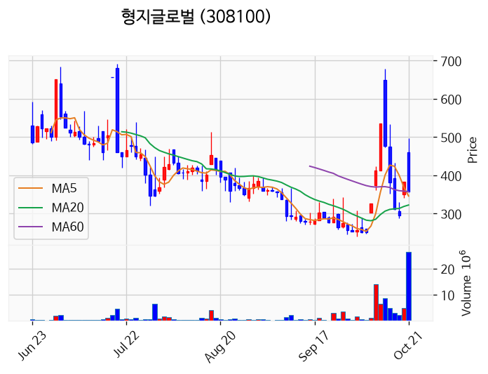

---

### 형지I&C (거래량 급증)
— 등락률 -7.02% / 거래량 1,080만 주

**◎ 관련기사**
- [트와이스 지효, JYP 떠난다… 1인 기획사 설립](https://news.google.com/rss/articles/CBMiqwFBVV95cUxPaktHRVRYNlNMODBycUE2Z1YxLXJWTjVVZlR5emZHa29JWWlwT0xSbnRPVWxINHJOM0JqY0EtbVBYQ0d0M0N5dWprdFJsaFlYNVRxalBOTGtKR2wtdjZlVGg2MFJVMTFBdHM4bUxmS1lkOW5QU2JaNjhhVlZnYnBLNnJrVU9icEdmY3N0d3BNV3kxbkFtVldsY3o1UjZQdnBIVGxhdnVHbTlLakk?oc=5) — Chosunbiz, 2026-10-21

**◎ 공시**
- _(공시 없음 / 미조회)_

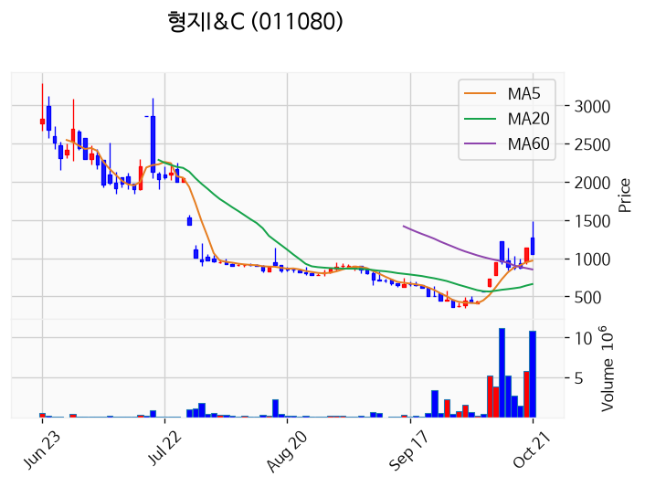

---

### 바른손이앤에이 (거래량 급증)
— 등락률 -18.35% / 거래량 1,060만 주

**◎ 관련기사**
- ['수능 출제의 비밀' 이선빈→유재명, 관객들 만난다…개봉 2주차까지 무대인사 확정](https://news.google.com/rss/articles/CBMickFVX3lxTE9zdFBWekhxRUROeG1rTE1lWk4xUUprVUZuTmliSFVUNjFTWDhvZlRCMzh3bGxzaW43Q0s0NlRlS0lPMHMyejlRQjdfeXFsa1hNdURuRTh6THNsVVZGbmhVNGNzTGJlMWRaVG05X21yVTdzUQ?oc=5) — TopStarNews, 2026-10-21

**◎ 공시**
- [[기재정정]주식등의대량보유상황보고서(일반)](https://dart.fss.or.kr/dsaf001/main.do?rcpNo=20261021000436) — 문양권, 20261021
- [[기재정정]주식등의대량보유상황보고서(일반)](https://dart.fss.or.kr/dsaf001/main.do?rcpNo=20261021000434) — 문양권, 20261021
- [주식등의대량보유상황보고서(일반)](https://dart.fss.or.kr/dsaf001/main.do?rcpNo=20261021000031) — 문양권, 20261021

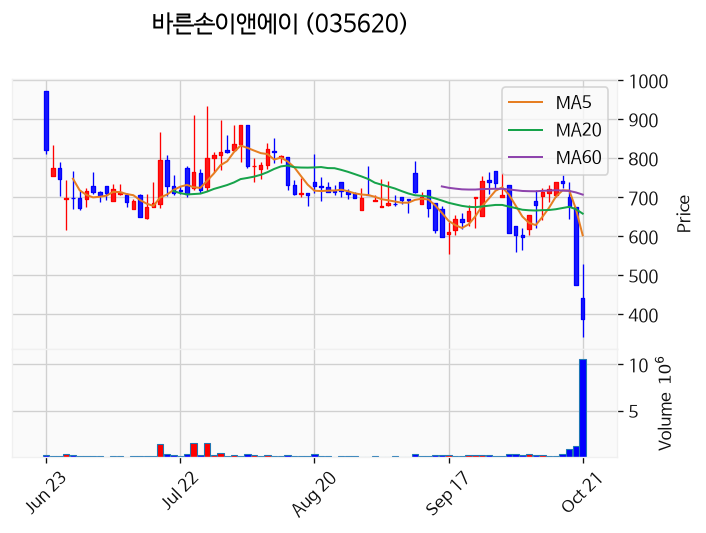

---

## 2. 거래량 폭증 후 급감 패턴 종목
_(폭증 전일 대비 500~1000%, 급감 전일 대비 25% 이하, 급감일 종가가 5일선 대비 -3% 이내)_

### 영화금속
- 폭증일: 2026-10-20, 거래량 6만 주 (전일 대비 863%)
- 급감일: 2026-10-21, 거래량 0만 주 (전일 대비 5%)
- 급감일 종가 4,000원 / 5일선 2,402원 (이격률 +66.53%)

### 웰크론
- 폭증일: 2026-10-20, 거래량 10만 주 (전일 대비 522%)
- 급감일: 2026-10-21, 거래량 2만 주 (전일 대비 23%)
- 급감일 종가 1,139원 / 5일선 678원 (이격률 +67.90%)

### 푸른로보틱스
- 폭증일: 2026-10-20, 거래량 15만 주 (전일 대비 505%)
- 급감일: 2026-10-21, 거래량 3만 주 (전일 대비 23%)
- 급감일 종가 5,420원 / 5일선 3,268원 (이격률 +65.85%)

### 녹십자엠에스
- 폭증일: 2026-10-20, 거래량 1,375만 주 (전일 대비 907%)
- 급감일: 2026-10-21, 거래량 342만 주 (전일 대비 25%)
- 급감일 종가 4,050원 / 5일선 2,360원 (이격률 +71.61%)

### 피엠티
- 폭증일: 2026-10-20, 거래량 51만 주 (전일 대비 675%)
- 급감일: 2026-10-21, 거래량 11만 주 (전일 대비 21%)
- 급감일 종가 3,610원 / 5일선 2,152원 (이격률 +67.75%)

### 라이온켐텍
- 폭증일: 2026-10-20, 거래량 9만 주 (전일 대비 544%)
- 급감일: 2026-10-21, 거래량 1만 주 (전일 대비 15%)
- 급감일 종가 2,000원 / 5일선 1,202원 (이격률 +66.36%)

### 링크제니시스
- 폭증일: 2026-10-20, 거래량 13만 주 (전일 대비 651%)
- 급감일: 2026-10-21, 거래량 2만 주 (전일 대비 14%)
- 급감일 종가 3,035원 / 5일선 1,808원 (이격률 +67.87%)

### 엔비티
- 폭증일: 2026-10-20, 거래량 4만 주 (전일 대비 731%)
- 급감일: 2026-10-21, 거래량 0만 주 (전일 대비 13%)
- 급감일 종가 1,492원 / 5일선 906원 (이격률 +64.75%)

### 씨유테크
- 폭증일: 2026-10-20, 거래량 1만 주 (전일 대비 503%)
- 급감일: 2026-10-21, 거래량 0만 주 (전일 대비 22%)
- 급감일 종가 2,675원 / 5일선 1,617원 (이격률 +65.43%)

### 이베스트스팩6호
- 폭증일: 2026-10-20, 거래량 1만 주 (전일 대비 566%)
- 급감일: 2026-10-21, 거래량 0만 주 (전일 대비 1%)
- 급감일 종가 2,060원 / 5일선 1,236원 (이격률 +66.67%)

### 엔에이치스팩31호
- 폭증일: 2026-10-20, 거래량 0만 주 (전일 대비 818%)
- 급감일: 2026-10-21, 거래량 0만 주 (전일 대비 3%)
- 급감일 종가 2,075원 / 5일선 1,245원 (이격률 +66.67%)
