# 2026년 10월 22일 시황 노트

## 1. 상한가 / 거래량 1,000만주 이상 종목

### 엠에스바이오 (상한가)
— 등락률 +70.77% / 거래량 6,777만 주

**◎ 관련기사**
- ["장중 따블 찍었다"…엠에스바이오, 코스닥 상장 첫날 71% 급등](https://news.google.com/rss/articles/CBMieEFVX3lxTE9uOXRTTjhhTUFWYk9Jc3ZNRml1Q2JFTmVLeEYxWXdJNFFKLXFuQ2tSX3I3eDRkcGdzWWVOM3o2QnRPVHcweDNWSkRTQk1wNDcwNEhjb295eEs2VEh1d2pGZ2M5ODBrbHVSRUozU00wNDN3QWRkRmZLYdIBeEFVX3lxTE9uOXRTTjhhTUFWYk9Jc3ZNRml1Q2JFTmVLeEYxWXdJNFFKLXFuQ2tSX3I3eDRkcGdzWWVOM3o2QnRPVHcweDNWSkRTQk1wNDcwNEhjb295eEs2VEh1d2pGZ2M5ODBrbHVSRUozU00wNDN3QWRkRmZLYQ?oc=5) — 뉴시스, 2026-10-22

**◎ 공시**
- _(공시 없음 / 미조회)_

---

### 윙스풋 (상한가)
— 등락률 +30.00% / 거래량 4만 주

**◎ 관련기사**
- [[IB토마토]윙스풋, 유통 넘어 스포츠 콘텐츠로 고객 접점 확대](https://news.google.com/rss/articles/CBMiYEFVX3lxTE9KN1RCNTR6bTlES21UQUxLU0FPLTJsTGNUX0ltWVVrblBiblNvektfWWpTX1Q4TVBwckIxQWU2dXhJT1E3MU9NNnREb0JuNFhGWFlJTXhVTnVPTFpTUmVlaQ?oc=5) — 뉴스토마토, 2026-10-22

**◎ 공시**
- [[기재정정]주요사항보고서(전환사채권발행결정)](https://dart.fss.or.kr/dsaf001/main.do?rcpNo=20261022000396) — 윙스풋, 20261022

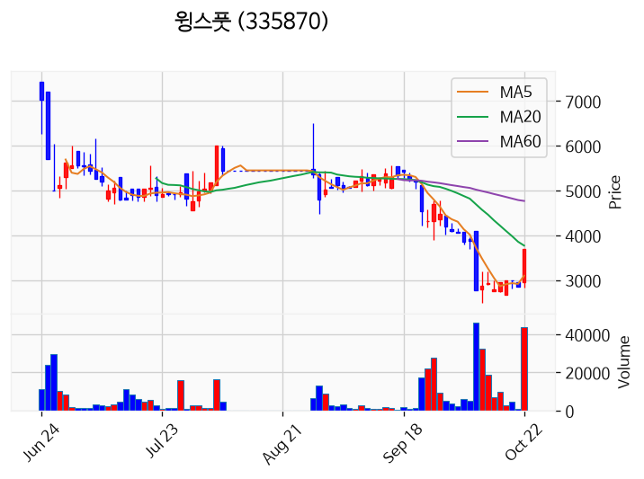

---

### SKAI (상한가)
— 등락률 +29.99% / 거래량 1,616만 주

**◎ 관련기사**
- [[상한가 종목] 윙스풋 이어 SKAI 등 마감](https://news.google.com/rss/articles/CBMibkFVX3lxTE55bDdnWEtzTElVdUh0bEtXXzR3Y0E5b2xWRllmbEJoeW1aSUlpWGJMYkpDSVJDa0VRZTR0TV83ckMwTjFtY3VoaEcxTHZnZTRXQUp6NFphR2Zqdkt6dFNLWXN3LU9meVZ0WVAxNFNR?oc=5) — 이코노뉴스, 2026-10-22

**◎ 공시**
- _(공시 없음 / 미조회)_

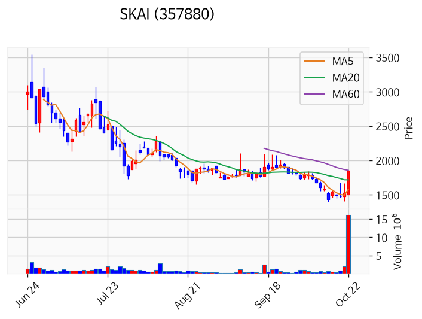

---

### 에이전트AI (상한가)
— 등락률 +29.93% / 거래량 45만 주

**◎ 관련기사**
- [[급등락주 짚어보기] AI 기대에 SKAI·에이전트AI ‘上’…뉴인텍은 하한가](https://news.google.com/rss/articles/CBMibEFVX3lxTE8xVXVabGR1blgtTXF5Sjd5MWd2dFNnQUlHY0gwYU1JRXM5bDRKNGl3Nmk4YnAwQVprWHRhRXlkTDdPTjluclNvdnNwV29iZ3doMzREeHRla3hHeWZCbm14RWpKNjZKeUdNNGJ2QQ?oc=5) — 이투데이, 2026-10-22

**◎ 공시**
- _(공시 없음 / 미조회)_

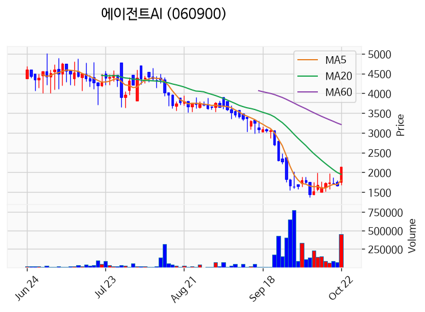

---

### 빅텍 (거래량 급증)
— 등락률 +21.36% / 거래량 3,230만 주

**◎ 관련기사**
- [[종목상담 주식민원처리반] 방산주, 작은 종목 위주로 강한 거래대금 유입 '빅텍' - 머니투데이](https://news.google.com/rss/articles/CBMibkFVX3lxTE5EbmFHc3pvSmwyX2ZqNnd3S2ZQWE1vMU9QLW1EcWlCWkh2ZHNIUjVMcmYzNklZT1h2bmdPZHZ1eGxzeGRfQlVBWkpqQzM3ekRGVzJTMHdzVUVCbVF1QjlwMGY0NnFmNVVmSmkyRDBR0gFuQVVfeXFMTkRuYUdzem9KbDJfZmo2d3dLZlBYTW8xT1AtbURxaUJaSHZkc0hSNUxyZjM2SVlPWHZuZ09kdnV4bHN4ZF9CVUFaSmpDMzd6REZXMlMwd3NVRUJtUXVCOXAwZjQ2cWY1VWZKaTJEMFE?oc=5) — 머니투데이, 2026-10-22

**◎ 공시**
- _(공시 없음 / 미조회)_

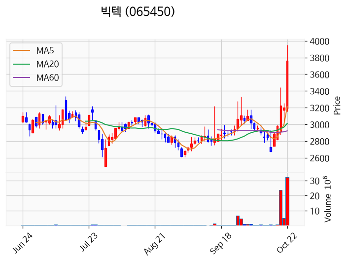

---

### 삼성E&A (거래량 급증)
— 등락률 +16.14% / 거래량 1,234만 주

**◎ 관련기사**
- [삼성E&A, 수주·영업익 모두 연간 목표 초과 달성](https://news.google.com/rss/articles/CBMiWkFVX3lxTE8tZW9WV2o1WXNSVjRPbHZkUFIxaXdvcktEZHVqOGdHQkNaWTYyY2Nxemc2UDFxWkpnc01MTG9kMVlXSDQxcGVFY3FCcDRiNzY2MkxQUnhIdlZBQQ?oc=5) — 한국경제, 2026-10-22

**◎ 공시**
- [동일인등출자계열회사와의상품ㆍ용역거래](https://dart.fss.or.kr/dsaf001/main.do?rcpNo=20261022000010) — 삼성E&A, 20261022
- [[기재정정]연결재무제표기준영업실적등에대한전망(공정공시)              ](https://dart.fss.or.kr/dsaf001/main.do?rcpNo=20261022800052) — 삼성E&A, 20261022
- [연결재무제표기준영업(잠정)실적(공정공시)              ](https://dart.fss.or.kr/dsaf001/main.do?rcpNo=20261022800044) — 삼성E&A, 20261022
- [주식소각결정              ](https://dart.fss.or.kr/dsaf001/main.do?rcpNo=20261022800038) — 삼성E&A, 20261022
- [주요사항보고서(자기주식취득결정)](https://dart.fss.or.kr/dsaf001/main.do?rcpNo=20261022000004) — 삼성E&A, 20261022

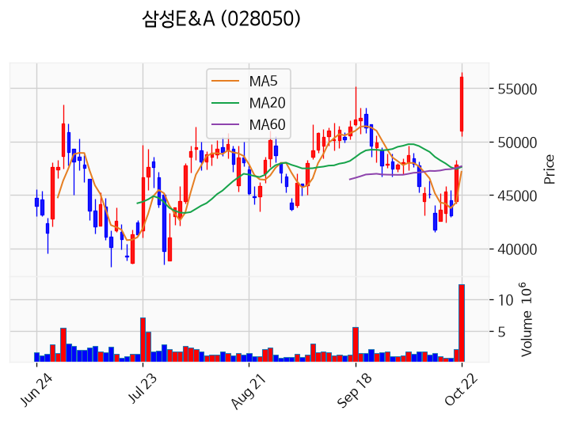

---

### 토마토시스템 (거래량 급증)
— 등락률 +12.41% / 거래량 1,011만 주

**◎ 관련기사**
- [[ET포토] 아이유, '평온한 미소'](https://news.google.com/rss/articles/CBMiTkFVX3lxTFBUbE5Pd1lLYnlpTEw1Y2FiaU1LSWRJNEphTEhNM3VraWpRVXJtVUE1dS1lNnhEWXNLdXFvcVZJN21BLTV3ME1hcHRVT0RyUQ?oc=5) — 전자신문, 2026-10-22

**◎ 공시**
- _(공시 없음 / 미조회)_

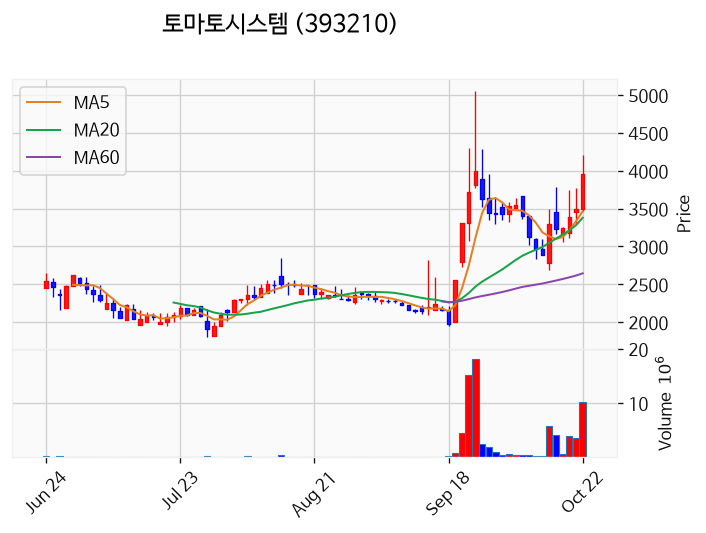

---

### 푸드나무 (거래량 급증)
— 등락률 +2.98% / 거래량 1,448만 주

**◎ 관련기사**
_(관련기사 없음 / 미조회)_

**◎ 공시**
- _(공시 없음 / 미조회)_

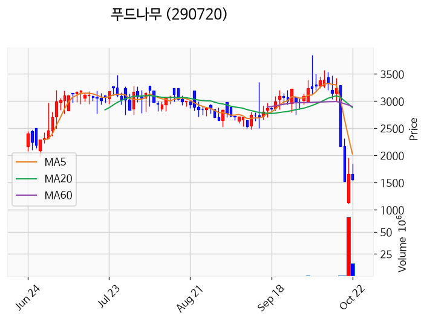

---

### 앤로보틱스 (거래량 급증)
— 등락률 -1.03% / 거래량 1,854만 주

**◎ 관련기사**
_(관련기사 없음 / 미조회)_

**◎ 공시**
- _(공시 없음 / 미조회)_

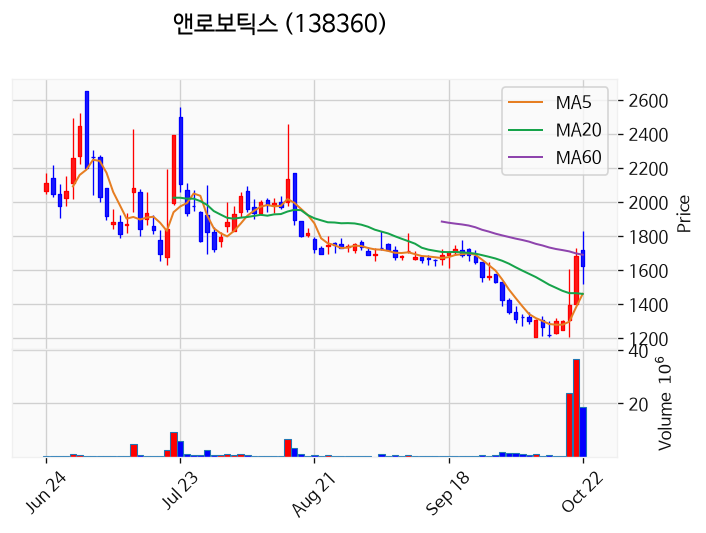

---

### 삼성전자 (거래량 급증)
— 등락률 -4.03% / 거래량 1,147만 주

**◎ 관련기사**
- [[비즈&] 삼성전자, 24일부터 JBL 80주년 기념 전시 外](https://news.google.com/rss/articles/CBMiZ0FVX3lxTE41cUJ0Y2d5WmFfUWhwREdYdGkwcG0tN1pDUDF1b3RLcmxmQXNiQlV1YTdmNGNhaHM4MmpoQ3I3SWg1OG5xdzN1c0NuQUxVNmRqd1BWNEd1MmhuUHBYX2RobHNEcG1ialk?oc=5) — 연합뉴스TV, 2026-10-22

**◎ 공시**
- _(공시 없음 / 미조회)_

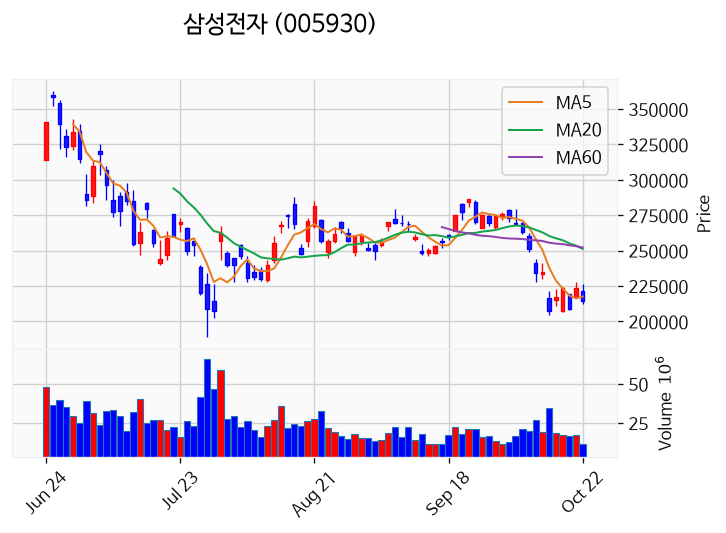

---

### 빛과전자 (거래량 급증)
— 등락률 -5.97% / 거래량 1,112만 주

**◎ 관련기사**
- [코스닥 '패닉'...주성엔지니어링·에코프로·대한광통신 '급락'](https://news.google.com/rss/articles/CBMic0FVX3lxTFB2cmhfaFJGcWdaWWp2OEl2MngzbjV4bUF2TXZWMzN2a0VFbFBVSlpEVUFiODRtVTVVSDJSQ3NnSkdxLVJvTmQ3emVMQ1A1V0k4aWd3YURQWmFQakVyUU9NZU5wUGQ2QU9OdTU2eE1VNTdfeG_SAXNBVV95cUxQdnJoX2hSRnFnWllqdjhJdjJ4M241eG1Bdk12VjMzdmtFRWxQVUpaRFVBYjg0bVU1VUgyUkNzZ0pHcS1Sb05kN3plTENQNVdJOGlnd2FEUFphUGpFclFPTWVOcFBkNkFPTnU1NnhNVTU3X3hv?oc=5) — 초이스경제, 2026-10-22

**◎ 공시**
- _(공시 없음 / 미조회)_

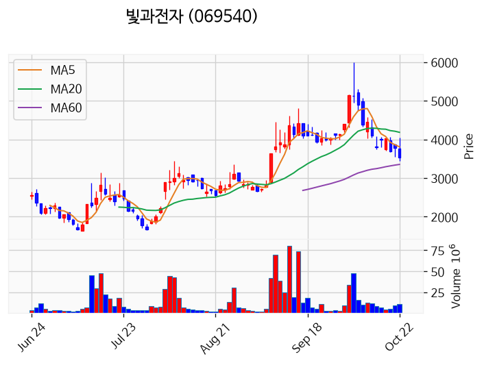

---

### 형지글로벌 (거래량 급증)
— 등락률 -15.92% / 거래량 1,213만 주

**◎ 관련기사**
- [1000원 못 넘긴 대가…뉴인텍·형지글로벌 등 5곳 ‘동전주 첫 상폐’](https://news.google.com/rss/articles/CBMiVkFVX3lxTFBzX2VXYjJOT1VRUkxlaExxRkJ1OTVJVTIzRDVLNVA3WDljYTBtY1Z2Y09CN21HOWU0Zm1sdVRILU9udUx3MDdSb3RiQ0dteTRBZnhIRkd3?oc=5) — 중앙일보, 2026-10-22

**◎ 공시**
- [주권매매거래정지              ](https://dart.fss.or.kr/dsaf001/main.do?rcpNo=20261022900753) — 코스닥시장본부, 20261022

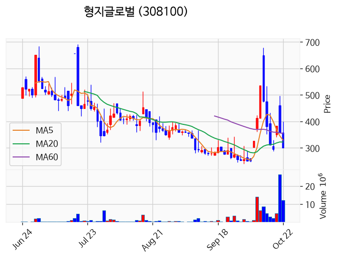

---

## 2. 거래량 폭증 후 급감 패턴 종목
_(폭증 전일 대비 500~1000%, 급감 전일 대비 25% 이하, 급감일 종가가 5일선 대비 -3% 이내)_

### KB제32호스팩
- 폭증일: 2026-10-20, 거래량 1만 주 (전일 대비 532%)
- 급감일: 2026-10-22, 거래량 0만 주 (전일 대비 7%)
- 급감일 종가 2,000원 / 5일선 1,599원 (이격률 +25.09%)

### 삼익제약
- 폭증일: 2026-10-20, 거래량 847만 주 (전일 대비 884%)
- 급감일: 2026-10-22, 거래량 113만 주 (전일 대비 21%)
- 급감일 종가 7,530원 / 5일선 6,394원 (이격률 +17.77%)

### 바른손이앤에이
- 폭증일: 2026-10-21, 거래량 1,060만 주 (전일 대비 864%)
- 급감일: 2026-10-22, 거래량 245만 주 (전일 대비 23%)
- 급감일 종가 418원 / 5일선 391원 (이격률 +6.85%)

### 코스리거글로벌
- 폭증일: 2026-10-21, 거래량 1만 주 (전일 대비 518%)
- 급감일: 2026-10-22, 거래량 0만 주 (전일 대비 22%)
- 급감일 종가 3,000원 / 5일선 2,346원 (이격률 +27.88%)

### 수산아이앤티
- 폭증일: 2026-10-20, 거래량 0만 주 (전일 대비 587%)
- 급감일: 2026-10-22, 거래량 0만 주 (전일 대비 11%)
- 급감일 종가 8,070원 / 5일선 6,538원 (이격률 +23.43%)

### 피씨디렉트
- 폭증일: 2026-10-21, 거래량 5만 주 (전일 대비 613%)
- 급감일: 2026-10-22, 거래량 1만 주 (전일 대비 18%)
- 급감일 종가 1,408원 / 5일선 1,133원 (이격률 +24.27%)

### 오성첨단소재
- 폭증일: 2026-10-20, 거래량 29만 주 (전일 대비 538%)
- 급감일: 2026-10-22, 거래량 3만 주 (전일 대비 19%)
- 급감일 종가 8,250원 / 5일선 6,496원 (이격률 +27.00%)

### 케이엠
- 폭증일: 2026-10-21, 거래량 2만 주 (전일 대비 605%)
- 급감일: 2026-10-22, 거래량 0만 주 (전일 대비 19%)
- 급감일 종가 3,275원 / 5일선 2,589원 (이격률 +26.50%)

### 아시아종묘
- 폭증일: 2026-10-21, 거래량 3만 주 (전일 대비 702%)
- 급감일: 2026-10-22, 거래량 1만 주 (전일 대비 25%)
- 급감일 종가 1,500원 / 5일선 1,205원 (이격률 +24.48%)

### 바이오프로테크
- 폭증일: 2026-10-20, 거래량 0만 주 (전일 대비 600%)
- 급감일: 2026-10-22, 거래량 0만 주 (전일 대비 0%)
- 급감일 종가 389원 / 5일선 317원 (이격률 +22.64%)

### 메디쎄이
- 폭증일: 2026-10-21, 거래량 0만 주 (전일 대비 963%)
- 급감일: 2026-10-22, 거래량 0만 주 (전일 대비 0%)
- 급감일 종가 12,000원 / 5일선 9,580원 (이격률 +25.26%)

### 틸론
- 폭증일: 2026-10-21, 거래량 3만 주 (전일 대비 663%)
- 급감일: 2026-10-22, 거래량 0만 주 (전일 대비 14%)
- 급감일 종가 940원 / 5일선 762원 (이격률 +23.36%)

### 질경이
- 폭증일: 2026-10-21, 거래량 1만 주 (전일 대비 865%)
- 급감일: 2026-10-22, 거래량 0만 주 (전일 대비 0%)
- 급감일 종가 640원 / 5일선 508원 (이격률 +25.93%)

### 화승엔터프라이즈
- 폭증일: 2026-10-21, 거래량 11만 주 (전일 대비 585%)
- 급감일: 2026-10-22, 거래량 2만 주 (전일 대비 16%)
- 급감일 종가 2,670원 / 5일선 2,183원 (이격률 +22.31%)

### 영화테크
- 폭증일: 2026-10-21, 거래량 8만 주 (전일 대비 604%)
- 급감일: 2026-10-22, 거래량 1만 주 (전일 대비 12%)
- 급감일 종가 5,660원 / 5일선 4,596원 (이격률 +23.15%)

### 경동도시가스
- 폭증일: 2026-10-21, 거래량 2만 주 (전일 대비 550%)
- 급감일: 2026-10-22, 거래량 0만 주 (전일 대비 17%)
- 급감일 종가 20,950원 / 5일선 16,810원 (이격률 +24.63%)

### 에스알바이오텍
- 폭증일: 2026-10-21, 거래량 0만 주 (전일 대비 660%)
- 급감일: 2026-10-22, 거래량 0만 주 (전일 대비 22%)
- 급감일 종가 9,920원 / 5일선 8,124원 (이격률 +22.11%)

### EMB
- 폭증일: 2026-10-21, 거래량 0만 주 (전일 대비 667%)
- 급감일: 2026-10-22, 거래량 0만 주 (전일 대비 5%)
- 급감일 종가 3,190원 / 5일선 2,434원 (이격률 +31.06%)

### 유엑스엔
- 폭증일: 2026-10-21, 거래량 0만 주 (전일 대비 840%)
- 급감일: 2026-10-22, 거래량 0만 주 (전일 대비 23%)
- 급감일 종가 6,110원 / 5일선 4,976원 (이격률 +22.79%)

### 아이엠지티
- 폭증일: 2026-10-21, 거래량 0만 주 (전일 대비 807%)
- 급감일: 2026-10-22, 거래량 0만 주 (전일 대비 6%)
- 급감일 종가 11,800원 / 5일선 9,424원 (이격률 +25.21%)

### 에스팀
- 폭증일: 2026-10-20, 거래량 100만 주 (전일 대비 667%)
- 급감일: 2026-10-22, 거래량 106만 주 (전일 대비 13%)
- 급감일 종가 4,190원 / 5일선 3,033원 (이격률 +38.15%)

### 신한제14호스팩
- 폭증일: 2026-10-21, 거래량 1만 주 (전일 대비 615%)
- 급감일: 2026-10-22, 거래량 0만 주 (전일 대비 20%)
- 급감일 종가 2,040원 / 5일선 1,628원 (이격률 +25.31%)
