# 2026년 10월 23일 시황 노트

## 1. 상한가 / 거래량 1,000만주 이상 종목

### 소프트센우 (상한가)
— 등락률 +45.25% / 거래량 10만 주

**◎ 관련기사**
- [오프더메뉴, 서강준X안은진 ‘너다연’ OST 합류..25일 ‘Easy’ 발매 - 조선비즈](https://news.google.com/rss/articles/CBMikwFBVV95cUxPaHVHUUZ6anZHcjgzZ1NyUnZ1QWc4QXJ6MFFzQmQ4cHB2Q3FUdnA3MUFKdlBicm9aakVCMTRBWWx1RTdFQ2c4cjFsY1VjOXcxTXBUZGYwZnR2MEYtTEwyZmhwSGZnZjZsVkxuZ250UUpVb1FWS1lyOFBOZVg1VlRhNzY2c2kweW40NmUxRHl1czNYUnfSAacBQVVfeXFMTVNCME9MWkxwMWw1anUxVE84Mmc1UEsya3JadDFRYlVMc0Z6X0xHT1BzNm9kNWN2bzdILWZhZFp5TUoyRVd5TDRsMVlsOHE4QS0tMTRJU0dGOHV5VjlqOC1kRzZHMmVUTHR0OUtZNmVrYUlHSjVKdnZFd2ZJcFl3RDVzbi1KVEg0NHNnbzRVS2loMHlWbzNGaTFxUGlBZnZHVU44ZllCT3M?oc=5) — Chosunbiz, 2026-10-23

**◎ 공시**
- _(공시 없음 / 미조회)_

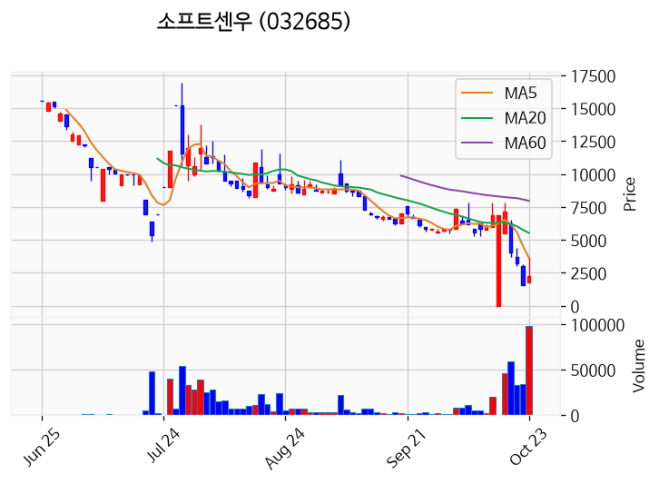

---

### 디티에스 (상한가)
— 등락률 +35.14% / 거래량 2,179만 주

**◎ 관련기사**
- [[마감] 아이패밀리에스씨, 공개매수에 '상한가'...디티에스 '강세'](https://news.google.com/rss/articles/CBMibEFVX3lxTFBlMkw1dVdmS3BudUtxU1RXZTZzb3pmaWVCNVdXTm1kNEZjRWhlNDJYcDdKOXZwZk9QQmdXRDdDX29pZk9NdDl3MmpJazgxek1vR3YtaEZrNUNrc1VhTDVUYXJFUTJrMmRzRjdjRtIBb0FVX3lxTE1rMmlGaFY5ejhtN0V0V1dqOGZQSWNxMDFtR0diVlBTY01ucGhMdXptS2RkUy1fUVB0S1J0Tnc3NURYMjFsSGtUS0llTmtqdURjODhUamVkU2pIRThEUU9zdnYzeVZ2SkZNSTZFWDM2RQ?oc=5) — 한스경제, 2026-10-23

**◎ 공시**
- _(공시 없음 / 미조회)_

---

### 스페코 (상한가)
— 등락률 +29.98% / 거래량 674만 주

**◎ 관련기사**
- [[주식마감] ‘오세훈 시장 항소심 무죄’ 소식에 진양그룹주 상한가… 스페코, 노을, 퓨쳐켐, 컨텍 등 급등](https://news.google.com/rss/articles/CBMiakFVX3lxTFBRQ1NwM01kQWtuRmZVbTNPbXNaRkRydnhiQzQ2VlNTZ2xsNkd3NVRLX21hN1hEa3NsM1E4MTRhRkg0VTU2YzV3aUNjbHJOclpTTlVUMDZ4dHV5Vzl5WjAtdlJ3UGhpNXExblE?oc=5) — 금강일보, 2026-10-23

**◎ 공시**
- _(공시 없음 / 미조회)_

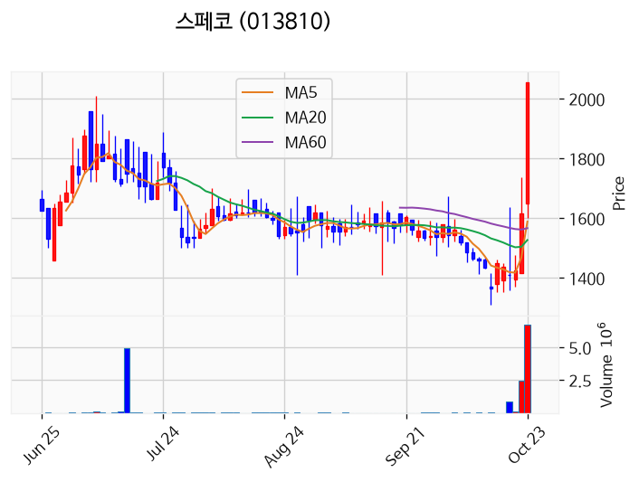

---

### 노을 (상한가)
— 등락률 +29.96% / 거래량 32만 주

**◎ 관련기사**
- [주민과 함께하는 북항노을축제, 10월 24일 개최!](https://news.google.com/rss/articles/CBMiV0FVX3lxTE5RdlJJRi1BaVJWaGpiRWxSanFzN3l6OUxBSmVCMXN0bnBkZ1pVVW45Y0NNWGx3Nm4xQzBSZERpM3FfUGxsTC1XYzdBZDFTUmY3NUV5OWVrcw?oc=5) — 대한뉴스통신, 2026-10-23

**◎ 공시**
- [주요사항보고서(유상증자결정)](https://dart.fss.or.kr/dsaf001/main.do?rcpNo=20261023000005) — 노을, 20261023

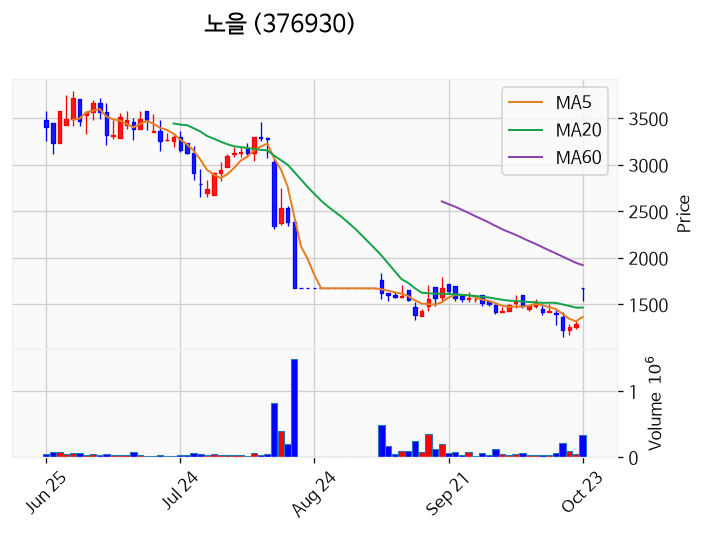

---

### 윙스풋 (상한가)
— 등락률 +29.96% / 거래량 23만 주

**◎ 관련기사**
- [윙스풋, 주가 5거래일 새 60％ 이상 급등으로 투자경고종목 지정예고](https://news.google.com/rss/articles/CBMickFVX3lxTE4zRmp3T1Ywc3JBME5SOGd0R0JWa1pQTkdsclZIQW1UQ3lrOVJEM01fMXVUbllDVE90ZnNRZE9lcVhscXFlSlZQN0M1bVBKbnRfemtyM2FCVUpRODBfaU1xSjhQSGpUMkNCUUFLckIyWnQwUQ?oc=5) — TopStarNews, 2026-10-23

**◎ 공시**
- _(공시 없음 / 미조회)_

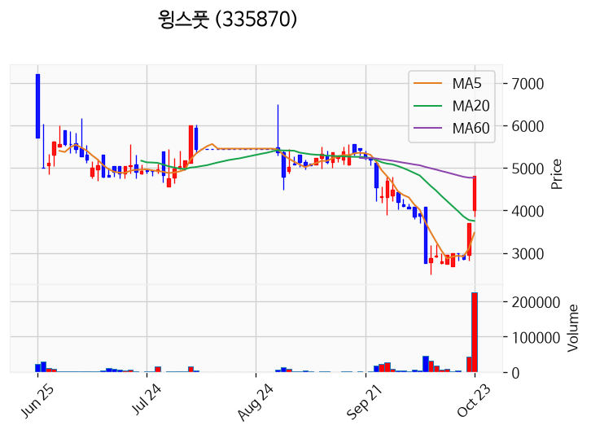

---

### 아이패밀리에스씨 (상한가)
— 등락률 +29.93% / 거래량 6만 주

**◎ 관련기사**
- [마루베니 공개매수에 아이패밀리에스씨 주가 상한가 : 한국증시](https://news.google.com/rss/articles/CBMiS0FVX3lxTE9aMUpVSEQzbnR3aFFwTFRjN0N2ZE1JYjEyZ2xYTVc2RVpwaklNcjJNcS1ubEMwZURuY3pmaUpIeExKd01rMXh1Ti1OVQ?oc=5) — 재경일보, 2026-10-23

**◎ 공시**
- [공개매수설명서](https://dart.fss.or.kr/dsaf001/main.do?rcpNo=20261023000002) — 웰라이언트, 20261023
- [공개매수신고서](https://dart.fss.or.kr/dsaf001/main.do?rcpNo=20261023000001) — 웰라이언트, 20261023

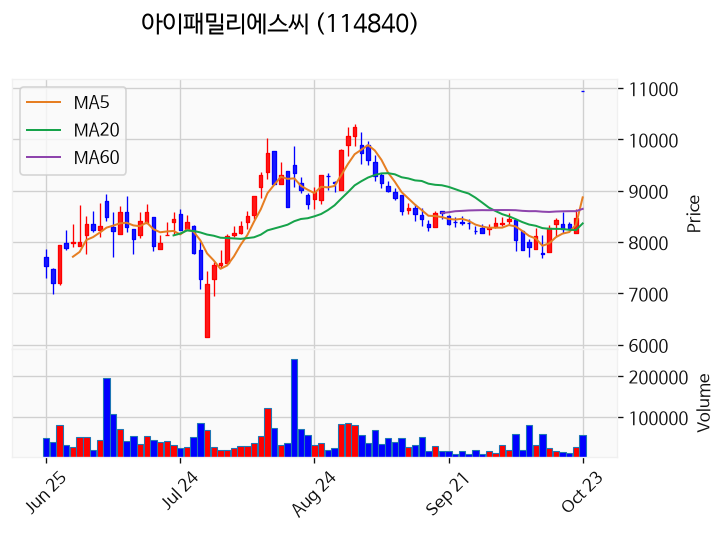

---

### 파이온엑스 (상한가)
— 등락률 +29.93% / 거래량 20만 주

**◎ 관련기사**
- [[상한가 종목] 진양화학-스페코 이어 컨텍 등 마감](https://news.google.com/rss/articles/CBMib0FVX3lxTE9tOXI2Y0JvLWNPcEd3UVdEb21OMFhMbjRsdmhDVVMyRE5qTEw1NG8wMWpZcUhSMTZEajlJZEdyWURwQS00dVFyVWFqZmxKemdRUm5EblRBbTJKS1ptVVppc2tMVHJwWWF2aUk2MllSYw?oc=5) — 이코노뉴스, 2026-10-23

**◎ 공시**
- _(공시 없음 / 미조회)_

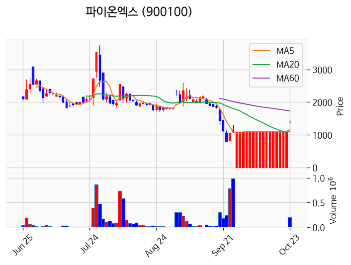

---

### 에이전트AI (상한가)
— 등락률 +29.91% / 거래량 56만 주

**◎ 관련기사**
- [에이전트AI, 5일간 60% 급등에 투자경고종목 지정예고](https://news.google.com/rss/articles/CBMickFVX3lxTE9iejMwMkx3MzFfb0NvSmtaSkxRbXFLbzMwVXh3WEZUQnhmeWRwVElhY3RGdHNacm04Y1dIQzlRVmdxYVIyd3lULVVqNVNqVHJkRjFITk0wbFhIOUF1Qm9uWTBHdHlmVl9QMHJkYWgxTlRsdw?oc=5) — TopStarNews, 2026-10-23

**◎ 공시**
- [대표이사변경              ](https://dart.fss.or.kr/dsaf001/main.do?rcpNo=20261023900627) — 에이전트AI, 20261023

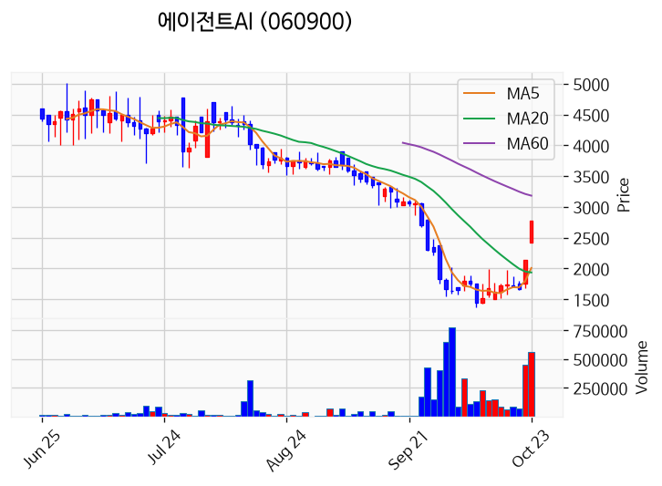

---

### 퓨쳐켐 (상한가)
— 등락률 +29.91% / 거래량 120만 주

**◎ 관련기사**
- [퓨쳐켐 FC705, 미국 임상 2a상서 완전 반응 5명…객관적 반응률 38.9%](https://news.google.com/rss/articles/CBMie0FVX3lxTE1NTVAzZTB2TE9WLV9FaXI3NjVVeDZmNWxqallZNnJtbnFKY0wtSFRuNXRHTWUyb0NNZHM3LVEwcFJValdzd3NhbnB0dWVFZVdjNldTNkZIX1NGenpkU3h6N3NuQU5ORXhEZkw3U0FnZGhESFctMG5FY3hHa9IBe0FVX3lxTE1NTVAzZTB2TE9WLV9FaXI3NjVVeDZmNWxqallZNnJtbnFKY0wtSFRuNXRHTWUyb0NNZHM3LVEwcFJValdzd3NhbnB0dWVFZVdjNldTNkZIX1NGenpkU3h6N3NuQU5ORXhEZkw3U0FnZGhESFctMG5FY3hHaw?oc=5) — 디지틀조선일보, 2026-10-23

**◎ 공시**
- [투자판단관련주요경영사항(임상시험결과)              (전이성 거세저항성 전립선암 환자에 대한 [177Lu]루도타다이펩의 안전성 및 유효성 평가; 미국 제2a상 Topline data 수령 )](https://dart.fss.or.kr/dsaf001/main.do?rcpNo=20261023900540) — 퓨쳐켐, 20261023

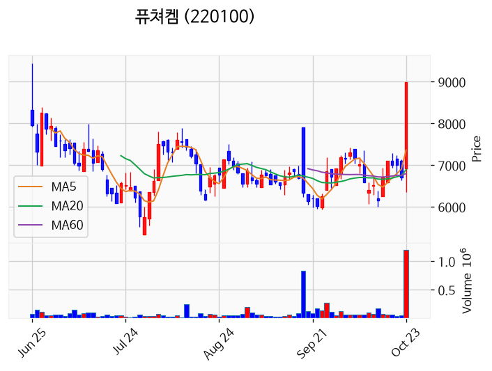

---

### 컨텍 (상한가)
— 등락률 +29.87% / 거래량 248만 주

**◎ 관련기사**
- [[주식마감] ‘오세훈 시장 항소심 무죄’ 소식에 진양그룹주 상한가… 스페코, 노을, 퓨쳐켐, 컨텍 등 급등](https://news.google.com/rss/articles/CBMiakFVX3lxTFBRQ1NwM01kQWtuRmZVbTNPbXNaRkRydnhiQzQ2VlNTZ2xsNkd3NVRLX21hN1hEa3NsM1E4MTRhRkg0VTU2YzV3aUNjbHJOclpTTlVUMDZ4dHV5Vzl5WjAtdlJ3UGhpNXExblE?oc=5) — 금강일보, 2026-10-23

**◎ 공시**
- _(공시 없음 / 미조회)_

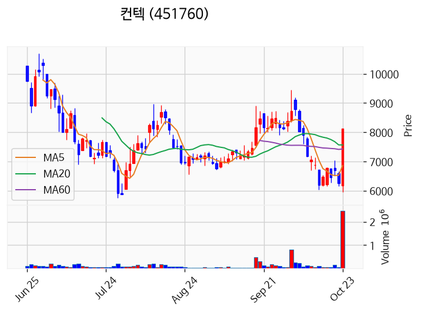

---

### 진양화학 (상한가)
— 등락률 +29.81% / 거래량 339만 주

**◎ 관련기사**
- [오세훈 항소심 무죄…진양화학 등 테마주 무더기 '上'(종합)](https://news.google.com/rss/articles/CBMieEFVX3lxTFBsNFppSUEyMEpJeGQycVRjS3FFOEE3X3J5eVVwYUh4TUllYVJpSHAxazhrcW40akhUa0JGai1XMm5MZUZSRFlqMXdtMFB1UlB2a3dIblhsM1ZwX1hKVlpZODVHeXJXQlNXOHlBaFRBVXhyczJfUG82cNIBeEFVX3lxTFBsNFppSUEyMEpJeGQycVRjS3FFOEE3X3J5eVVwYUh4TUllYVJpSHAxazhrcW40akhUa0JGai1XMm5MZUZSRFlqMXdtMFB1UlB2a3dIblhsM1ZwX1hKVlpZODVHeXJXQlNXOHlBaFRBVXhyczJfUG82cA?oc=5) — 뉴시스, 2026-10-23

**◎ 공시**
- _(공시 없음 / 미조회)_

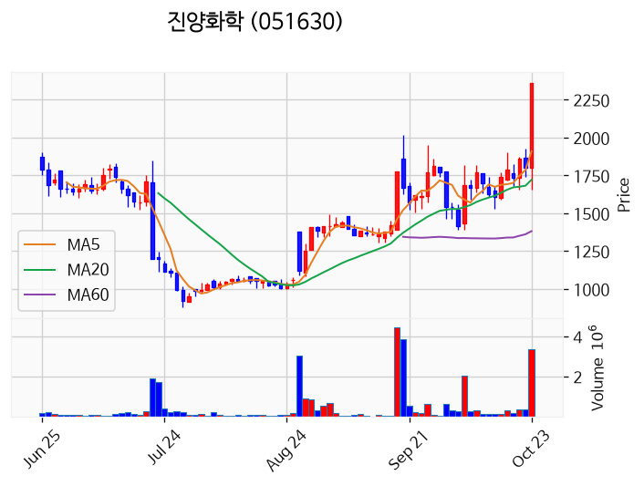

---

### 진양산업 (상한가)
— 등락률 +29.79% / 거래량 457만 주

**◎ 관련기사**
- [오세훈 무죄에 테마주 급등…진양화학·진양산업 상한가](https://news.google.com/rss/articles/CBMifEFVX3lxTFBlWk0wTmR3UTNlT3NKVFFFLUxSaUQzMmYwS3NfOVltYVBITktmaDNzWk0zWDRBMkVoV0xDQWlLNzJrMjh6TWFyU1hiNE5KU2VramxkNDVlVTFkR3FmY2w3eUdobXk0Ym81VnVMWmZENDlFaVRFNkc0Mm9wTUQ?oc=5) — 한국금융신문, 2026-10-23

**◎ 공시**
- _(공시 없음 / 미조회)_

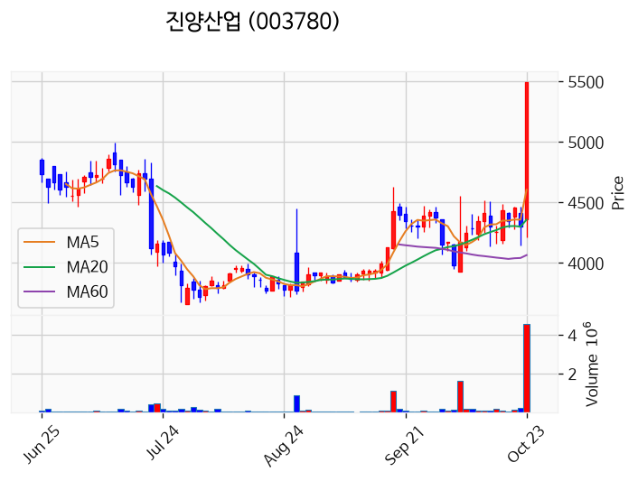

---

### 앤로보틱스 (거래량 급증)
— 등락률 +18.90% / 거래량 4,917만 주

**◎ 관련기사**
- [코스피 5,550선 탈환했지만…외국인 1조원 '매도 폭탄'](https://news.google.com/rss/articles/CBMiakFVX3lxTE9WLWhfRG5iX1k0M1FoZjhjdjFsQ0hiaXF2SlRpRC1sMVpvbXlzN2RsNXJKOHYxLW9ZVHR3TU9pQnFDMWQzeE1VTHhZNWNBYllydllJUUlMZTN3YVlCSzU1dmFfQ2FrQkJudlHSAWpBVV95cUxPVi1oX0RuYl9ZNDNRaGY4Y3YxbENIYmlxdkpUaUQtbDFab215czdkbDVySjh2MS1vWVR0d01PaUJxQzFkM3hNVUx4WTVjQWJZcnZZSVFJTGUzd2FZQks1NXZhX0Nha0JCbnZR?oc=5) — 센트럴경제, 2026-10-23

**◎ 공시**
- _(공시 없음 / 미조회)_

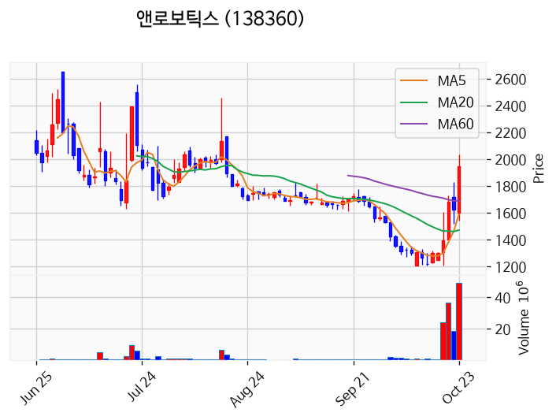

---

### 삼성E&A (거래량 급증)
— 등락률 +7.94% / 거래량 1,310만 주

**◎ 관련기사**
- [삼성E&A, 3Q 호실적에 연간 영업익 목표 상향딜사이트 최지혜 기자 입 : 네이버 블로그](https://news.google.com/rss/articles/CBMijwFBVV95cUxQTUNtQ2hqbmN0TW9Bejh1RGtKMWNDM3RHZFRhZmNnLWt5dGhHdUtqTWFTcW5zSWEwRmJTVUFSdnh6Q2R3V3VYUVBQTG0taThvOUFzMHE0TUdfNjlKYlE5V2RqaEZYWExTNm5FRFZldE1CeklvaEVvaUVqU3hjc2RVZXZod3Fkd2dIbHAta2ppdw?oc=5) — Naver Blog, 2026-10-23

**◎ 공시**
- _(공시 없음 / 미조회)_

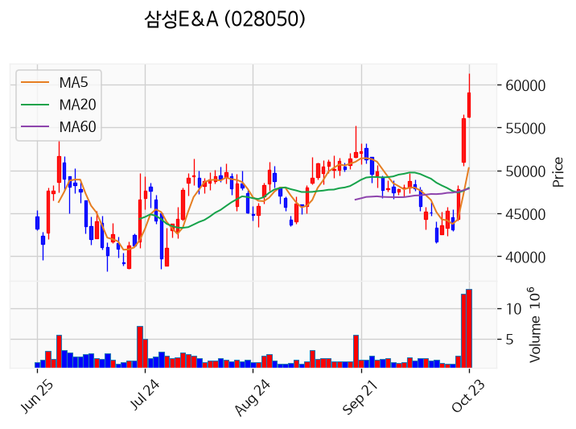

---

### SK증권 (거래량 급증)
— 등락률 +5.63% / 거래량 1,228만 주

**◎ 관련기사**
- [SK증권제12호스팩, SPAC 상장예비심사 미제출로 관리종목 지정](https://news.google.com/rss/articles/CBMickFVX3lxTE1xTWJuRWl4Tl8zZmRXMDIyUjNacGpwd09Xb2RnRlMyMTB3RGhNMzdkZVprOVZSQkFtOG5jcUdjNTdkTFo0Zlk4NnF0QzlGMkMtVVh2MjhKTDFmMHlVZkF1U3dSNlFQd2l1REQ3Qm1lVE41Zw?oc=5) — TopStarNews, 2026-10-23

**◎ 공시**
- [투자설명서(일괄신고)](https://dart.fss.or.kr/dsaf001/main.do?rcpNo=20261023000400) — SK증권, 20261023
- [일괄신고추가서류(파생결합사채-주가연계파생결합사채)](https://dart.fss.or.kr/dsaf001/main.do?rcpNo=20261023000354) — SK증권, 20261023
- [증권발행실적보고서](https://dart.fss.or.kr/dsaf001/main.do?rcpNo=20261023000312) — SK증권, 20261023

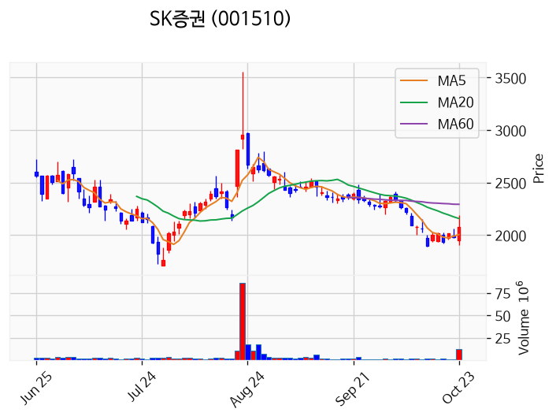

---

### 진양홀딩스 (거래량 급증)
— 등락률 +3.64% / 거래량 1,604만 주

**◎ 관련기사**
- [오세훈 항소심 무죄…진양화학 등 테마주 무더기 '上'(종합)](https://news.google.com/rss/articles/CBMieEFVX3lxTFBsNFppSUEyMEpJeGQycVRjS3FFOEE3X3J5eVVwYUh4TUllYVJpSHAxazhrcW40akhUa0JGai1XMm5MZUZSRFlqMXdtMFB1UlB2a3dIblhsM1ZwX1hKVlpZODVHeXJXQlNXOHlBaFRBVXhyczJfUG82cNIBeEFVX3lxTFBsNFppSUEyMEpJeGQycVRjS3FFOEE3X3J5eVVwYUh4TUllYVJpSHAxazhrcW40akhUa0JGai1XMm5MZUZSRFlqMXdtMFB1UlB2a3dIblhsM1ZwX1hKVlpZODVHeXJXQlNXOHlBaFRBVXhyczJfUG82cA?oc=5) — 뉴시스, 2026-10-23

**◎ 공시**
- _(공시 없음 / 미조회)_

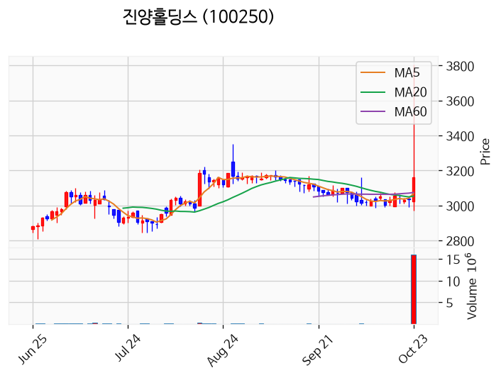

---

### 한일단조 (거래량 급증)
— 등락률 +1.96% / 거래량 1,200만 주

**◎ 관련기사**
_(관련기사 없음 / 미조회)_

**◎ 공시**
- _(공시 없음 / 미조회)_

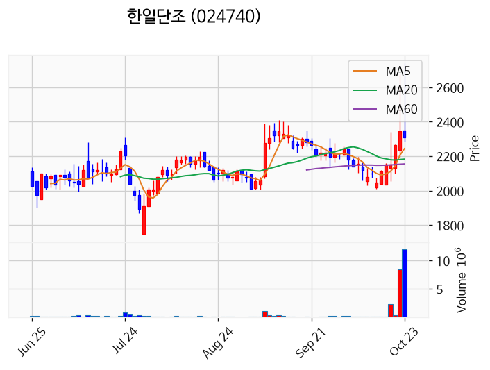

---

### 빅텍 (거래량 급증)
— 등락률 +1.60% / 거래량 4,455만 주

**◎ 관련기사**
_(관련기사 없음 / 미조회)_

**◎ 공시**
- _(공시 없음 / 미조회)_

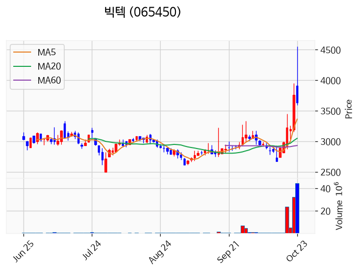

---

### 삼성전자 (거래량 급증)
— 등락률 +0.47% / 거래량 1,615만 주

**◎ 관련기사**
- [연기금이 담는 삼성화재, 삼성전자 지분 1.38%에 특별배당 기대까지](https://news.google.com/rss/articles/CBMiWkFVX3lxTE5ZYkFQcHVDQ0llelpaYWtVZzByeHFMTTZfczd6NGdiUEhSLUo1bmZTbUphV0ZWandPUEJ1elEza2lVUkw2MWFwMlBsa19ZaGxxRDZvYlgtRXU3dw?oc=5) — 파이낸셜뉴스, 2026-10-23

**◎ 공시**
- [주식등의대량보유상황보고서(일반)](https://dart.fss.or.kr/dsaf001/main.do?rcpNo=20261023000484) — 삼성물산, 20261023
- [임원ㆍ주요주주특정증권등소유상황보고서](https://dart.fss.or.kr/dsaf001/main.do?rcpNo=20261023000478) — 서경헌, 20261023

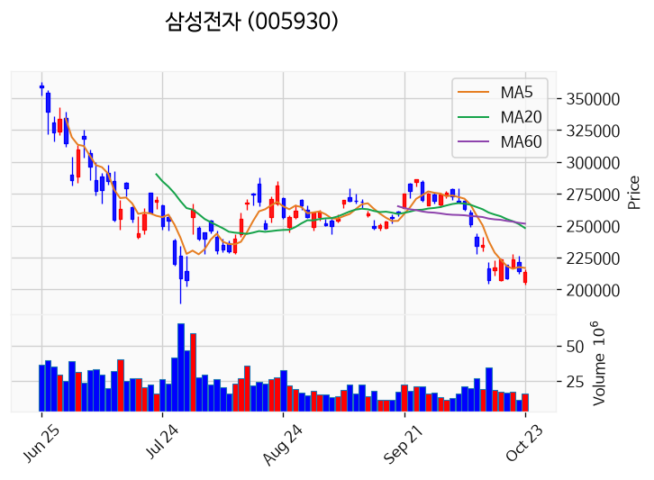

---

### SKAI (거래량 급증)
— 등락률 -9.13% / 거래량 2,090만 주

**◎ 관련기사**
- [SKAI·에이전트AI 상한가에도 증시 활력 제한…코스피·코스닥 저조한 흐름 속 변동성 장세](https://news.google.com/rss/articles/CBMiaEFVX3lxTE1YSGtHd1o3N3k5VDRTanFtX3hnVWNNczRBb2toQ0RPNkVENm1aU2NmMkg2eHljQWJzUnhTb1hiSDJEYm56TUdsQ3hGeHJ2UUpMX045cEduZVU3RnBUNnNzZlo1eXQxbzFp?oc=5) — CBC뉴스, 2026-10-23

**◎ 공시**
- _(공시 없음 / 미조회)_

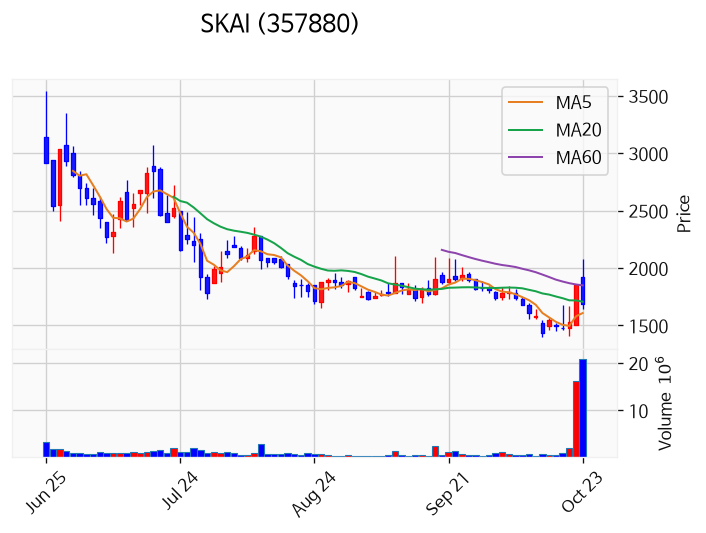

---

### 엠에스바이오 (거래량 급증)
— 등락률 -27.25% / 거래량 1,523만 주

**◎ 관련기사**
- [제조업 뜨고 AI 지고…달라진 공모주 흥행 공식](https://news.google.com/rss/articles/CBMiWkFVX3lxTE5EdXl4bE9CNE9PNVc0WFZBemRiQ20yWHdvc3ZBa00tdkhoSGk0b2lhZ01XSUUwSFBvdmVieFBPR3ZOdHotdTlVbUp3RmNSa2tsem1LZHVQbGNOUQ?oc=5) — 한국경제, 2026-10-23

**◎ 공시**
- _(공시 없음 / 미조회)_

---

## 2. 거래량 폭증 후 급감 패턴 종목
_(폭증 전일 대비 500~1000%, 급감 전일 대비 25% 이하, 급감일 종가가 5일선 대비 -3% 이내)_

### 조광피혁
- 폭증일: 2026-10-20, 거래량 0만 주 (전일 대비 719%)
- 급감일: 2026-10-23, 거래량 0만 주 (전일 대비 2%)
- 급감일 종가 66,000원 / 5일선 66,240원 (이격률 -0.36%)

### 대원산업
- 폭증일: 2026-10-22, 거래량 1만 주 (전일 대비 773%)
- 급감일: 2026-10-23, 거래량 0만 주 (전일 대비 13%)
- 급감일 종가 10,180원 / 5일선 10,246원 (이격률 -0.64%)

### 동부건설우
- 폭증일: 2026-10-21, 거래량 0만 주 (전일 대비 730%)
- 급감일: 2026-10-23, 거래량 0만 주 (전일 대비 25%)
- 급감일 종가 15,840원 / 5일선 15,894원 (이격률 -0.34%)

### 벽산
- 폭증일: 2026-10-22, 거래량 63만 주 (전일 대비 630%)
- 급감일: 2026-10-23, 거래량 11만 주 (전일 대비 18%)
- 급감일 종가 1,351원 / 5일선 1,390원 (이격률 -2.79%)

### 로젠
- 폭증일: 2026-10-22, 거래량 15만 주 (전일 대비 867%)
- 급감일: 2026-10-23, 거래량 2만 주 (전일 대비 11%)
- 급감일 종가 1,581원 / 5일선 1,591원 (이격률 -0.63%)

### 나라엠앤디
- 폭증일: 2026-10-20, 거래량 4만 주 (전일 대비 824%)
- 급감일: 2026-10-23, 거래량 0만 주 (전일 대비 20%)
- 급감일 종가 2,470원 / 5일선 2,499원 (이격률 -1.16%)

### 신화인터텍
- 폭증일: 2026-10-21, 거래량 7만 주 (전일 대비 542%)
- 급감일: 2026-10-23, 거래량 1만 주 (전일 대비 16%)
- 급감일 종가 1,400원 / 5일선 1,395원 (이격률 +0.36%)

### 지엔코
- 폭증일: 2026-10-22, 거래량 5만 주 (전일 대비 958%)
- 급감일: 2026-10-23, 거래량 1만 주 (전일 대비 11%)
- 급감일 종가 2,990원 / 5일선 3,057원 (이격률 -2.19%)

### 인베니아
- 폭증일: 2026-10-22, 거래량 11만 주 (전일 대비 597%)
- 급감일: 2026-10-23, 거래량 2만 주 (전일 대비 15%)
- 급감일 종가 1,429원 / 5일선 1,445원 (이격률 -1.09%)

### 태양기계
- 폭증일: 2026-10-20, 거래량 1만 주 (전일 대비 666%)
- 급감일: 2026-10-23, 거래량 0만 주 (전일 대비 0%)
- 급감일 종가 650원 / 5일선 618원 (이격률 +5.14%)

### 씨알푸드
- 폭증일: 2026-10-21, 거래량 0만 주 (전일 대비 533%)
- 급감일: 2026-10-23, 거래량 0만 주 (전일 대비 24%)
- 급감일 종가 2,300원 / 5일선 2,174원 (이격률 +5.80%)

### 피엔티엠에스
- 폭증일: 2026-10-22, 거래량 4만 주 (전일 대비 755%)
- 급감일: 2026-10-23, 거래량 0만 주 (전일 대비 10%)
- 급감일 종가 1,801원 / 5일선 1,832원 (이격률 -1.68%)

### 이노시뮬레이션
- 폭증일: 2026-10-21, 거래량 8만 주 (전일 대비 820%)
- 급감일: 2026-10-23, 거래량 0만 주 (전일 대비 15%)
- 급감일 종가 2,115원 / 5일선 2,173원 (이격률 -2.67%)

### 솔루스첨단소재1우
- 폭증일: 2026-10-22, 거래량 1만 주 (전일 대비 525%)
- 급감일: 2026-10-23, 거래량 0만 주 (전일 대비 22%)
- 급감일 종가 1,473원 / 5일선 1,505원 (이격률 -2.14%)

### 이지트로닉스
- 폭증일: 2026-10-22, 거래량 1만 주 (전일 대비 828%)
- 급감일: 2026-10-23, 거래량 0만 주 (전일 대비 24%)
- 급감일 종가 2,700원 / 5일선 2,698원 (이격률 +0.07%)

### 코람코더원리츠
- 폭증일: 2026-10-21, 거래량 56만 주 (전일 대비 762%)
- 급감일: 2026-10-23, 거래량 8만 주 (전일 대비 8%)
- 급감일 종가 2,400원 / 5일선 2,393원 (이격률 +0.29%)
