# 2026년 10월 26일 시황 노트

## 1. 상한가 / 거래량 1,000만주 이상 종목

### 루닛 (상한가)
— 등락률 +30.00% / 거래량 418만 주

**◎ 관련기사**
- [호재 겹쳐 'AI 의료주' 동반 급등…루닛·노을·뷰노 줄줄이 상한가](https://news.google.com/rss/articles/CBMiWkFVX3lxTE1LNW9mdm9wOXJ3S3gweGxtS0VLWG8wVVBGVWtGa0ZSbXFDdV82TE15YXZHQ2VJbHhyZktzQk52QWxtZEVfNzdXTG9zc2lSYUFpeVZmbG5mU1dmQQ?oc=5) — 한국경제, 2026-10-26

**◎ 공시**
- _(공시 없음 / 미조회)_

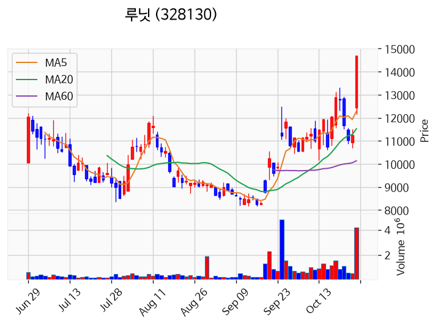

---

### 아이씨에이치 (상한가)
— 등락률 +29.98% / 거래량 35만 주

**◎ 관련기사**
- [[주식마감] 삼성전자 벤더 코드 취득 소식에 아이씨에이치 '上'... 루닛, 노을, 뷰노, 빅웨이브로보틱스 등 상한가](https://news.google.com/rss/articles/CBMiakFVX3lxTE9ZZUROcmZGMWVLYzE3bnRKblVRenNSSmVqQWp5MGRqdVlIc0hrYTB3OTFLS2JQRW9KVm1pMHo1ZkpnLV9HQXNUaXdKWTVLRmQ2UlBadjJFbGpMd3I3aEQzY2t3c243emlQdlE?oc=5) — 금강일보, 2026-10-26

**◎ 공시**
- [전환청구권행사              ](https://dart.fss.or.kr/dsaf001/main.do?rcpNo=20261026900172) — 아이씨에이치, 20261026

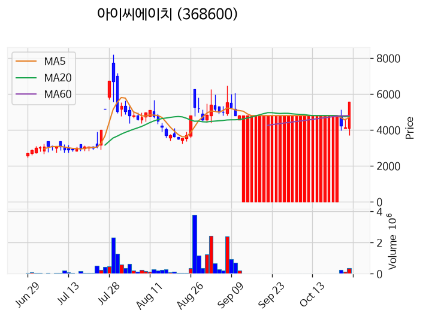

---

### 뷰노 (상한가)
— 등락률 +29.95% / 거래량 195만 주

**◎ 관련기사**
- [호재 겹쳐 'AI 의료주' 동반 급등…루닛·노을·뷰노 줄줄이 상한가](https://news.google.com/rss/articles/CBMiWkFVX3lxTE1LNW9mdm9wOXJ3S3gweGxtS0VLWG8wVVBGVWtGa0ZSbXFDdV82TE15YXZHQ2VJbHhyZktzQk52QWxtZEVfNzdXTG9zc2lSYUFpeVZmbG5mU1dmQQ?oc=5) — 한국경제, 2026-10-26

**◎ 공시**
- _(공시 없음 / 미조회)_

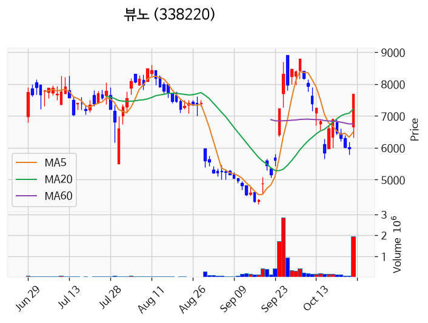

---

### 노을 (상한가)
— 등락률 +29.94% / 거래량 11만 주

**◎ 관련기사**
- [호재 겹쳐 'AI 의료주' 동반 급등…루닛·노을·뷰노 줄줄이 상한가](https://news.google.com/rss/articles/CBMiWkFVX3lxTE1LNW9mdm9wOXJ3S3gweGxtS0VLWG8wVVBGVWtGa0ZSbXFDdV82TE15YXZHQ2VJbHhyZktzQk52QWxtZEVfNzdXTG9zc2lSYUFpeVZmbG5mU1dmQQ?oc=5) — 한국경제, 2026-10-26

**◎ 공시**
- [기타시장안내              (주가 미달에 따른 상장폐지 우려 관련 안내)](https://dart.fss.or.kr/dsaf001/main.do?rcpNo=20261026900762) — 코스닥시장본부, 20261026

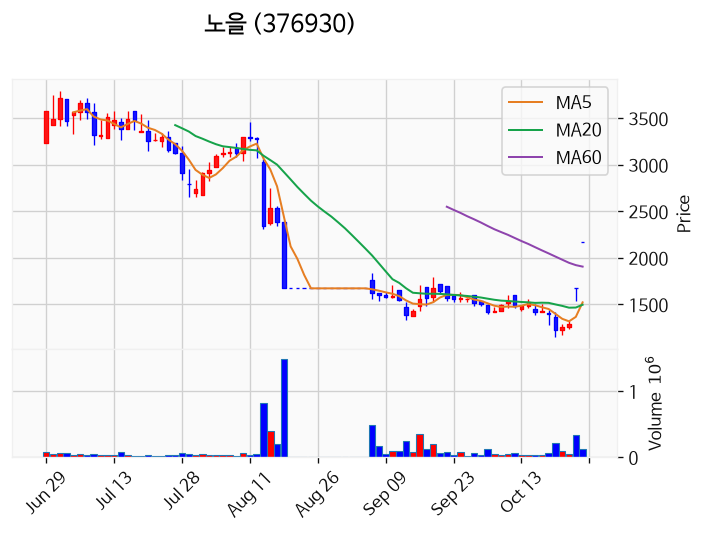

---

### 컨텍 (상한가)
— 등락률 +29.89% / 거래량 642만 주

**◎ 관련기사**
- [컨텍, 자체 지상국으로 '대전샛' 교신 성공](https://news.google.com/rss/articles/CBMiakFVX3lxTE1ha3l3Wjg5YW1TM2YySkdMb2RGN1pTdmUxcFVnbHFpTDQ0d1VvQW9zemliNEdId1VBMF9iM2VZYVRtRk41Y0hRRVJEakNYdFpHSnlSYjR3WHExU0YwWC1sbmRLN3hVN2Q5eVE?oc=5) — 헬로디디, 2026-10-26

**◎ 공시**
- _(공시 없음 / 미조회)_

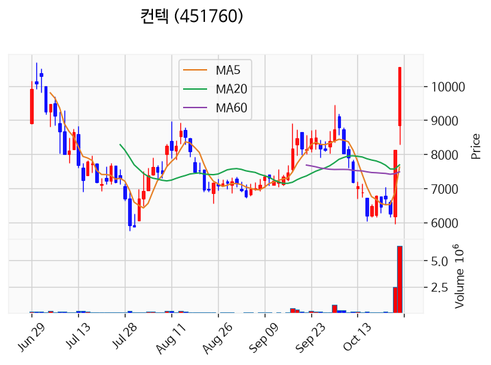

---

### 빅웨이브로보틱스 (상한가)
— 등락률 +29.82% / 거래량 530만 주

**◎ 관련기사**
- [[주식마감] 삼성전자 벤더 코드 취득 소식에 아이씨에이치 '上'... 루닛, 노을, 뷰노, 빅웨이브로보틱스 등 상한가](https://news.google.com/rss/articles/CBMiakFVX3lxTE9ZZUROcmZGMWVLYzE3bnRKblVRenNSSmVqQWp5MGRqdVlIc0hrYTB3OTFLS2JQRW9KVm1pMHo1ZkpnLV9HQXNUaXdKWTVLRmQ2UlBadjJFbGpMd3I3aEQzY2t3c243emlQdlE?oc=5) — 금강일보, 2026-10-26

**◎ 공시**
- _(공시 없음 / 미조회)_

---

### 대양금속 (거래량 급증)
— 등락률 +18.34% / 거래량 1,418만 주

**◎ 관련기사**
_(관련기사 없음 / 미조회)_

**◎ 공시**
- _(공시 없음 / 미조회)_

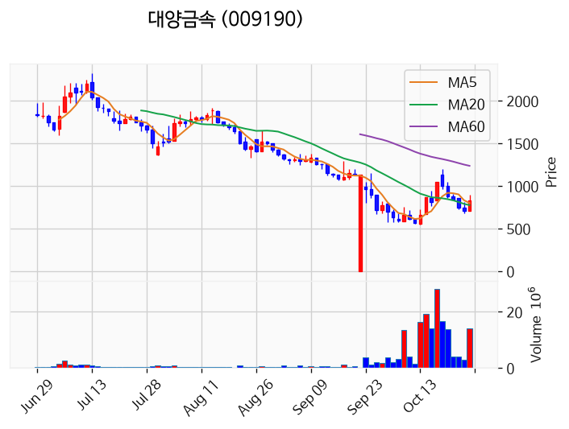

---

### SKAI (거래량 급증)
— 등락률 +16.35% / 거래량 2,067만 주

**◎ 관련기사**
- [SKAI, 스카이인텔리전스 지분 66.92%로 확대](https://news.google.com/rss/articles/CBMiX0FVX3lxTE5sdjVVdzRCNnI5dzd3RmpDTHh2dVh6VUlJX0QtdHU4bVo5N1VTR2xwRFoyY0FaS3BlcWk4ZEQwQUxmQXJOel95bTROdHQzNEREQXNIcXdENHhqNHA0Y1hZ?oc=5) — MTN 머니투데이방송, 2026-10-26

**◎ 공시**
- _(공시 없음 / 미조회)_

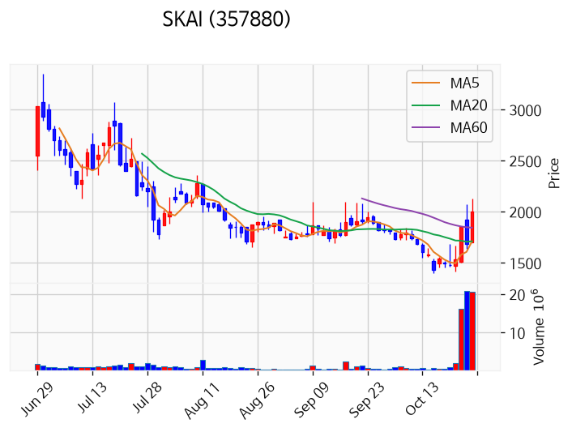

---

### 레몬헬스케어 (거래량 급증)
— 등락률 +12.53% / 거래량 1,638만 주

**◎ 관련기사**
- [2026년 10/26(월) - 데일리포인트](https://news.google.com/rss/articles/CBMiiwFBVV95cUxPNDJxYnNEUzRlYi0wVjZCVkFUZ0lJbkkyZGRWTDI3VVgyYzFJMUhHaU5BZ0hyTm8yVDFTMC1MVkFpM3FVMEtDRFdkRlFOLUpkM1VZNjdKazczY2VkdlNrWmlLeXpPUzgxWENRdWQ2RThEOUdOajFYSFpTSEJ1RzNueEpMVUFJVmRpcGlZ?oc=5) — 네이버 프리미엄콘텐츠, 2026-10-26

**◎ 공시**
- _(공시 없음 / 미조회)_

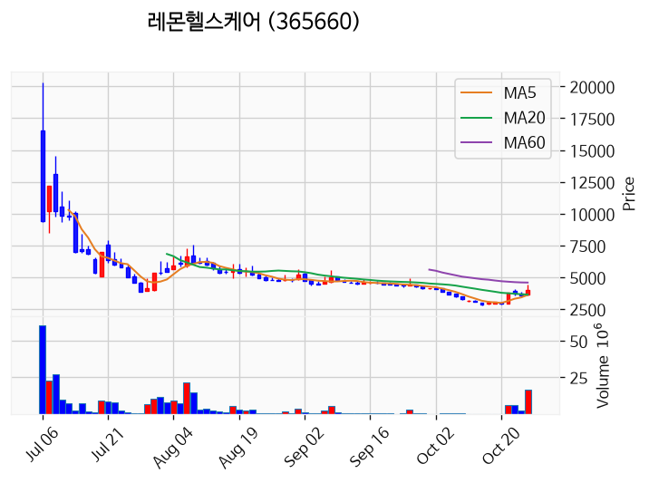

---

### 엠에스바이오 (거래량 급증)
— 등락률 +11.25% / 거래량 1,605만 주

**◎ 관련기사**
- [2026년 10/26(월) - 데일리포인트](https://news.google.com/rss/articles/CBMiiwFBVV95cUxPNDJxYnNEUzRlYi0wVjZCVkFUZ0lJbkkyZGRWTDI3VVgyYzFJMUhHaU5BZ0hyTm8yVDFTMC1MVkFpM3FVMEtDRFdkRlFOLUpkM1VZNjdKazczY2VkdlNrWmlLeXpPUzgxWENRdWQ2RThEOUdOajFYSFpTSEJ1RzNueEpMVUFJVmRpcGlZ?oc=5) — 네이버 프리미엄콘텐츠, 2026-10-26

**◎ 공시**
- _(공시 없음 / 미조회)_

---

### 앤로보틱스 (거래량 급증)
— 등락률 +4.68% / 거래량 3,304만 주

**◎ 관련기사**
- [[1026마감체크] 코스피, 외인 매도에 5500선 붕괴... 7개월 만에 최저 By 인포스탁데일리](https://news.google.com/rss/articles/CBMicEFVX3lxTFBpakkxTi1HdVh4dFB2ajRESkdSTFRDSzRPY01MQWJOVER0dE0xUnA1eVNoZnQzTlJPSjkxYzc0cnpwUHlGLVIyRjIyRC1RSUtxbW1mVHRpcXlmZmJqNTlwRVNDTzlTX1JmekJxdUFnQlg?oc=5) — Investing.com 한국어, 2026-10-26

**◎ 공시**
- _(공시 없음 / 미조회)_

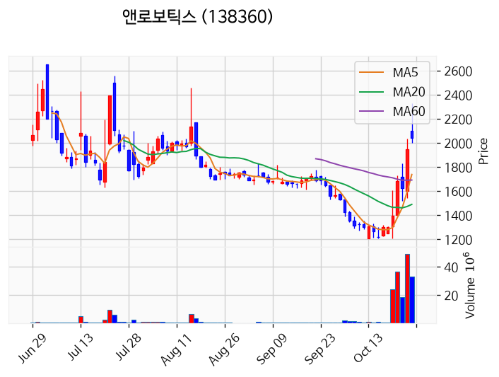

---

### 삼기에너지솔루션즈 (거래량 급증)
— 등락률 +3.33% / 거래량 1,148만 주

**◎ 관련기사**
_(관련기사 없음 / 미조회)_

**◎ 공시**
- _(공시 없음 / 미조회)_

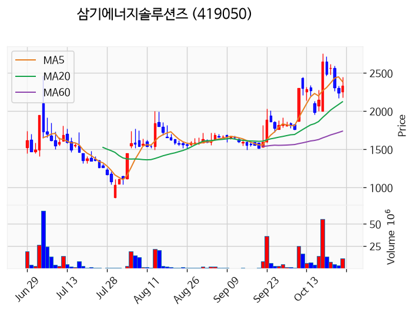

---

### 푸드나무 (거래량 급증)
— 등락률 +0.89% / 거래량 1,027만 주

**◎ 관련기사**
_(관련기사 없음 / 미조회)_

**◎ 공시**
- _(공시 없음 / 미조회)_

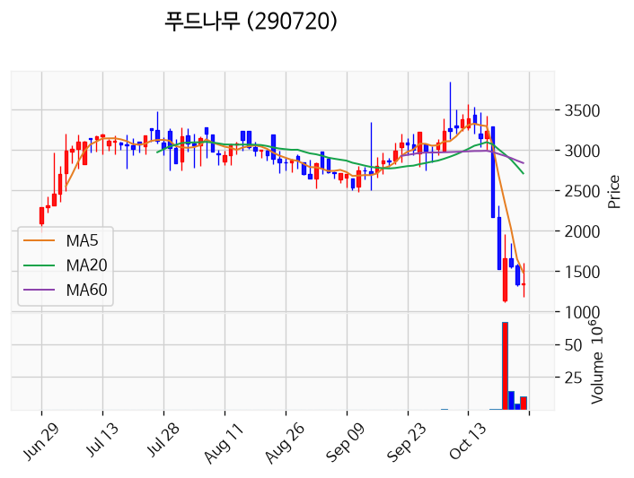

---

### 삼성전자 (거래량 급증)
— 등락률 -1.16% / 거래량 1,138만 주

**◎ 관련기사**
- [[단독] "연 4% 이자가 어디냐"…삼성전자도 수십조 굴린다](https://news.google.com/rss/articles/CBMiWkFVX3lxTE1rZDlLWXNkQnpUZmZMQUJCVm5hdUVkSkdCSndDemZIUWtENHVZR0t1WFhEVmFhWVJ5ZmdESGloOUtqUEZiR3Z0UjNJaXlKZGZzVTZPbzRHOEJDQQ?oc=5) — 한국경제, 2026-10-26

**◎ 공시**
- [임원ㆍ주요주주특정증권등소유상황보고서](https://dart.fss.or.kr/dsaf001/main.do?rcpNo=20261026000017) — 이헌, 20261026

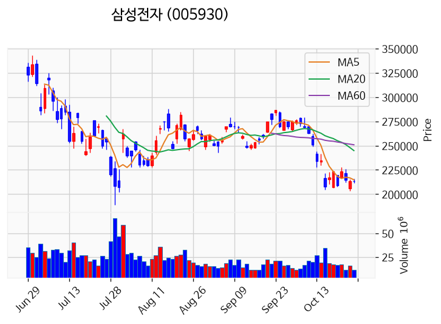

---

## 2. 거래량 폭증 후 급감 패턴 종목
_(폭증 전일 대비 500~1000%, 급감 전일 대비 25% 이하, 급감일 종가가 5일선 대비 -3% 이내)_

_해당 종목 없음_
