# 2026년 10월 27일 시황 노트

## 1. 상한가 / 거래량 1,000만주 이상 종목

### 멜콘 (상한가)
— 등락률 +29.97% / 거래량 288만 주

**◎ 관련기사**
- [[상한가 종목] 멜콘-나무가 이어 캠시스 등 마감](https://news.google.com/rss/articles/CBMib0FVX3lxTFA1N1FtRGRKc1dVQ1J0aXJmNVpJNTFEcklwQk53VWxnNnJZTEw0Nks3b293bzVrc0ZlaWxuVGxVbFZ0bHIzdTRxWV9ueGt4UUxnNW12V0dzblhGem9OUERhaXdfbzh2c2VFcVB0Z0NXbw?oc=5) — 이코노뉴스, 2026-10-27

**◎ 공시**
- _(공시 없음 / 미조회)_

---

### 나무가 (상한가)
— 등락률 +29.96% / 거래량 112만 주

**◎ 관련기사**
- [[인기검색TOP5] 나무가, JYP Ent., 대한전선, 한미반도체, SK텔레콤](https://news.google.com/rss/articles/CBMiUkFVX3lxTFAyY2VPcm9PRDVYLUE3cENoSk8xQnRua0ZHRWtsaDdyT1RRTm5wMU9ncTZCOXBjOS1tYzRkWWlvZHVvel94ajhKWnoyQ0pQX1FkWGc?oc=5) — 매일경제 마켓, 2026-10-27

**◎ 공시**
- _(공시 없음 / 미조회)_

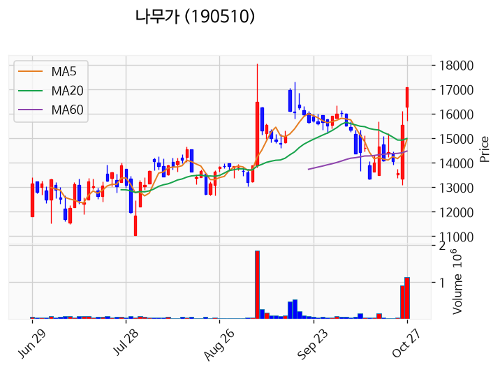

---

### 이지트로닉스 (상한가)
— 등락률 +29.94% / 거래량 18만 주

**◎ 관련기사**
- [[주식마감] 현대차그룹 로봇 부품 공급 기대감에 '나무가' 상한가... 루닛, 이지트로닉스, 액스비스 등 급등](https://news.google.com/rss/articles/CBMiaEFVX3lxTE01VWNKUVZZSmItalhCMXRGTXB0amVkUjdUR2lfLXpLWkZ5djNWU0ZJTTRfTW1lYThyWFlhU0ktZE5BLXpDWjhXYnhRTmMyNlh2RExpR2NEQzlxMk1QOU1xSEZPT2tJY3pX?oc=5) — 금강일보, 2026-10-27

**◎ 공시**
- _(공시 없음 / 미조회)_

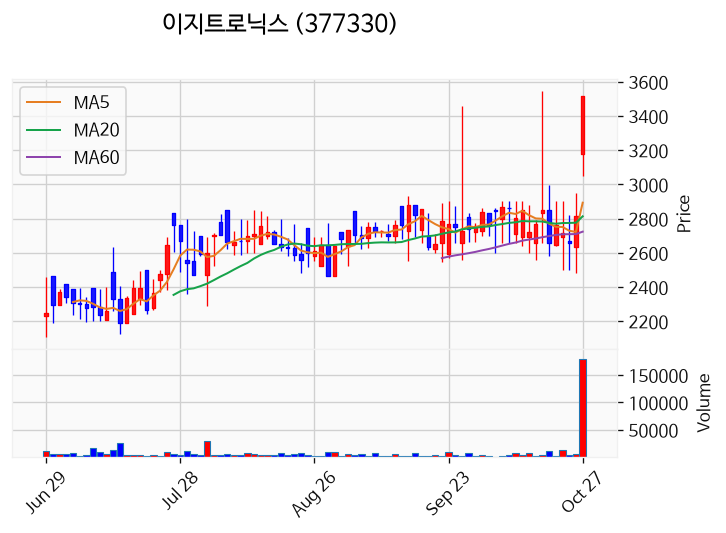

---

### 액스비스 (상한가)
— 등락률 +29.88% / 거래량 235만 주

**◎ 관련기사**
- [[주식마감] 현대차그룹 로봇 부품 공급 기대감에 '나무가' 상한가... 루닛, 이지트로닉스, 액스비스 등 급등](https://news.google.com/rss/articles/CBMiaEFVX3lxTE01VWNKUVZZSmItalhCMXRGTXB0amVkUjdUR2lfLXpLWkZ5djNWU0ZJTTRfTW1lYThyWFlhU0ktZE5BLXpDWjhXYnhRTmMyNlh2RExpR2NEQzlxMk1QOU1xSEZPT2tJY3pX?oc=5) — 금강일보, 2026-10-27

**◎ 공시**
- _(공시 없음 / 미조회)_

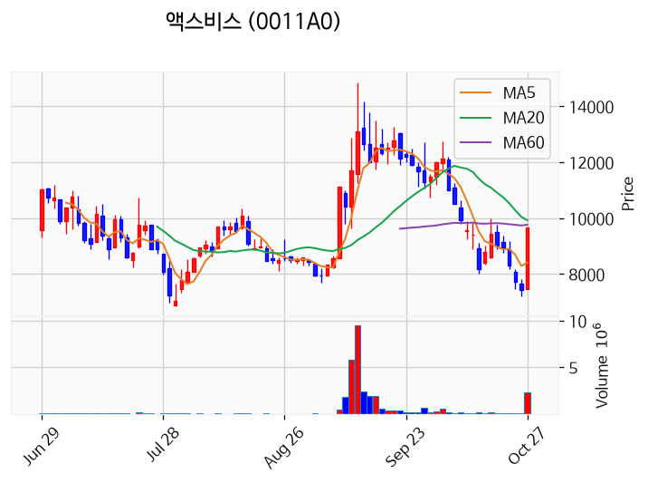

---

### 캠시스 (상한가)
— 등락률 +29.83% / 거래량 8만 주

**◎ 관련기사**
- [[상한가 종목] 멜콘-나무가 이어 캠시스 등 마감](https://news.google.com/rss/articles/CBMib0FVX3lxTFA1N1FtRGRKc1dVQ1J0aXJmNVpJNTFEcklwQk53VWxnNnJZTEw0Nks3b293bzVrc0ZlaWxuVGxVbFZ0bHIzdTRxWV9ueGt4UUxnNW12V0dzblhGem9OUERhaXdfbzh2c2VFcVB0Z0NXbw?oc=5) — 이코노뉴스, 2026-10-27

**◎ 공시**
- _(공시 없음 / 미조회)_

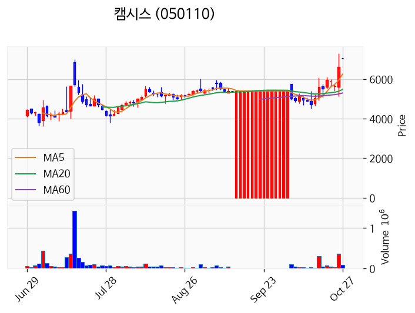

---

### 알트 (거래량 급증)
— 등락률 +10.74% / 거래량 1,266만 주

**◎ 관련기사**
- [사토시 나카모토의 숨은 업적 'UTXO'…알트코인까지 이어진 설계](https://news.google.com/rss/articles/CBMic0FVX3lxTE8tUE1YU3kxb2lzUXRQNjBQeUxkV180N1FCc1ZydTRQTHRSbTBUd0pmUUQwMm5PQmltZmhNcEo4NnZrd05aMkZSZFI1bTBsWTh4ak5BdTMxS0NtSmx4RndXcFY5UWtwdUhyMGhPZ1d3bXhzT2M?oc=5) — 디지털투데이, 2026-10-27

**◎ 공시**
- _(공시 없음 / 미조회)_

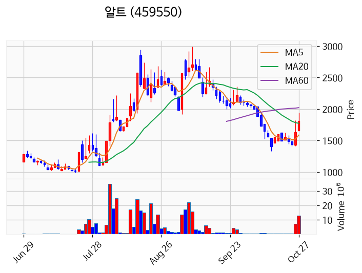

---

### 엠에스바이오 (거래량 급증)
— 등락률 +8.91% / 거래량 2,528만 주

**◎ 관련기사**
- [“치킨값은 번다던 공모주, 진짜 돈 될까?”…하반기 청약 성적표 따져보니](https://news.google.com/rss/articles/CBMiUkFVX3lxTE5zdmZkelZrdlBYQnFicTFoUnFVd0FQdC1UUFp0c3BxZ0pjYnVQOW5BMklOT0x5Q2M3Ui1WWnN3LTJtN2ItamFxem4zY2RXSVJENWc?oc=5) — 매일경제, 2026-10-27

**◎ 공시**
- _(공시 없음 / 미조회)_

---

### 앤로보틱스 (거래량 급증)
— 등락률 +6.63% / 거래량 2,616만 주

**◎ 관련기사**
- [칩스앤미디어, AI SoC·로보틱스 신규 실적에 3분기 매출 ↑](https://news.google.com/rss/articles/CBMiakFVX3lxTE95Sm1xcS1YUG5FaElZemdQMHNQWjh2UlJhcVVBQlhiek5FOWs5b0pQdDl1SFlxN0FYbjZkenJOUjJCMWNCV1M1OENYRVZOOWpKcVE3MVJITXZwVU04Umh3eXhmV3JFUk13dUE?oc=5) — AI타임스, 2026-10-27

**◎ 공시**
- _(공시 없음 / 미조회)_

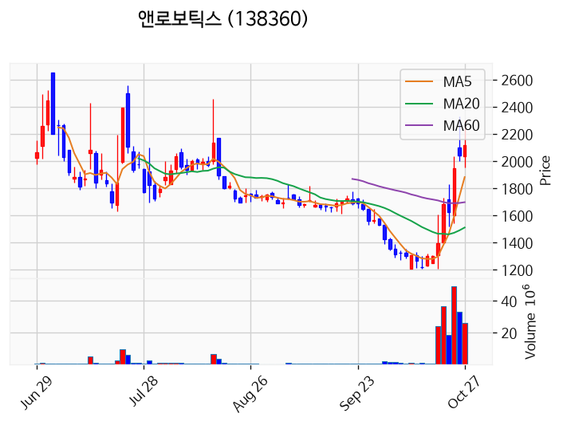

---

### 푸드나무 (거래량 급증)
— 등락률 +4.57% / 거래량 1,028만 주

**◎ 관련기사**
- [[주식마감] 현대차그룹 로봇 부품 공급 기대감에 '나무가' 상한가... 루닛, 이지트로닉스, 액스비스 등 급등](https://news.google.com/rss/articles/CBMiaEFVX3lxTE01VWNKUVZZSmItalhCMXRGTXB0amVkUjdUR2lfLXpLWkZ5djNWU0ZJTTRfTW1lYThyWFlhU0ktZE5BLXpDWjhXYnhRTmMyNlh2RExpR2NEQzlxMk1QOU1xSEZPT2tJY3pX?oc=5) — 금강일보, 2026-10-27

**◎ 공시**
- _(공시 없음 / 미조회)_

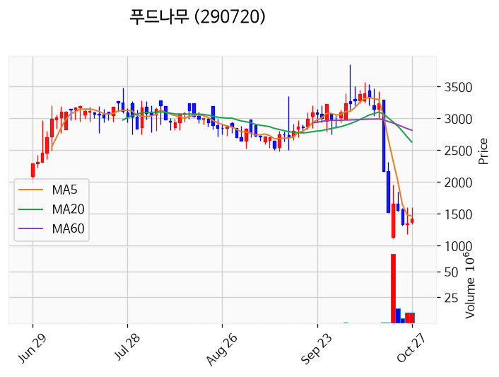

---

### 삼성전자 (거래량 급증)
— 등락률 +4.23% / 거래량 1,420만 주

**◎ 관련기사**
- [삼성전자, HBM 매출 하이닉스 첫 추월 가능성…"주가 재평가" [분석+]](https://news.google.com/rss/articles/CBMiWkFVX3lxTE9ab2hfTXhyMlQ1c1ROcHpKRFQ0WU1nTHRTazNhT0txM1NEUW1CTjB4TUd5STloX1VUT3VkV3U3Qm9hZXdvNUIzZUVrZkJKSVA0ZzFwR19MZTNDdw?oc=5) — 한국경제, 2026-10-27

**◎ 공시**
- _(공시 없음 / 미조회)_

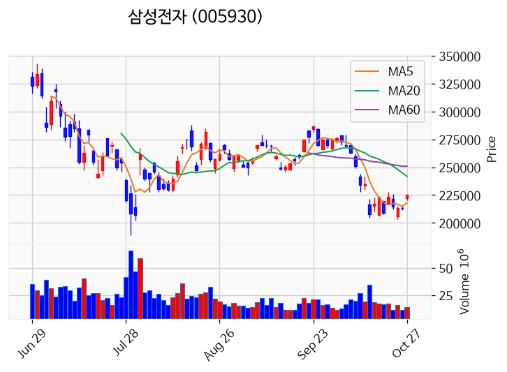

---

### 퀀텀레일 (거래량 급증)
— 등락률 +2.57% / 거래량 1,018만 주

**◎ 관련기사**
_(관련기사 없음 / 미조회)_

**◎ 공시**
- [의결권대리행사권유참고서류](https://dart.fss.or.kr/dsaf001/main.do?rcpNo=20261027000247) — 퀀텀레일, 20261027

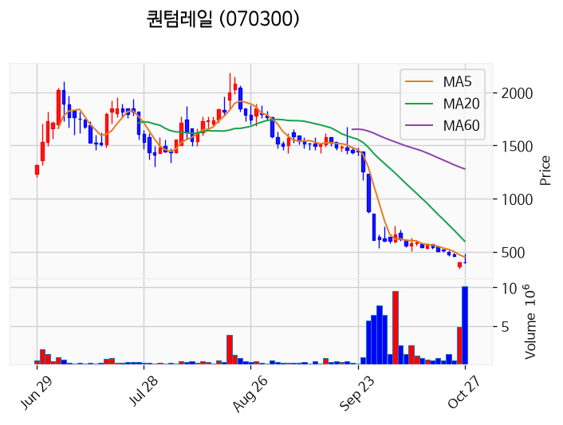

---

### 대양금속 (거래량 급증)
— 등락률 +0.48% / 거래량 1,001만 주

**◎ 관련기사**
_(관련기사 없음 / 미조회)_

**◎ 공시**
- _(공시 없음 / 미조회)_

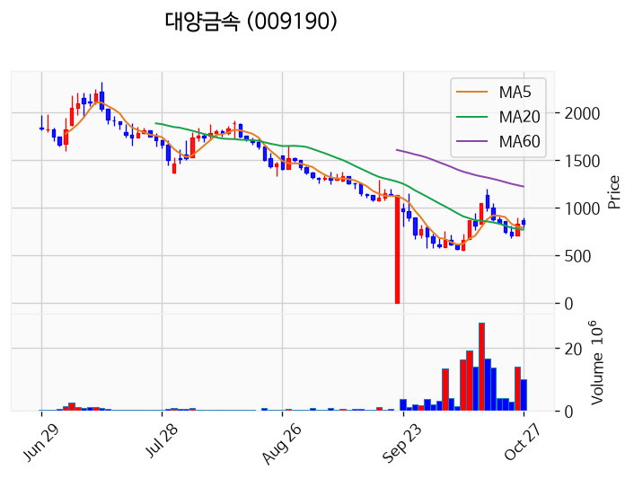

---

### 빛과전자 (거래량 급증)
— 등락률 -0.15% / 거래량 1,320만 주

**◎ 관련기사**
- [빛과전자, 최대주주 비엔에스조합 측 주식등 보유 비율 3.43%p 감소](https://news.google.com/rss/articles/CBMie0FVX3lxTE1UVlVVRjN4bWNqc1hhZm14OUxoR0xvS3ZGbmJ3cUlkazVGQVVvZHpFYUpEdlZqMUxndmtXTXdlanN2RS1aWTBYVVRDTjlMUkVuaHhOU2VoMGlnOS1jTW9OWVZnaGtqaDlubmpENmtKM1dQb3ZmY3pOQmJ2NA?oc=5) — 디지털투데이, 2026-10-27

**◎ 공시**
- [임원ㆍ주요주주특정증권등소유상황보고서](https://dart.fss.or.kr/dsaf001/main.do?rcpNo=20261027000370) — 케이헤드조합, 20261027
- [주식등의대량보유상황보고서(일반)](https://dart.fss.or.kr/dsaf001/main.do?rcpNo=20261027000368) — 비엔에스조합, 20261027

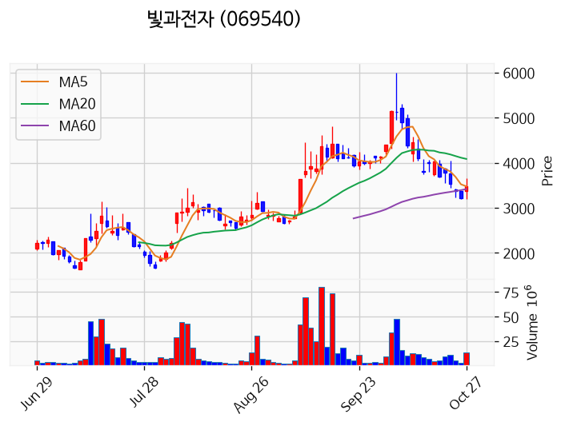

---

### 에스케이증권제14호기업인수목적 (거래량 급증)
— 등락률 -2.75% / 거래량 9,203만 주

**◎ 관련기사**
- [에스케이증권제14호기업인수목적, 단일계좌 대량매매로 투자주의종목 지정](https://news.google.com/rss/articles/CBMickFVX3lxTFB4WHpJMXVEbFVfWTVZcTlnNEsxWkhJUmRZclhhaTh0XzZjTkppM0U4LUdsT05OYnpDektCRzUwc3NLWDVRcHlHTGw0b0psZFdpLXdDeG93NHpXVGNlNmdjME1qZWNpUHdVQzlkTkpCRHBRQQ?oc=5) — 톱스타뉴스, 2026-10-27

**◎ 공시**
- _(공시 없음 / 미조회)_

---

## 2. 거래량 폭증 후 급감 패턴 종목
_(폭증 전일 대비 500~1000%, 급감 전일 대비 25% 이하, 급감일 종가가 5일선 대비 -3% 이내)_

_해당 종목 없음_
