# 2026년 10월 28일 시황 노트

## 1. 상한가 / 거래량 1,000만주 이상 종목

### 지니언스 (상한가)
— 등락률 +30.00% / 거래량 146만 주

**◎ 관련기사**
- [[주식마감] 美 광통신사 공급 계약 소식에 빛과전자 상한가... 지니언스, 에스피소프트, 케이아이엔엑스 등 급등](https://news.google.com/rss/articles/CBMiakFVX3lxTE5hbmhwd1ZHVUdFdU1iRW1TY0JIWk5iTjNvMVlXQmw3SVFRRENzdGN6bm42UmFjSm53NndtRUh3SXZHWUNqVWlFYy0zQU05bG5Bd2EtRVJUMi1GeFB5dTI2Z282RTMzZFN1Mnc?oc=5) — 금강일보, 2026-10-28

**◎ 공시**
- _(공시 없음 / 미조회)_

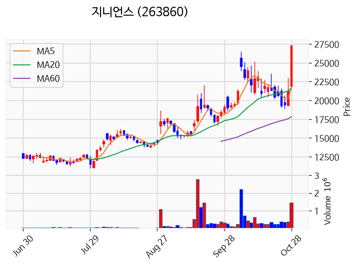

---

### 케이아이엔엑스 (상한가)
— 등락률 +29.96% / 거래량 1만 주

**◎ 관련기사**
- [[오늘의 특징주] 케이아이엔엑스·지니언스 상한가…공개매수 가격 인상에 보안 투자 확대 기대](https://news.google.com/rss/articles/CBMiZEFVX3lxTE00RTJlOTB1T1lScWhHTTNyMWhwTmh5TkhIU09iNUticmRlazVMUVY5SW1HeGw1YUJRcnJIRXNiUnROQzJwNTJMZTdWWWtxSnBpM3JUamNLa1IxOUpScFB2TTZGUHQ?oc=5) — https://www.ppss.kr/, 2026-10-28

**◎ 공시**
- [조회공시요구(풍문또는보도)              ](https://dart.fss.or.kr/dsaf001/main.do?rcpNo=20261028900390) — 코스닥시장본부, 20261028
- [주식등의대량보유상황보고서(일반)](https://dart.fss.or.kr/dsaf001/main.do?rcpNo=20261028000004) — 가비아, 20261028
- [주식등의대량보유상황보고서(일반)](https://dart.fss.or.kr/dsaf001/main.do?rcpNo=20261028000002) — 한국인터넷인프라홀딩스, 20261028

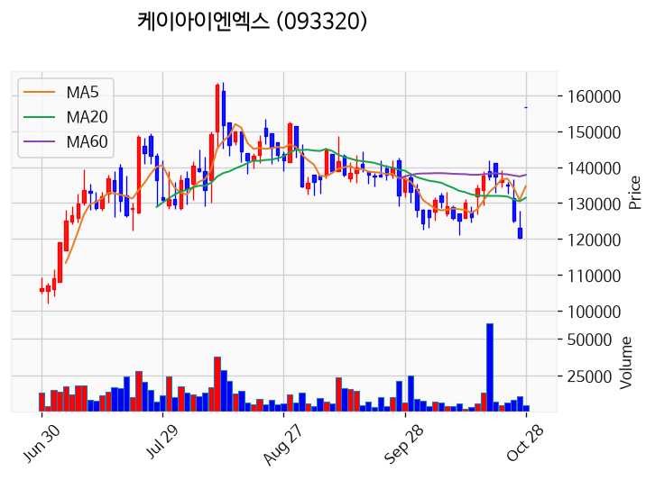

---

### 피앤에스로보틱스 (상한가)
— 등락률 +29.95% / 거래량 77만 주

**◎ 관련기사**
- [[상한가 종목] 빛과전자-지니언스 이어 피앤에스로보틱스 등 마감](https://news.google.com/rss/articles/CBMibkFVX3lxTE9fVk1lUHJqdG9XWmZpZHNQRXNjU3Rad2J3cml5anlBdW95Um9vQnQtOUZ1S0tqOVVqU2tsZUQ2RGZiV3h4d09SbjFYVTdoaFkxdmdLdjIxa1ZOODdEa2tHaFZFQkY5LWsxRG9lc0hB?oc=5) — 이코노뉴스, 2026-10-28

**◎ 공시**
- _(공시 없음 / 미조회)_

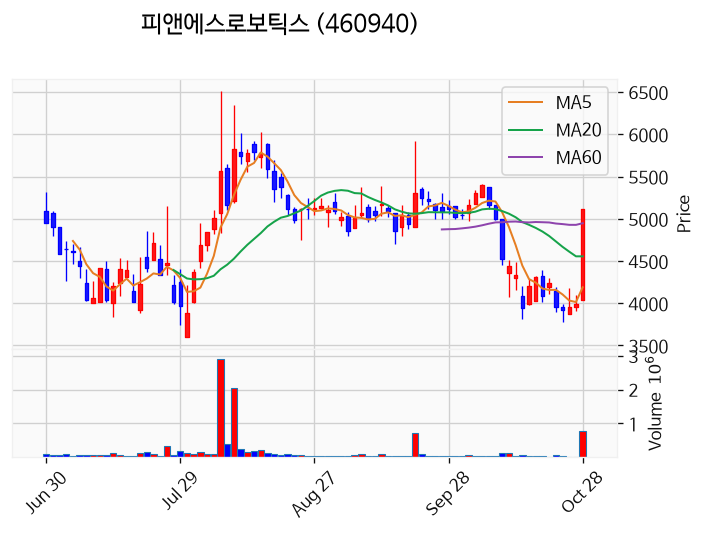

---

### 에스피소프트 (상한가)
— 등락률 +29.93% / 거래량 145만 주

**◎ 관련기사**
- [[주식마감] 美 광통신사 공급 계약 소식에 빛과전자 상한가... 지니언스, 에스피소프트, 케이아이엔엑스 등 급등](https://news.google.com/rss/articles/CBMiakFVX3lxTE5hbmhwd1ZHVUdFdU1iRW1TY0JIWk5iTjNvMVlXQmw3SVFRRENzdGN6bm42UmFjSm53NndtRUh3SXZHWUNqVWlFYy0zQU05bG5Bd2EtRVJUMi1GeFB5dTI2Z282RTMzZFN1Mnc?oc=5) — 금강일보, 2026-10-28

**◎ 공시**
- _(공시 없음 / 미조회)_

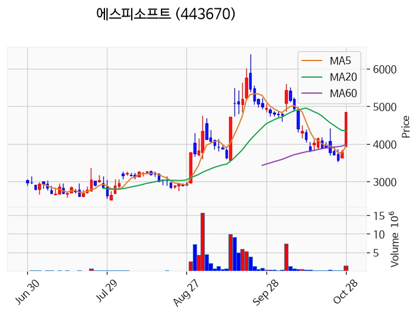

---

### 빛과전자 (상한가)
— 등락률 +29.88% / 거래량 3,863만 주

**◎ 관련기사**
- [[특징주] 빛과전자, 美 글로벌 기업향 '광통신 핵심' 양산 본격화에 上…차세대 기술력 '부각'](https://news.google.com/rss/articles/CBMibEFVX3lxTE8yUGo0aFJWSmRSakJIYTFmUV9qX1dMMTlNYXhINmNRLUpUQUthWktSZ28yYkYtUUJTd19xVVltSFFOdjNXMmsxcDkyQlduSnlTNEZzd0xjSm13SFV6aHh3Rkc5Y0daWE9ONFhIWg?oc=5) — 프라임경제, 2026-10-28

**◎ 공시**
- [[기재정정]주요사항보고서(전환사채권발행결정)](https://dart.fss.or.kr/dsaf001/main.do?rcpNo=20261028000310) — 빛과전자, 20261028

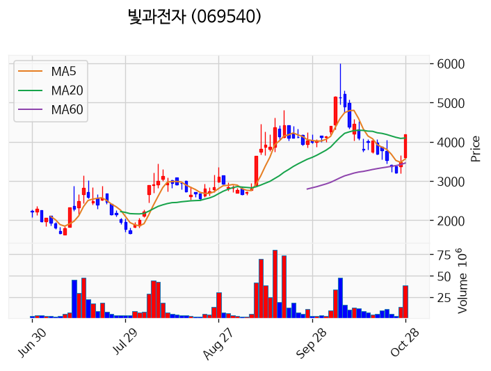

---

### 한울앤제주 (상한가)
— 등락률 +29.85% / 거래량 38만 주

**◎ 관련기사**
- [[주식마감] 美 광통신사 공급 계약 소식에 빛과전자 상한가... 지니언스, 에스피소프트, 케이아이엔엑스 등 급등](https://news.google.com/rss/articles/CBMiakFVX3lxTE5hbmhwd1ZHVUdFdU1iRW1TY0JIWk5iTjNvMVlXQmw3SVFRRENzdGN6bm42UmFjSm53NndtRUh3SXZHWUNqVWlFYy0zQU05bG5Bd2EtRVJUMi1GeFB5dTI2Z282RTMzZFN1Mnc?oc=5) — 금강일보, 2026-10-28

**◎ 공시**
- _(공시 없음 / 미조회)_

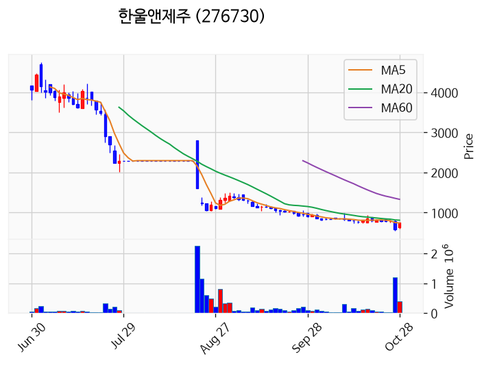

---

### 멜콘 (거래량 급증)
— 등락률 +21.35% / 거래량 2,407만 주

**◎ 관련기사**
- [멜콘(179880)눌릴때마다 물량 모아둘 기회로 보이며 이후 전망 및 대응전략.](https://news.google.com/rss/articles/CBMiXEFVX3lxTE44TXI2RndJbTBlZGFrSWdScUJhRV9lZ3pkMXdPVG5hbEFqb1h6ekJ2X3FqXzItcTk1X1hJQ3B1NjR2c3RHQ1JqaGxic3Z2Ym05djd5TF9BSU5SMDJI?oc=5) — ThinkPool, 2026-10-28

**◎ 공시**
- _(공시 없음 / 미조회)_

---

### 대한광통신 (거래량 급증)
— 등락률 +9.34% / 거래량 1,305만 주

**◎ 관련기사**
- [대한광통신 주가 7.81% 급등…광통신 테마 강세 : 한국증시](https://news.google.com/rss/articles/CBMiS0FVX3lxTE1hajAtUV9BUlNFcElXN1ZaQXVXeU9xR3daVFgwZzJxRkJHNlVESzB4MmxoRmlFTjc2U1VfV2h0TzBBcXNvSlMxMGswdw?oc=5) — 재경일보, 2026-10-28

**◎ 공시**
- _(공시 없음 / 미조회)_

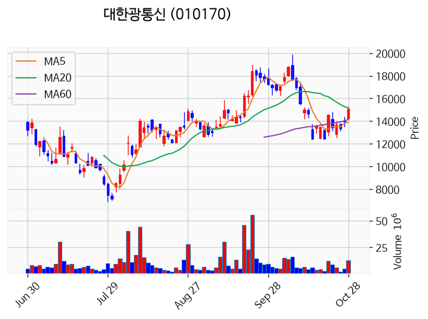

---

### 삼성전자 (거래량 급증)
— 등락률 +9.01% / 거래량 1,784만 주

**◎ 관련기사**
- [SK하이닉스 올해 100조 푼다…삼성전자 주주환원도 주목](https://news.google.com/rss/articles/CBMiZ0FVX3lxTE9rQlFObWhFck9Ra3dvaGlNSFo3cjNoV0Q1SVBVSTdMcHpsbTFZX0NMZGczVW1vck03dHdLNUU4c1FwSGZWMDFsZndhRVBWV0EzMVZnbGdjbHRlYmtNZmF4eWZTN0gyTmM?oc=5) — 연합뉴스TV, 2026-10-28

**◎ 공시**
- _(공시 없음 / 미조회)_

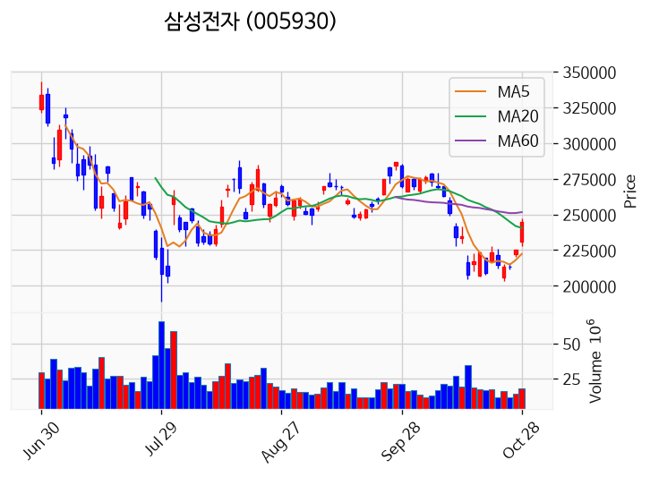

---

### 샌즈랩 (거래량 급증)
— 등락률 +6.71% / 거래량 1,466만 주

**◎ 관련기사**
- [10/26일 공략주 Review _ 미코](https://news.google.com/rss/articles/CBMiiwFBVV95cUxQMGw0WVBJR3ZWa0ZUajk4ZHR1TDB3N3hZTjVaVXVtY2tlZ1lmNHh5bEIzTjh3VFNBYzJieEpQZVZaaDJFYmtVVUdtWE55NDM4LXRpSmtQbllHYmNtWEJYU2FNLVd6Yk44bU9WRDhXa1BsV044LW1KOWVXeVVEUllhMVoxQ2w1UXJQdkFZ?oc=5) — 네이버 프리미엄콘텐츠, 2026-10-28

**◎ 공시**
- _(공시 없음 / 미조회)_

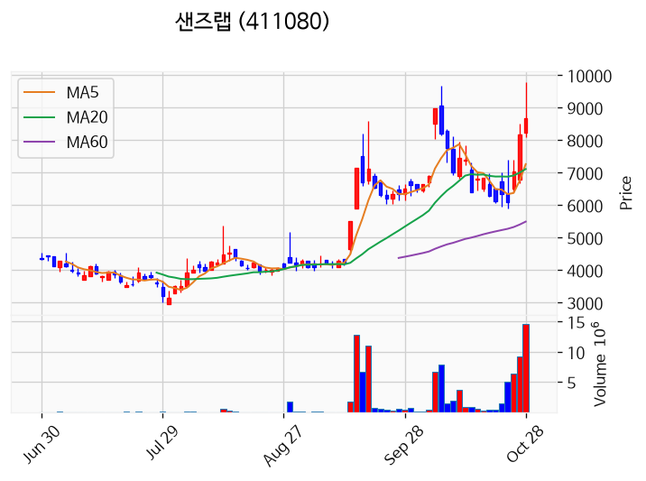

---

### 삼기에너지솔루션즈 (거래량 급증)
— 등락률 +4.90% / 거래량 3,482만 주

**◎ 관련기사**
- [삼기에너지솔루션즈, 3회차 전환사채 전환청구로 78만2122주 발행](https://news.google.com/rss/articles/CBMie0FVX3lxTE9RNDhRaVBBdV9YckQxXzhRZUgzMkZEaW9nQm82d3lwUG84V1BySmN4eXdCc3NVQ2pyZllyaG5zXzBCdm92Y1pQNnZTOHVvMGkzSVlvUXJ3UGJyY1I1bEhaQVVpVnJfOWF6UDFhQUM5dzlabG5uaXdGVDVxdw?oc=5) — 디지털투데이, 2026-10-28

**◎ 공시**
- [전환청구권행사              ](https://dart.fss.or.kr/dsaf001/main.do?rcpNo=20261028900519) — 삼기에너지솔루션즈, 20261028

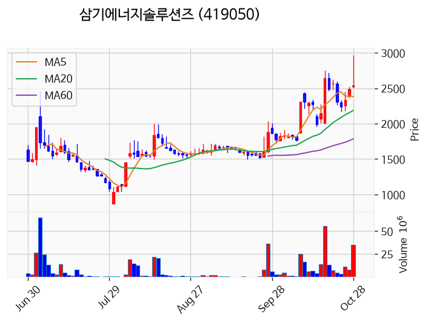

---

### 앤로보틱스 (거래량 급증)
— 등락률 -3.23% / 거래량 2,443만 주

**◎ 관련기사**
- [[주식마감] 美 광통신사 공급 계약 소식에 빛과전자 상한가... 지니언스, 에스피소프트, 케이아이엔엑스 등 급등](https://news.google.com/rss/articles/CBMiakFVX3lxTE5hbmhwd1ZHVUdFdU1iRW1TY0JIWk5iTjNvMVlXQmw3SVFRRENzdGN6bm42UmFjSm53NndtRUh3SXZHWUNqVWlFYy0zQU05bG5Bd2EtRVJUMi1GeFB5dTI2Z282RTMzZFN1Mnc?oc=5) — 금강일보, 2026-10-28

**◎ 공시**
- _(공시 없음 / 미조회)_

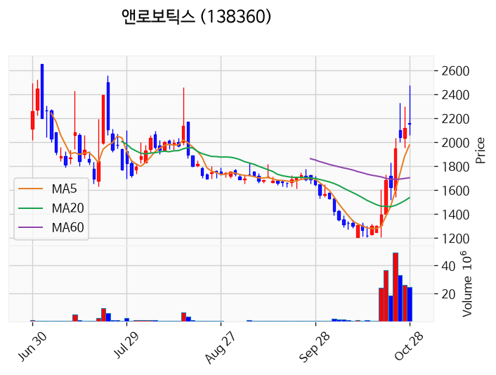

---

### 다보링크 (거래량 급증)
— 등락률 -29.95% / 거래량 1,641만 주

**◎ 관련기사**
- [[급등락주 짚어보기] 금융권 해킹에 보안주 상한가…‘공개매수’ KINX 공개매수·‘美 수주’빛과전자도 급등](https://news.google.com/rss/articles/CBMiVEFVX3lxTE45SFpjRXNMdElCNlRlRXM4M1Flamk0enNPdElEc2NWLXlxTVY5RVFCR3lWbWk3RFRMckVEV25HOFdER0x0Ni03NjctRzR5U0hyZTlIcA?oc=5) — 이투데이, 2026-10-28

**◎ 공시**
- [[기재정정]주요사항보고서(전환사채권발행결정)](https://dart.fss.or.kr/dsaf001/main.do?rcpNo=20261028000277) — 다보링크, 20261028
- [[기재정정]주요사항보고서(유상증자결정)](https://dart.fss.or.kr/dsaf001/main.do?rcpNo=20261028000290) — 다보링크, 20261028
- [[기재정정]주식병합결정              ](https://dart.fss.or.kr/dsaf001/main.do?rcpNo=20261028900423) — 다보링크, 20261028

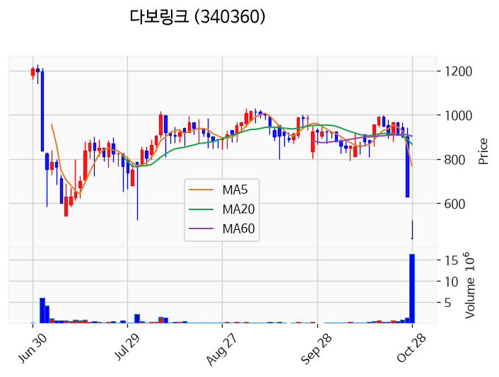

---

## 2. 거래량 폭증 후 급감 패턴 종목
_(폭증 전일 대비 500~1000%, 급감 전일 대비 25% 이하, 급감일 종가가 5일선 대비 -3% 이내)_

### CJ우
- 폭증일: 2026-10-27, 거래량 4만 주 (전일 대비 544%)
- 급감일: 2026-10-28, 거래량 0만 주 (전일 대비 6%)
- 급감일 종가 56,000원 / 5일선 33,640원 (이격률 +66.47%)

### 조흥
- 폭증일: 2026-10-27, 거래량 0만 주 (전일 대비 540%)
- 급감일: 2026-10-28, 거래량 0만 주 (전일 대비 22%)
- 급감일 종가 139,700원 / 5일선 83,560원 (이격률 +67.19%)

### 대원제약
- 폭증일: 2026-10-27, 거래량 19만 주 (전일 대비 745%)
- 급감일: 2026-10-28, 거래량 4만 주 (전일 대비 22%)
- 급감일 종가 7,760원 / 5일선 4,626원 (이격률 +67.75%)

### 한샘
- 폭증일: 2026-10-27, 거래량 21만 주 (전일 대비 748%)
- 급감일: 2026-10-28, 거래량 3만 주 (전일 대비 12%)
- 급감일 종가 38,450원 / 5일선 22,790원 (이격률 +68.71%)

### 하나36호스팩
- 폭증일: 2026-10-27, 거래량 7만 주 (전일 대비 577%)
- 급감일: 2026-10-28, 거래량 0만 주 (전일 대비 1%)
- 급감일 종가 1,981원 / 5일선 1,186원 (이격률 +67.09%)

### 키움히어로제2호스팩
- 폭증일: 2026-10-27, 거래량 1만 주 (전일 대비 849%)
- 급감일: 2026-10-28, 거래량 0만 주 (전일 대비 19%)
- 급감일 종가 1,960원 / 5일선 1,179원 (이격률 +66.27%)

### 특수건설
- 폭증일: 2026-10-27, 거래량 7만 주 (전일 대비 921%)
- 급감일: 2026-10-28, 거래량 2만 주 (전일 대비 24%)
- 급감일 종가 3,555원 / 5일선 2,168원 (이격률 +63.98%)

### KTcs
- 폭증일: 2026-10-27, 거래량 11만 주 (전일 대비 569%)
- 급감일: 2026-10-28, 거래량 2만 주 (전일 대비 19%)
- 급감일 종가 2,035원 / 5일선 1,216원 (이격률 +67.35%)

### 영림원소프트랩
- 폭증일: 2026-10-27, 거래량 3만 주 (전일 대비 585%)
- 급감일: 2026-10-28, 거래량 1만 주 (전일 대비 19%)
- 급감일 종가 3,895원 / 5일선 2,356원 (이격률 +65.32%)

### 파트론
- 폭증일: 2026-10-27, 거래량 90만 주 (전일 대비 774%)
- 급감일: 2026-10-28, 거래량 17만 주 (전일 대비 19%)
- 급감일 종가 4,890원 / 5일선 2,875원 (이격률 +70.09%)

### 그리티
- 폭증일: 2026-10-27, 거래량 3만 주 (전일 대비 522%)
- 급감일: 2026-10-28, 거래량 0만 주 (전일 대비 16%)
- 급감일 종가 1,737원 / 5일선 1,043원 (이격률 +66.51%)

### 두산퓨얼셀2우B
- 폭증일: 2026-10-27, 거래량 0만 주 (전일 대비 797%)
- 급감일: 2026-10-28, 거래량 0만 주 (전일 대비 6%)
- 급감일 종가 7,170원 / 5일선 4,272원 (이격률 +67.84%)

### 원텍
- 폭증일: 2026-10-27, 거래량 198만 주 (전일 대비 663%)
- 급감일: 2026-10-28, 거래량 44만 주 (전일 대비 22%)
- 급감일 종가 3,940원 / 5일선 2,308원 (이격률 +70.71%)

### 브이씨
- 폭증일: 2026-10-27, 거래량 15만 주 (전일 대비 864%)
- 급감일: 2026-10-28, 거래량 2만 주 (전일 대비 16%)
- 급감일 종가 2,580원 / 5일선 1,593원 (이격률 +61.96%)

### DB금융스팩12호
- 폭증일: 2026-10-27, 거래량 1만 주 (전일 대비 780%)
- 급감일: 2026-10-28, 거래량 0만 주 (전일 대비 17%)
- 급감일 종가 2,070원 / 5일선 1,243원 (이격률 +66.53%)
