# 2026년 10월 29일 시황 노트

## 1. 상한가 / 거래량 1,000만주 이상 종목

### 티앤이코리아 (상한가)
— 등락률 +40.52% / 거래량 2,079만 주

**◎ 관련기사**
- [[코스닥 새내기] 따블 갔는데… 뒷심 부족 ‘티앤이코리아’](https://news.google.com/rss/articles/CBMibEFVX3lxTE5OZ3FRRzNtME8yRnNsdGx0cGN1c1Rvb0xERjVmd01OZVBZZW5sTXJLRk5kc01wblNmMzhaOEpyM2N3eGVnd3lQcnFseEUyaDA5Nm9uV1NEMmZNbUlYcGtiYjA4dUNPT3JaamdKdg?oc=5) — 뉴스웰, 2026-10-29

**◎ 공시**
- _(공시 없음 / 미조회)_

---

### 상지건설 (상한가)
— 등락률 +30.00% / 거래량 199만 주

**◎ 관련기사**
- [오후 이슈 [보험] : 메리츠금융지주, 현대해상, 롯데손해보험, 삼성화재, 한화손해보험](https://news.google.com/rss/articles/CBMiWkFVX3lxTFBxT1JxVVI0TDNkbGNSd01HVHJPeFBZYzdhdFdsZDRkckxfaDNlNnV5dUIzb25DS1JXbXRLa2poNm5QdFFPeW5xZlRadi1femNBLTdMTnpCN09tZw?oc=5) — 파이낸셜뉴스, 2026-10-29

**◎ 공시**
- [[기재정정]투자설명서](https://dart.fss.or.kr/dsaf001/main.do?rcpNo=20261029000433) — 상지건설, 20261029
- [[발행조건확정]증권신고서(지분증권)](https://dart.fss.or.kr/dsaf001/main.do?rcpNo=20261029000422) — 상지건설, 20261029
- [[기재정정]주요사항보고서(유상증자결정)](https://dart.fss.or.kr/dsaf001/main.do?rcpNo=20261029000254) — 상지건설, 20261029
- [유상증자최종발행가액확정              ](https://dart.fss.or.kr/dsaf001/main.do?rcpNo=20261029900219) — 상지건설, 20261029

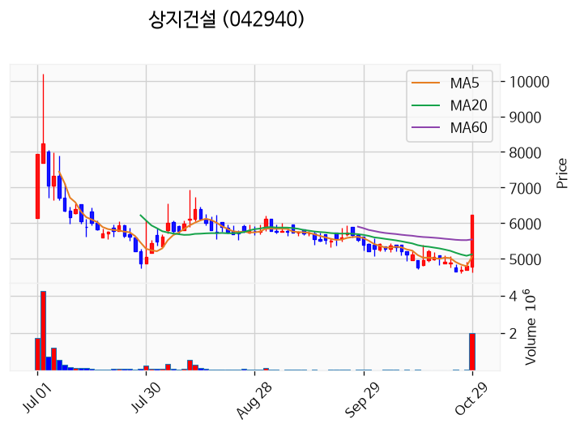

---

### 서울바이오시스 (상한가)
— 등락률 +30.00% / 거래량 13만 주

**◎ 관련기사**
- [오늘의 프리미엄9 콘텐츠 다이제스트(10월 29일)](https://news.google.com/rss/articles/CBMiWkFVX3lxTFBZc1lzZXhOd1MyZlBLVGFWVXRkZmlzWjhoVXVxYUtRX1FSemxNLVdhbENYc29STy1zSVFrUHAzQlZIMVF0MjBnX29qS0pjU0dnSHhmSkNwRldhdw?oc=5) — 한국경제, 2026-10-29

**◎ 공시**
- _(공시 없음 / 미조회)_

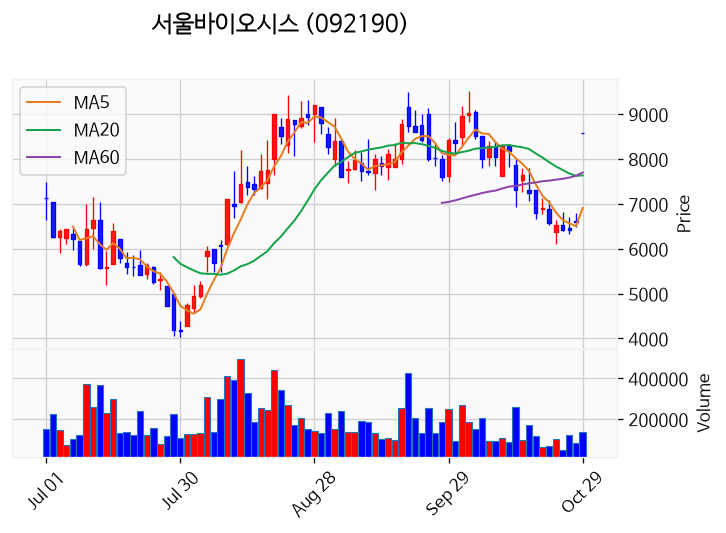

---

### 파이온엑스 (상한가)
— 등락률 +29.96% / 거래량 23만 주

**◎ 관련기사**
- [패션주 반등 기대 속 종목별 차별화…OEM·브랜드주 어디로](https://news.google.com/rss/articles/CBMid0FVX3lxTE82ZmhXUTBHRE5jWWFBam5jS1BoLW82aXdNOVlGVkcyMy1tTWx4dHZrR0Y0WXNkOWpmOGNIQkhCeUh1bU9zUklfN2hMTXV4clRHVHIxX2xpWXBsTVpaQ0JrNlVmMERMLUE3TTE2R3RvYXE1STRCVkF30gF3QVVfeXFMTzZmaFdRMEdETmNZYUFqbmNLUGgtbzZpd005WUZWRzIzLW1NbHh0dmtHRjRZc2Q5amY4Y0hCSEJ5SHVtT3NSSV83aExNdXhyVEdUcjFfbGlZcGxNWlpDQms2VWYwREwtQTdNMTZHdG9hcTVJNEJWQXc?oc=5) — 핀포인트뉴스, 2026-10-29

**◎ 공시**
- _(공시 없음 / 미조회)_

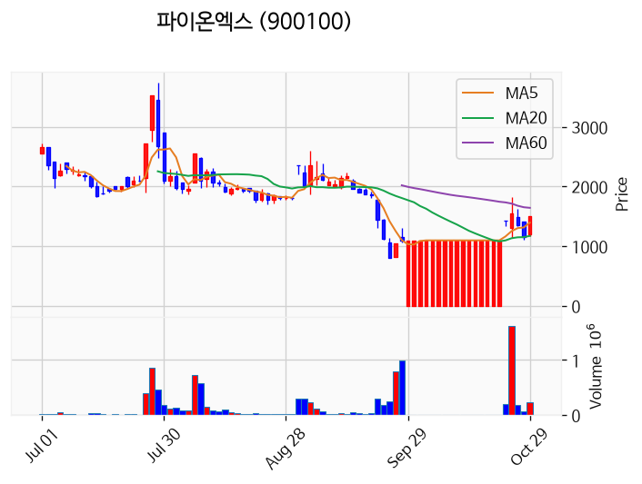

---

### 서울반도체 (상한가)
— 등락률 +29.93% / 거래량 41만 주

**◎ 관련기사**
- [코스닥 '급락'...로킷헬스케어·서울반도체·루닛은 '활짝'](https://news.google.com/rss/articles/CBMicEFVX3lxTE5CSm1HaDJUb3YtZTlaMnRFcWpJOElaX05EU0NsM2tMSnhCOUJiUE8weFVVdkVYT0x4ZEFNYmdaV2FFSDN0T1FhSU5YNmV2enNYVVBBRG0zU3JpRFpfZG1TT0FwQnBTa2ZSdW5ZQkVuNzjSAXNBVV95cUxNWUltcHl1bm5XTm5rd3lVX1JHeWF2endEcEpJTW1CenB0cFNwckwzOE9nTTZuYS1UaGJBdVJBUWg2WkRSTkxLcDF1ZXhpa3hEX0hxTEEyV2gyVkZ5cld2ZGNkaFU3SWw5ZWI4NkFkdTdEQkNr?oc=5) — 초이스경제, 2026-10-29

**◎ 공시**
- _(공시 없음 / 미조회)_

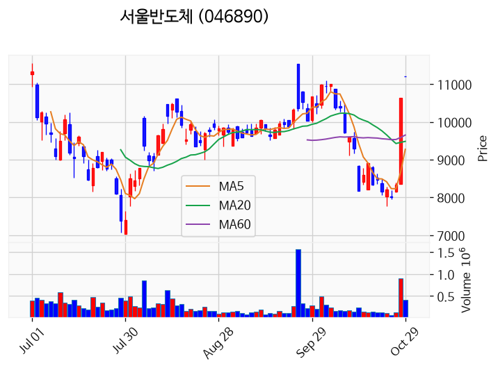

---

### 씨티알모빌리티 (상한가)
— 등락률 +29.86% / 거래량 183만 주

**◎ 관련기사**
- [로보인베스팅 골든크로스 돌파종목 : 에프엔씨엔터(173940) & 씨티알모빌리티(308170)](https://news.google.com/rss/articles/CBMiYEFVX3lxTE9Kd2JacExGYkNpQlVfNmZGTW96MGhIUDFNQkZTM1dVX0lvSTI2LUliSEpneGs5dGpCcE1ha1BPOUpLbTFSNWdfX2cyWXRGMWNzVG1OeThkOURKRU5tZzNMaw?oc=5) — Investing.com 한국어, 2026-10-29

**◎ 공시**
- _(공시 없음 / 미조회)_

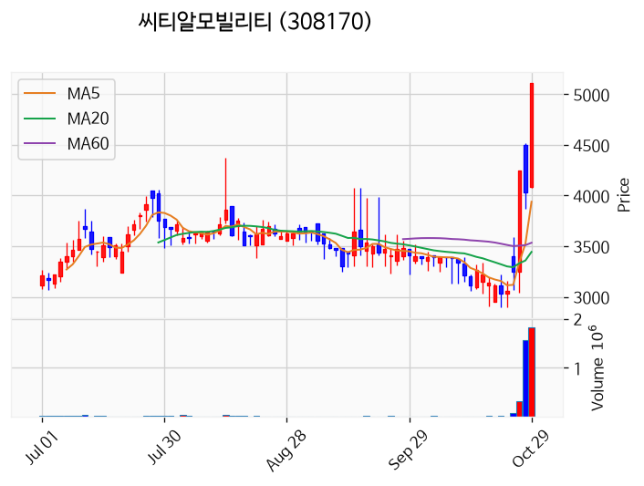

---

### 광전자 (거래량 급증)
— 등락률 +18.15% / 거래량 1,625만 주

**◎ 관련기사**
- [[오늘의 특징주] 10월 29일](https://news.google.com/rss/articles/CBMiZ0FVX3lxTE0yZUdqak1sT3ZjaEFLdlZESGxHUW1zNUVTNm5kNjhXc0ZNRFRIZXpONmM0NkllUXJwd3F1Ukd6Q29DT1ZESl9kd05zZi1XdjRfaDFGeU1KenZtZE5fYU5GY1g5VTVoa1U?oc=5) — 빅터뉴스, 2026-10-29

**◎ 공시**
- _(공시 없음 / 미조회)_

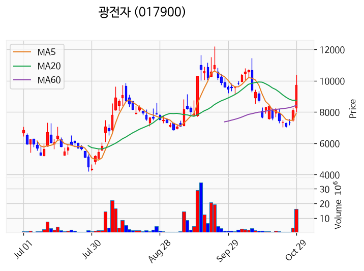

---

### 서산 (거래량 급증)
— 등락률 +6.04% / 거래량 1,385만 주

**◎ 관련기사**
- [국제 크루즈선 비지오호, 11월 27일 서산 대상한 기항 확정](https://news.google.com/rss/articles/CBMiUkFVX3lxTE5Ma0N4UUJ4YllXUktCWTBCdlFOTC1fMm9SeWotaXFWZnZJOGg2UmlKdW52NExxMFE2Qk5tbFI0M2R1TlZmWUo0WTBGUG9DS0UzWlHSAVNBVV95cUxObTg4R2VvT291RzRmSUJrSDVibEFabUZWczBRbFBOc3VSbXRZdGR5anhxQVVVRmR3R2RIVEVjNGtRWVFfUHhUX2p0bmVjN3dSUzBnRQ?oc=5) — 서울경제, 2026-10-29

**◎ 공시**
- _(공시 없음 / 미조회)_

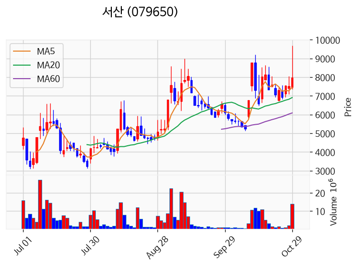

---

### 에스피소프트 (거래량 급증)
— 등락률 +3.72% / 거래량 1,192만 주

**◎ 관련기사**
- [이혜영, 美 사는 친언니 '숙대 퀸카' 시절 폭로…"멋을 그렇게 부렸다" ('혜영이는 못말려')](https://news.google.com/rss/articles/CBMikwFBVV95cUxOLVA4TmVjR0JoSk0yTVBFXzFFZ0hIMDJKTzFUUkFaaGQ2dGV6VHVBeVNJNVhsaG1MekdjTjk5ZHl0RkN3enU0MGJqc1ZzTUZHbENvMG1lYzNSanljUWxtdUhwdWhxZXJRd0kxNVpWOTZEMFJCWXVJU0cwaldYVHhWNER2VWdua0owejU0REtLanUzZHPSAacBQVVfeXFMTWhUNXEwdzFWeTZjdjFkY2wwcE1ZTmNQTmF0LTBUam1XWHgyd3JyM2gyYV83M1JFVUswUkZhQnpLNzNuRzVxNHNPTnVDLVotRGY2R1VzZmtRTW1LRy1xRnZuc2Y0TE9oTUdNNmtvTk5GLTEwRW9zck5aRHZBakpJbGtOQ0gtRUhRc1hoV2w1aGk5UTZHWmtWOENuMEJweDc0YVFvbmhMckU?oc=5) — Chosunbiz, 2026-10-29

**◎ 공시**
- _(공시 없음 / 미조회)_

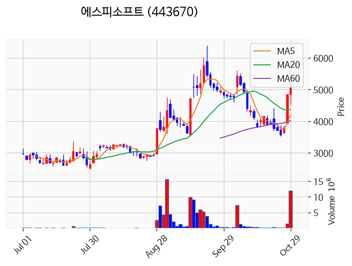

---

### 대한광통신 (거래량 급증)
— 등락률 +0.33% / 거래량 1,076만 주

**◎ 관련기사**
- [[코스닥 외국인] 리노공업·지엔씨에너지 담고 심텍·피에스케이홀딩스 팔았다](https://news.google.com/rss/articles/CBMid0FVX3lxTFBlNFY2TGQ1VlkwRmdTcUJ6UmRtR1N5bFpnT1F3cXdYQng5S01CbHRjQS1OaVRSV2dzaS1ydkpaWC1uN2poNTZYSDJSdm4yamt1aDRrMVNhampBelducDl3WHg5SXFYNDZkcnl6N3JicTZTYW95cWZr0gF3QVVfeXFMUGU0VjZMZDVWWTBGZ1NxQnpSZG1HU3lsWmdPUXdxd1hCeDlLTUJsdGNBLU5pVFJXZ3NpLXJ2SlpYLW43amg1NlhIMlJ2bjJqa3VoNGsxU2FqakF6V25wOXdYeDlJcVg0NmRyeXo3cmJxNlNhb3lxZms?oc=5) — 핀포인트뉴스, 2026-10-29

**◎ 공시**
- _(공시 없음 / 미조회)_

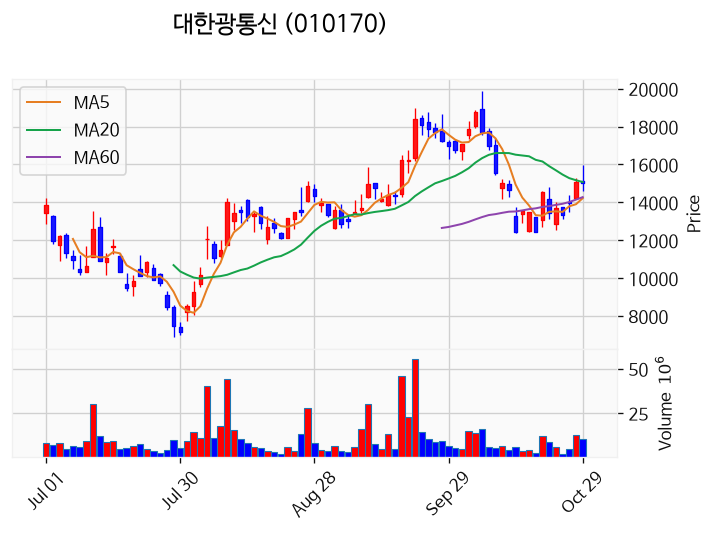

---

### TS트릴리온 (거래량 급증)
— 등락률 -2.95% / 거래량 1,284만 주

**◎ 관련기사**
_(관련기사 없음 / 미조회)_

**◎ 공시**
- [임시주주총회결과              ](https://dart.fss.or.kr/dsaf001/main.do?rcpNo=20261029900297) — TS트릴리온, 20261029

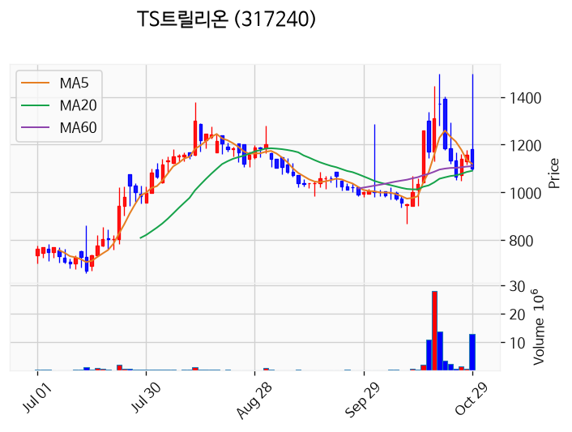

---

### 빛과전자 (거래량 급증)
— 등락률 -3.69% / 거래량 4,244만 주

**◎ 관련기사**
- [[속보] 빛과전자 장초반 VI 발동, 주가 급등…16%대 껑충](https://news.google.com/rss/articles/CBMiaEFVX3lxTE5ReUlZMjZLWTV4c3R6T1BiQnFOZjNsaWxWaWJEWTktNVd1cEtrZnpLY1VGNUQyczZZcnJLdlNQbnEwZ013UlJOZVZjTVpIMXQ2MWZyQUF5SkhtZnhhZWp1c2hiWnV1Xzl0?oc=5) — CBC뉴스, 2026-10-29

**◎ 공시**
- _(공시 없음 / 미조회)_

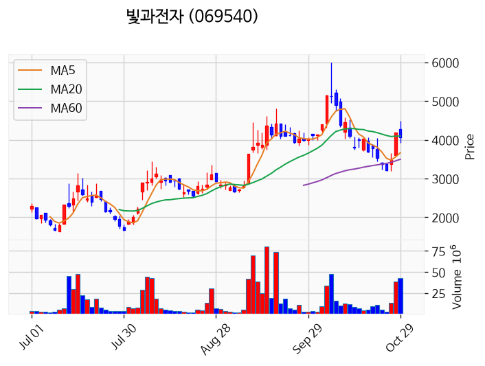

---

### 삼성전자 (거래량 급증)
— 등락률 -4.13% / 거래량 2,498만 주

**◎ 관련기사**
- [삼성전자 역대급 잭팟에도 주가 흘러내렸다…개미들 또 비명](https://news.google.com/rss/articles/CBMiWkFVX3lxTE5Qdk1PXzRuOUVPVTM3UUdSM1R1R2M4ZEQ0eEFtWkRIOXFBYndYbVhILTJ3LWZmSFduWlJQOC1kRC1iZmFWTXBHa2huYWI4R0ktLU9nOEkyTEowUQ?oc=5) — 한국경제, 2026-10-29

**◎ 공시**
- [기타경영사항(자율공시)              ](https://dart.fss.or.kr/dsaf001/main.do?rcpNo=20261029800752) — 삼성전자, 20261029
- [기타경영사항(자율공시)              ](https://dart.fss.or.kr/dsaf001/main.do?rcpNo=20261029800748) — 삼성전자, 20261029
- [특수관계인에대한증여](https://dart.fss.or.kr/dsaf001/main.do?rcpNo=20261029000573) — 삼성전자, 20261029
- [특수관계인에대한증여](https://dart.fss.or.kr/dsaf001/main.do?rcpNo=20261029000567) — 삼성전자, 20261029
- [특수관계인에대한증여](https://dart.fss.or.kr/dsaf001/main.do?rcpNo=20261029000564) — 삼성전자, 20261029
- [특수관계인에대한증여](https://dart.fss.or.kr/dsaf001/main.do?rcpNo=20261029000557) — 삼성전자, 20261029
- [주요사항보고서(자기주식처분결정)](https://dart.fss.or.kr/dsaf001/main.do?rcpNo=20261029000539) — 삼성전자, 20261029
- [특수관계인과의보험거래](https://dart.fss.or.kr/dsaf001/main.do?rcpNo=20261029000525) — 삼성전자, 20261029
- [특수관계인에대한출자](https://dart.fss.or.kr/dsaf001/main.do?rcpNo=20261029000501) — 삼성전자, 20261029
- [장래사업ㆍ경영계획(공정공시)              ](https://dart.fss.or.kr/dsaf001/main.do?rcpNo=20261029800102) — 삼성전자, 20261029
- [[기재정정]연결재무제표기준영업(잠정)실적(공정공시)              ](https://dart.fss.or.kr/dsaf001/main.do?rcpNo=20261029800099) — 삼성전자, 20261029
- [현금ㆍ현물배당결정              ](https://dart.fss.or.kr/dsaf001/main.do?rcpNo=20261029800101) — 삼성전자, 20261029
- [연결재무제표기준영업(잠정)실적(공정공시)              ](https://dart.fss.or.kr/dsaf001/main.do?rcpNo=20261029800087) — 삼성전자, 20261029

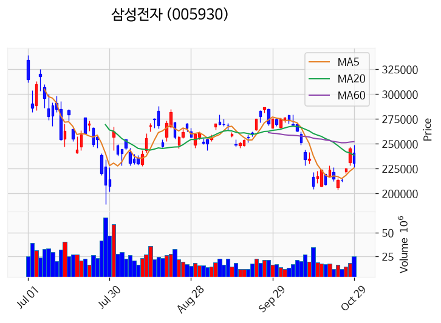

---

### 앤로보틱스 (거래량 급증)
— 등락률 -5.10% / 거래량 1,105만 주

**◎ 관련기사**
- [인텔–SAP, 피지컬 AI로 자율 창고 현장 혁신 이끈다](https://news.google.com/rss/articles/CBMijgFBVV95cUxQMFhSTnVqd0VYX0hzS3F5WHg3Vjd4RWl0V3ZxREoyOUVMVUQzcVNJeG9fWFktbkdRNTlfNndLZ3JyT0d6YlFaTUZRcWZTd2F6V2t4U0ZSeW1SSlllOUNCMnFmNTVKQ0tUMGpYbTlQSnNZMHUxc2pBOUxlR202aEJTaG12c01aeldwdTJmZnBB?oc=5) — 캐드앤그래픽스, 2026-10-29

**◎ 공시**
- _(공시 없음 / 미조회)_

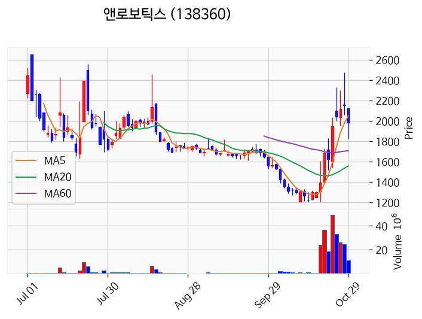

---

### 대우건설 (거래량 급증)
— 등락률 -18.57% / 거래량 3,283만 주

**◎ 관련기사**
- [대우건설 "한수원이 3주 만에 수용하라며 일방 결렬…재협상 나서야"](https://news.google.com/rss/articles/CBMiWkFVX3lxTFBXMXRmdEZqZUtGN3BsaDZRQ21Iem10NE12dU1xRnRPbVFxZWdnNVg1U0JraTFGV29RMGtNdndXcEZMUFpVMkZnWm96OFl6MWx5RVQzam4xc2o5dw?oc=5) — 한국경제, 2026-10-29

**◎ 공시**
- [풍문또는보도에대한해명(미확정)              ](https://dart.fss.or.kr/dsaf001/main.do?rcpNo=20261029800449) — 대우건설, 20261029

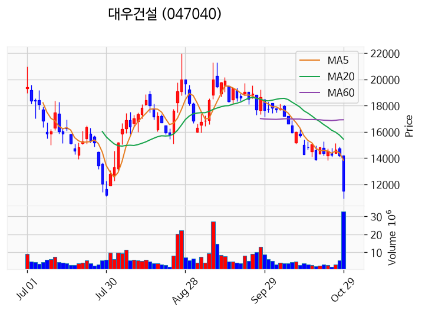

---

## 2. 거래량 폭증 후 급감 패턴 종목
_(폭증 전일 대비 500~1000%, 급감 전일 대비 25% 이하, 급감일 종가가 5일선 대비 -3% 이내)_

### 대한항공우
- 폭증일: 2026-10-28, 거래량 0만 주 (전일 대비 544%)
- 급감일: 2026-10-29, 거래량 0만 주 (전일 대비 24%)
- 급감일 종가 21,000원 / 5일선 16,790원 (이격률 +25.07%)

### 비엔케이제3호스팩
- 폭증일: 2026-10-28, 거래량 0만 주 (전일 대비 624%)
- 급감일: 2026-10-29, 거래량 0만 주 (전일 대비 6%)
- 급감일 종가 1,982원 / 5일선 1,589원 (이격률 +24.72%)

### 에스엠벡셀
- 폭증일: 2026-10-28, 거래량 986만 주 (전일 대비 755%)
- 급감일: 2026-10-29, 거래량 193만 주 (전일 대비 20%)
- 급감일 종가 3,575원 / 5일선 2,675원 (이격률 +33.64%)

### 우성머티리얼스
- 폭증일: 2026-10-28, 거래량 72만 주 (전일 대비 636%)
- 급감일: 2026-10-29, 거래량 18만 주 (전일 대비 25%)
- 급감일 종가 2,060원 / 5일선 1,812원 (이격률 +13.69%)

### 대호특수강
- 폭증일: 2026-10-27, 거래량 8만 주 (전일 대비 772%)
- 급감일: 2026-10-29, 거래량 4만 주 (전일 대비 19%)
- 급감일 종가 975원 / 5일선 801원 (이격률 +21.69%)

### 정원엔시스
- 폭증일: 2026-10-28, 거래량 19만 주 (전일 대비 750%)
- 급감일: 2026-10-29, 거래량 3만 주 (전일 대비 15%)
- 급감일 종가 1,103원 / 5일선 910원 (이격률 +21.18%)

### 디에이피
- 폭증일: 2026-10-28, 거래량 1만 주 (전일 대비 941%)
- 급감일: 2026-10-29, 거래량 0만 주 (전일 대비 5%)
- 급감일 종가 1,728원 / 5일선 1,372원 (이격률 +25.91%)

### 코아스
- 폭증일: 2026-10-28, 거래량 80만 주 (전일 대비 928%)
- 급감일: 2026-10-29, 거래량 14만 주 (전일 대비 17%)
- 급감일 종가 1,064원 / 5일선 971원 (이격률 +9.60%)

### 메타케어
- 폭증일: 2026-10-28, 거래량 29만 주 (전일 대비 541%)
- 급감일: 2026-10-29, 거래량 0만 주 (전일 대비 0%)
- 급감일 종가 1,298원 / 5일선 1,046원 (이격률 +24.07%)

### 우리이앤엘하루틴
- 폭증일: 2026-10-28, 거래량 1만 주 (전일 대비 587%)
- 급감일: 2026-10-29, 거래량 0만 주 (전일 대비 19%)
- 급감일 종가 3,115원 / 5일선 2,497원 (이격률 +24.75%)

### 네오오토
- 폭증일: 2026-10-28, 거래량 33만 주 (전일 대비 853%)
- 급감일: 2026-10-29, 거래량 8만 주 (전일 대비 25%)
- 급감일 종가 8,810원 / 5일선 7,014원 (이격률 +25.61%)

### 크로넥스
- 폭증일: 2026-10-28, 거래량 0만 주 (전일 대비 980%)
- 급감일: 2026-10-29, 거래량 0만 주 (전일 대비 0%)
- 급감일 종가 598원 / 5일선 496원 (이격률 +20.56%)

### 인바이츠바이오코아
- 폭증일: 2026-10-27, 거래량 0만 주 (전일 대비 704%)
- 급감일: 2026-10-29, 거래량 0만 주 (전일 대비 1%)
- 급감일 종가 1,400원 / 5일선 1,106원 (이격률 +26.63%)

### 틸론
- 폭증일: 2026-10-28, 거래량 1만 주 (전일 대비 510%)
- 급감일: 2026-10-29, 거래량 0만 주 (전일 대비 17%)
- 급감일 종가 977원 / 5일선 753원 (이격률 +29.71%)

### 플레이디
- 폭증일: 2026-10-28, 거래량 8만 주 (전일 대비 570%)
- 급감일: 2026-10-29, 거래량 2만 주 (전일 대비 24%)
- 급감일 종가 2,060원 / 5일선 1,650원 (이격률 +24.85%)

### 크라운제과우
- 폭증일: 2026-10-28, 거래량 0만 주 (전일 대비 747%)
- 급감일: 2026-10-29, 거래량 0만 주 (전일 대비 10%)
- 급감일 종가 7,100원 / 5일선 5,776원 (이격률 +22.92%)

### 에스에스알
- 폭증일: 2026-10-28, 거래량 1만 주 (전일 대비 568%)
- 급감일: 2026-10-29, 거래량 0만 주 (전일 대비 21%)
- 급감일 종가 3,000원 / 5일선 2,450원 (이격률 +22.45%)

### 더네이쳐홀딩스
- 폭증일: 2026-10-28, 거래량 16만 주 (전일 대비 614%)
- 급감일: 2026-10-29, 거래량 2만 주 (전일 대비 10%)
- 급감일 종가 6,230원 / 5일선 5,030원 (이격률 +23.86%)

### 시선AI
- 폭증일: 2026-10-28, 거래량 46만 주 (전일 대비 957%)
- 급감일: 2026-10-29, 거래량 11만 주 (전일 대비 24%)
- 급감일 종가 2,970원 / 5일선 2,497원 (이격률 +18.94%)

### 삼영에스앤씨
- 폭증일: 2026-10-28, 거래량 2만 주 (전일 대비 702%)
- 급감일: 2026-10-29, 거래량 0만 주 (전일 대비 16%)
- 급감일 종가 3,975원 / 5일선 3,182원 (이격률 +24.92%)

### 이지트로닉스
- 폭증일: 2026-10-28, 거래량 157만 주 (전일 대비 873%)
- 급감일: 2026-10-29, 거래량 20만 주 (전일 대비 13%)
- 급감일 종가 2,560원 / 5일선 2,350원 (이격률 +8.94%)

### 지에프씨생명과학
- 폭증일: 2026-10-28, 거래량 5만 주 (전일 대비 500%)
- 급감일: 2026-10-29, 거래량 1만 주 (전일 대비 19%)
- 급감일 종가 4,445원 / 5일선 3,628원 (이격률 +22.52%)

### 탈로스
- 폭증일: 2026-10-28, 거래량 0만 주 (전일 대비 551%)
- 급감일: 2026-10-29, 거래량 0만 주 (전일 대비 4%)
- 급감일 종가 2,295원 / 5일선 1,872원 (이격률 +22.60%)

### 아이엠지티
- 폭증일: 2026-10-28, 거래량 0만 주 (전일 대비 576%)
- 급감일: 2026-10-29, 거래량 0만 주 (전일 대비 16%)
- 급감일 종가 10,670원 / 5일선 8,476원 (이격률 +25.88%)

### 프레스티지바이오파마
- 폭증일: 2026-10-28, 거래량 70만 주 (전일 대비 972%)
- 급감일: 2026-10-29, 거래량 11만 주 (전일 대비 16%)
- 급감일 종가 4,155원 / 5일선 3,697원 (이격률 +12.39%)
