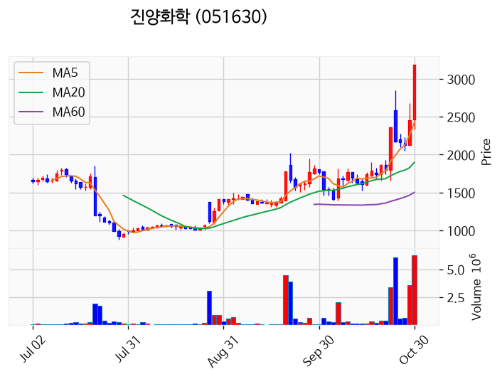
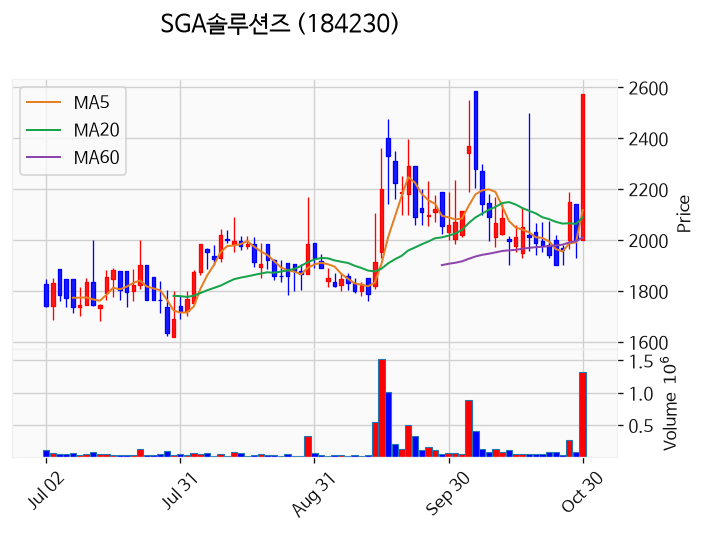
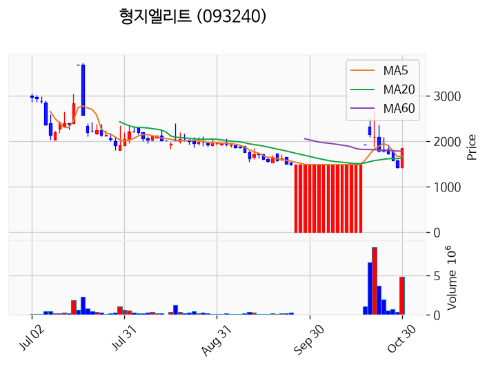
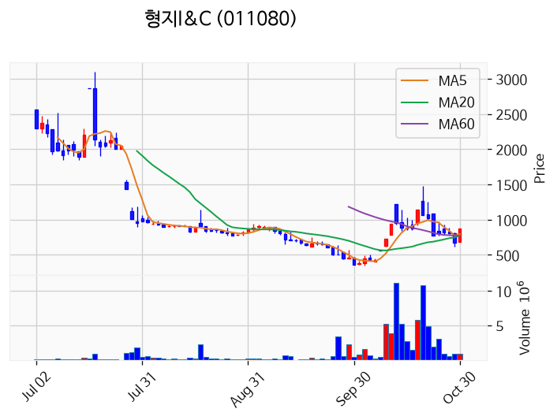
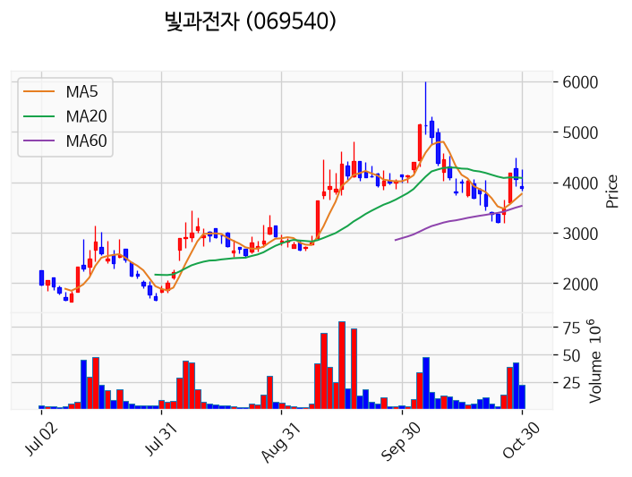
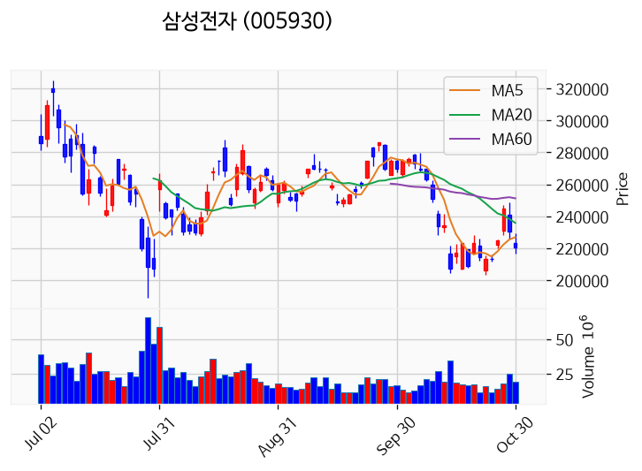

# 2026년 10월 30일 시황 노트

## 1. 상한가 / 거래량 1,000만주 이상 종목

### 인텔리빅스 (상한가)
— 등락률 +244.44% / 거래량 5,553만 주

**◎ 관련기사**
- [급락장서 '따블' 넘은 인텔리빅스…상장 첫날 공모가 3.4배](https://news.google.com/rss/articles/CBMiWkFVX3lxTE41dWw4bW9LZGNoOGlsMDFWYUJFOGRYMFBGNDNEamU0UnlJenEyN3hqQ0t5M3l1UzZMRXl6T3QwZFlCMEtQN1NZZjBnTDFhdnFZLWI2RC1ZUVZvdw?oc=5) — 한국경제, 2026-10-30

**◎ 공시**
- _(공시 없음 / 미조회)_

---

### 진양화학 (상한가)
— 등락률 +30.00% / 거래량 627만 주

**◎ 관련기사**
- [[특징주] 진양화학, 약세장 속에서 ‘상한가’ 직행 눈길](https://news.google.com/rss/articles/CBMiakFVX3lxTE9KS0UwVjNtLXRqQldjNmxnMUxuaFdHaXl2Uk95UHRXWDZxX2hqdzFKUnlOSTZhZVk3d1NWWXprUTk4ckNGa0p2QUVYVkNaWWhNNFN3WHZWM011emw1N0Fick51OXdlUHNBWEE?oc=5) — https://www.moneystorm.kr/, 2026-10-30

**◎ 공시**
- [조회공시요구(현저한시황변동)              ](https://dart.fss.or.kr/dsaf001/main.do?rcpNo=20261030801314) — 유가증권시장본부, 20261030

---

### SGA솔루션즈 (상한가)
— 등락률 +29.98% / 거래량 132만 주

**◎ 관련기사**
- [[상한가 종목] 진양화학-형지엘리트 이어 SGA솔루션즈 등 마감](https://news.google.com/rss/articles/CBMibkFVX3lxTFBwbFA0c3h1d1R1N2x1YWxucGpkUXFMdjVXSm42a0JpSXJVVnVwUjlRVUdySXBlTFRXMWVmUkpGS1puRHNyU0hfUnkzR1J3elZLeklDWFFwblRUTnMtcko2YnBoU0M5MXg4Rl9aM3pR?oc=5) — 이코노뉴스, 2026-10-30

**◎ 공시**
- _(공시 없음 / 미조회)_

---

### 형지엘리트 (상한가)
— 등락률 +29.94% / 거래량 479만 주

**◎ 관련기사**
- [형지엘리트, 관리종목 지정 효력정지 가처분 신청](https://news.google.com/rss/articles/CBMickFVX3lxTE5VbGxMdW53ZXQwUEg2SEhzVXFvWExiWmo1UmU4TTZHcko0THg3X3FaeWNXVmFuSURJZE5ackZlaGRaYk9JemFYYjlJR2FPZTd6WnNYRno5NWxxSnZiTE5yQVZzRTJvdTdaSkRGVXhSbEoydw?oc=5) — 톱스타뉴스, 2026-10-30

**◎ 공시**
- [기타경영사항(자율공시)              (관리종목지정결정 효력정지 가처분 신청)](https://dart.fss.or.kr/dsaf001/main.do?rcpNo=20261030801297) — 형지엘리트, 20261030

---

### 형지I&C (상한가)
— 등락률 +29.91% / 거래량 96만 주

**◎ 관련기사**
- [형지I&C 상한가 873원…감자·유상증자 이후 실적 회복 여부 관건](https://news.google.com/rss/articles/CBMickFVX3lxTE44VTY0UzBwMEd0QVlOeDdyNFA1TGd5R0FqWVpIOVVkUTRhR0YtbUNocDNfMFVKSXFGSnJWcnF6TTJrd1ZmNlhYZmFvYW5Yd1NqMDZLM2NLQXdnX0NJT1pkdDQ2dktIQmZPbnRKUVI3MEtlZ9IBckFVX3lxTE44VTY0UzBwMEd0QVlOeDdyNFA1TGd5R0FqWVpIOVVkUTRhR0YtbUNocDNfMFVKSXFGSnJWcnF6TTJrd1ZmNlhYZmFvYW5Yd1NqMDZLM2NLQXdnX0NJT1pkdDQ2dktIQmZPbnRKUVI3MEtlZw?oc=5) — 잡포스트, 2026-10-30

**◎ 공시**
- _(공시 없음 / 미조회)_

---

### 빛과전자 (거래량 급증)
— 등락률 -1.49% / 거래량 2,215만 주

**◎ 관련기사**
- [빛과전자, 기말현금 21.8억·CB 누적 1,002.5억으로 단기 유동성·희석 리스크](https://news.google.com/rss/articles/CBMiW0FVX3lxTFA1NkZrYXh6WWJwNEUzalRsOEZWZzNNdnRLQ1JydHNpQkgwY1hFQlNsTEQ1b1lOYU5oZlN0OXFsNEdrSmt5YkVyQzJQT1hiN3N5UzJFNnU2UmlQMGM?oc=5) — 데일리연합, 2026-10-30

**◎ 공시**
- _(공시 없음 / 미조회)_

---

### 삼성전자 (거래량 급증)
— 등락률 -3.02% / 거래량 1,967만 주

**◎ 관련기사**
- [삼성전자, '이익 100조' 자축 경계…"오늘의 호황이 내일의 경쟁력 아냐"](https://news.google.com/rss/articles/CBMiWkFVX3lxTFBUaUZuaHc4Qk5ZbjNDWTlSOE9MQ0RzMDZpUXc1NVNZbURLbVJ5UW5ZU2Y0MVZXaDNrdi1hLWR6Yl84STc4dGQ4UDIwbTVJTVdnY2hSSTlmWlFuUQ?oc=5) — 한국경제, 2026-10-30

**◎ 공시**
- [임원ㆍ주요주주특정증권등소유상황보고서](https://dart.fss.or.kr/dsaf001/main.do?rcpNo=20261030000719) — 윤주한, 20261030
- [주식등의대량보유상황보고서(일반)](https://dart.fss.or.kr/dsaf001/main.do?rcpNo=20261030000716) — 삼성물산, 20261030
- [특수관계인으로부터주식의취득](https://dart.fss.or.kr/dsaf001/main.do?rcpNo=20261030000586) — 삼성전자, 20261030

---

### 한화플러스제6호스팩 (거래량 급증)
— 등락률 -6.40% / 거래량 2,811만 주

**◎ 관련기사**
- [[코스닥 새내기] 검은 금요일 ‘한화플러스제6호스팩’도 꽁꽁 얼었다](https://news.google.com/rss/articles/CBMibEFVX3lxTE9KdTh1RDB3OFBqWVZEazlsTWpTUkVhZVFqekhHaWxaTmZNLWpuUi00TGI3c2JJV3BvQWNHVDZUaV9aSXZpVGRUS0pteVkxbVZzUWw4TDFHLUhwaTZqRG41N3FxWHBXaE9kTHZhOA?oc=5) — 뉴스웰, 2026-10-30

**◎ 공시**
- _(공시 없음 / 미조회)_

---

### 크리에이츠 (거래량 급증)
— 등락률 -37.60% / 거래량 1,600만 주

**◎ 관련기사**
- [[코스닥 새내기] 첫날부터 바닥 잊은 ‘크리에이츠’](https://news.google.com/rss/articles/CBMibEFVX3lxTE9zTDZGdWc0SWJodk1HRmtXdU83dlpDVmtNTm1sUVloSjk5dXZCSEE2d1JaYVdZd2Q0X0pFQVhzNmU4S181eVpZaHNKUE5MemtWcjFUY3MzSHlzdUZhbVVudUdFTkdDNWhOZlozaw?oc=5) — 뉴스웰, 2026-10-30

**◎ 공시**
- _(공시 없음 / 미조회)_

---

## 2. 거래량 폭증 후 급감 패턴 종목
_(폭증 전일 대비 500~1000%, 급감 전일 대비 25% 이하, 급감일 종가가 5일선 대비 -3% 이내)_

### 제일연마
- 폭증일: 2026-10-28, 거래량 0만 주 (전일 대비 510%)
- 급감일: 2026-10-30, 거래량 0만 주 (전일 대비 9%)
- 급감일 종가 8,700원 / 5일선 8,668원 (이격률 +0.37%)

### 유화증권우
- 폭증일: 2026-10-28, 거래량 0만 주 (전일 대비 568%)
- 급감일: 2026-10-30, 거래량 0만 주 (전일 대비 3%)
- 급감일 종가 2,800원 / 5일선 2,851원 (이격률 -1.79%)

### 송원산업
- 폭증일: 2026-10-29, 거래량 62만 주 (전일 대비 534%)
- 급감일: 2026-10-30, 거래량 13만 주 (전일 대비 21%)
- 급감일 종가 10,550원 / 5일선 10,408원 (이격률 +1.36%)

### 동방아그로
- 폭증일: 2026-10-28, 거래량 1만 주 (전일 대비 620%)
- 급감일: 2026-10-30, 거래량 0만 주 (전일 대비 6%)
- 급감일 종가 5,330원 / 5일선 5,354원 (이격률 -0.45%)

### 호텔신라우
- 폭증일: 2026-10-28, 거래량 0만 주 (전일 대비 583%)
- 급감일: 2026-10-30, 거래량 0만 주 (전일 대비 19%)
- 급감일 종가 26,950원 / 5일선 27,000원 (이격률 -0.19%)

### 메리츠제1호스팩
- 폭증일: 2026-10-29, 거래량 1만 주 (전일 대비 993%)
- 급감일: 2026-10-30, 거래량 0만 주 (전일 대비 4%)
- 급감일 종가 2,055원 / 5일선 2,057원 (이격률 -0.10%)

### 태영건설우
- 폭증일: 2026-10-28, 거래량 0만 주 (전일 대비 604%)
- 급감일: 2026-10-30, 거래량 0만 주 (전일 대비 11%)
- 급감일 종가 5,620원 / 5일선 5,656원 (이격률 -0.64%)

### 삼정펄프
- 폭증일: 2026-10-27, 거래량 0만 주 (전일 대비 806%)
- 급감일: 2026-10-30, 거래량 0만 주 (전일 대비 22%)
- 급감일 종가 26,000원 / 5일선 26,400원 (이격률 -1.52%)

### 원일특강
- 폭증일: 2026-10-29, 거래량 2만 주 (전일 대비 729%)
- 급감일: 2026-10-30, 거래량 0만 주 (전일 대비 18%)
- 급감일 종가 7,660원 / 5일선 7,394원 (이격률 +3.60%)

### 신원종합개발
- 폭증일: 2026-10-29, 거래량 8만 주 (전일 대비 826%)
- 급감일: 2026-10-30, 거래량 2만 주 (전일 대비 19%)
- 급감일 종가 2,090원 / 5일선 2,078원 (이격률 +0.58%)

### SK
- 폭증일: 2026-10-29, 거래량 180만 주 (전일 대비 857%)
- 급감일: 2026-10-30, 거래량 16만 주 (전일 대비 9%)
- 급감일 종가 503,000원 / 5일선 508,200원 (이격률 -1.02%)

### 파인디지털
- 폭증일: 2026-10-28, 거래량 0만 주 (전일 대비 539%)
- 급감일: 2026-10-30, 거래량 0만 주 (전일 대비 4%)
- 급감일 종가 2,830원 / 5일선 2,772원 (이격률 +2.09%)

### KNN
- 폭증일: 2026-10-29, 거래량 16만 주 (전일 대비 529%)
- 급감일: 2026-10-30, 거래량 3만 주 (전일 대비 19%)
- 급감일 종가 4,995원 / 5일선 5,005원 (이격률 -0.20%)

### 지엔코
- 폭증일: 2026-10-28, 거래량 1만 주 (전일 대비 614%)
- 급감일: 2026-10-30, 거래량 0만 주 (전일 대비 14%)
- 급감일 종가 2,995원 / 5일선 3,008원 (이격률 -0.43%)

### 빛샘전자
- 폭증일: 2026-10-28, 거래량 634만 주 (전일 대비 508%)
- 급감일: 2026-10-30, 거래량 97만 주 (전일 대비 13%)
- 급감일 종가 14,450원 / 5일선 14,410원 (이격률 +0.28%)

### 서산
- 폭증일: 2026-10-29, 거래량 1,385만 주 (전일 대비 662%)
- 급감일: 2026-10-30, 거래량 267만 주 (전일 대비 19%)
- 급감일 종가 7,220원 / 5일선 7,404원 (이격률 -2.49%)

### 코리아에셋투자증권
- 폭증일: 2026-10-29, 거래량 2만 주 (전일 대비 764%)
- 급감일: 2026-10-30, 거래량 0만 주 (전일 대비 16%)
- 급감일 종가 5,940원 / 5일선 5,972원 (이격률 -0.54%)

### 비씨월드제약
- 폭증일: 2026-10-27, 거래량 1만 주 (전일 대비 665%)
- 급감일: 2026-10-30, 거래량 0만 주 (전일 대비 23%)
- 급감일 종가 2,790원 / 5일선 2,839원 (이격률 -1.73%)

### 루트락
- 폭증일: 2026-10-29, 거래량 0만 주 (전일 대비 600%)
- 급감일: 2026-10-30, 거래량 0만 주 (전일 대비 17%)
- 급감일 종가 625원 / 5일선 631원 (이격률 -0.89%)

### 바이오텐
- 폭증일: 2026-10-29, 거래량 0만 주 (전일 대비 500%)
- 급감일: 2026-10-30, 거래량 0만 주 (전일 대비 20%)
- 급감일 종가 2,720원 / 5일선 2,760원 (이격률 -1.45%)

### 두산퓨얼셀2우B
- 폭증일: 2026-10-29, 거래량 0만 주 (전일 대비 856%)
- 급감일: 2026-10-30, 거래량 0만 주 (전일 대비 1%)
- 급감일 종가 6,930원 / 5일선 7,048원 (이격률 -1.67%)

### 아이비김영
- 폭증일: 2026-10-29, 거래량 14만 주 (전일 대비 546%)
- 급감일: 2026-10-30, 거래량 3만 주 (전일 대비 24%)
- 급감일 종가 2,225원 / 5일선 2,247원 (이격률 -0.98%)

### 오아
- 폭증일: 2026-10-28, 거래량 1만 주 (전일 대비 654%)
- 급감일: 2026-10-30, 거래량 0만 주 (전일 대비 17%)
- 급감일 종가 3,575원 / 5일선 3,685원 (이격률 -2.99%)

### 신한제12호스팩
- 폭증일: 2026-10-28, 거래량 7만 주 (전일 대비 549%)
- 급감일: 2026-10-30, 거래량 0만 주 (전일 대비 15%)
- 급감일 종가 2,090원 / 5일선 2,089원 (이격률 +0.05%)

### 신한제14호스팩
- 폭증일: 2026-10-28, 거래량 0만 주 (전일 대비 773%)
- 급감일: 2026-10-30, 거래량 0만 주 (전일 대비 4%)
- 급감일 종가 2,035원 / 5일선 2,035원 (이격률 -0.02%)
